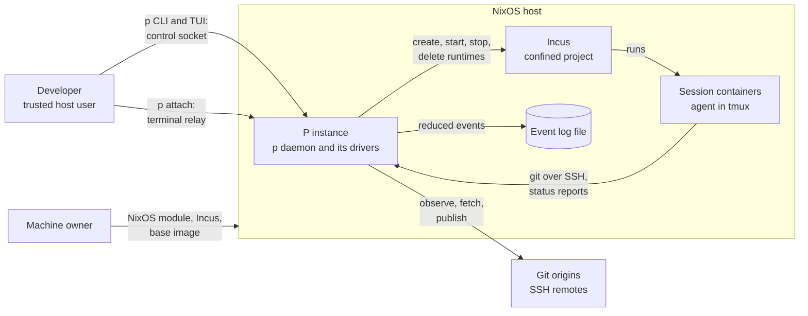
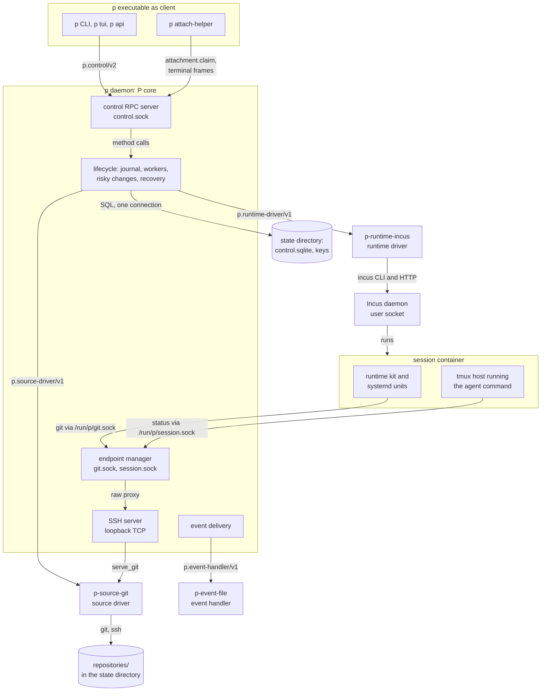
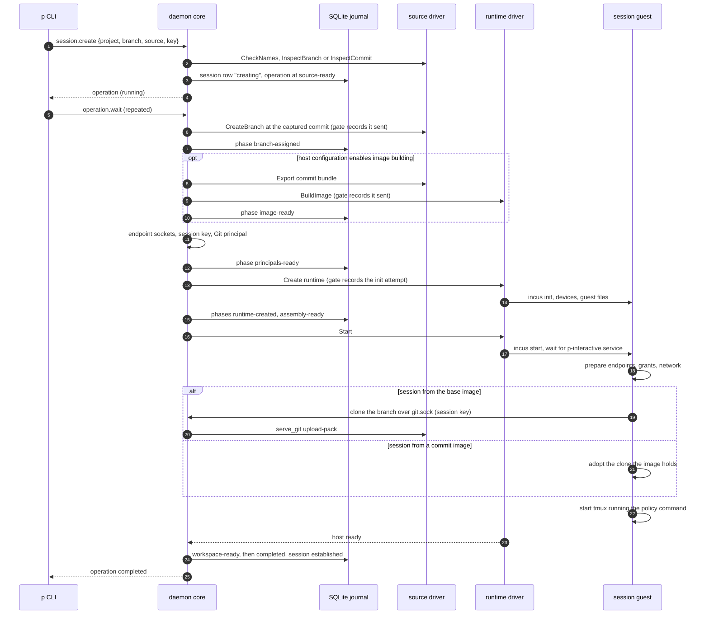

# P architecture overview

P is a self-contained control plane that runs and governs concurrent streams of
agent-driven software development on one Linux machine. A developer uses the
`p` command line or its terminal browser to create projects, which are bare Git
repositories that P serves, and sessions, each of which is one branch with its
own Incus system container where an agent such as Codex works in a persistent
tmux terminal. The developer attaches to a session's terminal, reviews what a
destructive change would lose before running it, and publishes branches to
ordinary Git remotes. Agents inside sessions reach P only through Git over SSH
and a small status socket. This account explains how the code at commit
`471a3eb` is built: its parts and their responsibilities, the boundaries
between them and what crosses each, who owns which state, how representative
operations run from request to result, including failure and restart, how the
code is validated, and which limits and open questions remain. It is written
for the maintainer reviewing the current state and for people and agents
changing the code. It describes behavior the code shows; where it names a gap,
the gap is current behavior, not a plan.

| Document | What it covers |
|---|---|
| [P architecture overview](README.md) (this page) | Purpose, surroundings, major parts, boundaries, permitted dependencies, state ownership, representative operations, cross-cutting guarantees, where typical changes belong, validation, known limits and open questions |
| [Control plane: the daemon core and its state](control-plane.md) | The daemon's composition and startup, the SQLite store, the operation journal, admission and holds, the risky-change engine, workers, recovery, waiting, and what survives a restart |
| [Control protocol and clients](control-protocol-and-clients.md) | The `p.control/v2` protocol, the CLI, the TUI, `p api`, attachment through the helper, errors, exit statuses, keys and lost replies |
| [Driver model: launch, protocol and settlement](driver-model.md) | What the runtime driver, the source driver and the event handler share: launch checks, the hello, the wire, gates, lost calls, `Settle`, supervision and conformance |
| [Runtime driver and the session guest](runtime-driver-and-session-guest.md) | The runtime driver contract, the Incus driver, commit images and builders, terminals, project services, and what runs inside a session container |
| [Source driver and P's Git endpoint](source-driver-and-git-endpoint.md) | The source driver contract, the bundled Git driver, P's SSH server, Git authority, an agent's push, origins and publication |
| [Plugins and events](plugins-and-events.md) | Plugin packages and their selection, the event handler and the event model, the agent adapter, and the session status socket |
| [Deployment on NixOS](nixos-deployment.md) | What the Nix flake builds, the NixOS module and its generated host configuration, digest pinning, and what the machine owner provisions |

| Subject | Where it is governed |
|---|---|
| Purpose, goals, non-goals, tenets and project model | [PROJECT.md](../../PROJECT.md) |
| Product direction | [docs/PRODUCT.md](../PRODUCT.md) |
| Domain terms | [GLOSSARY.md](../../GLOSSARY.md) |
| Known problems left unfixed on purpose | [DEBT.md](../../DEBT.md) and [docs/debts/](../debts/) |
| The TUI change and validation workflow | [docs/tui-validation-workflow.md](../tui-validation-workflow.md) |
| History and rationale of earlier designs | [docs/archive/README.md](../archive/README.md) (not authority) |

## The system and its surroundings

One [P instance](../../GLOSSARY.md#p-instance) runs on one host. It owns its
control state and core lifecycle and needs no other P instance or central
service. Around it:

- **The developer** is the trusted host user. They run `p` commands and the
  TUI against the daemon's control socket, attach to session terminals, and
  write the trusted host configuration that selects drivers, plugins and
  project policy.
- **The machine owner** (often the same person) installs P through the NixOS
  module and provisions what P does not: Incus, a confined Incus project, the
  session base image and any directories that grants mount.
- **Agents** run inside sessions as the command that project policy names,
  for example `codex`. They own their reasoning; P gives them a workspace, a
  branch they may push, and a socket to report status.
- **Incus** runs every session as a system container in one confined Incus
  project. Of P's code, only the runtime driver talks to it, through the Incus
  user socket; an executable plugin runs with P's account and could open that
  socket too ([L2](#known-limits)).
- **Git origins** are ordinary SSH remotes. Only the source driver talks to
  them, and only for explicit operations: observing, fetching, and publishing
  a branch.
- **The event log** is a file the bundled event handler writes; P never reads
  it back.

The context view answers what P talks to and who starts each exchange; its
scope is one host and the remotes it reaches.

The takeaway: a session changes durable state only through P, P alone talks
to origins, and the developer is the only party that selects what P runs.

## Major parts

P ships as four host executables built from one Go module, plus a session
image that carries a fifth, the runtime kit. The `p` executable is both the
daemon (`p daemon`) and every client. The daemon
starts child executables and supervises them: the runtime driver
`p-runtime-incus`, the source driver `p-source-git` and, when host
configuration selects one, an event handler such as the bundled
`p-event-file` ([Q8](#open-questions)). Inside each session container, the
systemd units the runtime driver installs and the runtime kit from the session
image prepare the guest and keep the session's tmux server running.

The container view answers which processes and stores cooperate and over which
channels; its scope is one host with one session container, and arrows point
from the side that starts the exchange.

The takeaway: every effect on Incus or on Git goes through one of two driver
processes, and the daemon is the only process that holds P's database and Git
authority.

| Part | Code | Responsibility | Read more |
|---|---|---|---|
| Clients | [`cmd/p`](../../cmd/p), [`internal/api`](../../internal/api), [`internal/tui`](../../internal/tui), [`internal/attachment`](../../internal/attachment), [`internal/errtext`](../../internal/errtext) | Turn the typed control protocol into task commands (`p NOUN VERB`), the TUI, raw calls (`p api`) and attachment; validate request bounds before sending; decide nothing | [Control protocol and clients](control-protocol-and-clients.md) |
| Control plane (P core) | [`internal/control`](../../internal/control), [`internal/daemon`](../../internal/daemon), [`internal/sshserver`](../../internal/sshserver), [`internal/strictjson`](../../internal/strictjson) | Own the SQLite state, the operation journal, admission, planning and running of [risky changes](../../GLOSSARY.md#risky-change), workers and recovery, Git authority and the SSH server, per-session endpoints, attachment relay and event production | [Control plane](control-plane.md), [Source driver and P's Git endpoint](source-driver-and-git-endpoint.md) |
| Shared driver plumbing | [`internal/driverwire`](../../internal/driverwire), [`internal/driverwire/launch`](../../internal/driverwire/launch) | Launch checks, start by checked descriptor, JSON-RPC over a socket pair, gates and lost-call rules, restart with backoff | [Driver model](driver-model.md) |
| Runtime driver | [`internal/runtimedriver`](../../internal/runtimedriver) and its `incus` package, [`cmd/p-runtime-incus`](../../cmd/p-runtime-incus) | Own every runtime effect: session containers, commit images and builders, terminals, project services, workspace edits, inventory and proofs of the driver's own boundary | [Runtime driver and the session guest](runtime-driver-and-session-guest.md) |
| Source driver | [`internal/sourcedriver`](../../internal/sourcedriver) and its `git` package, [`cmd/p-source-git`](../../cmd/p-source-git) | Own P's repositories and every Git process: heads by compare-and-swap, commit export, the Git service behind P's SSH endpoint, origin transport | [Source driver and P's Git endpoint](source-driver-and-git-endpoint.md) |
| Session guest | [`runtime/`](../../runtime), [`internal/runtimekit`](../../internal/runtimekit), [`cmd/p-runtime-kit`](../../cmd/p-runtime-kit), the units in [`internal/runtimedriver/incus/host`](../../internal/runtimedriver/incus/host) | The base image, workspace preparation, the [persistent interactive host](../../GLOSSARY.md#persistent-interactive-host) (tmux under systemd) and the paths back to the daemon | [Runtime driver and the session guest](runtime-driver-and-session-guest.md) |
| Plugins and events | [`internal/plugin`](../../internal/plugin), [`internal/eventhandler`](../../internal/eventhandler), [`internal/eventfile`](../../internal/eventfile), [`cmd/p-event-file`](../../cmd/p-event-file), [`plugins/`](../../plugins) | The plugin package format, the event handler and its protocol, the bundled file-log and Codex agent adapter | [Plugins and events](plugins-and-events.md) |
| Packaging and deployment | [`flake.nix`](../../flake.nix), [`dev/package.nix`](../../dev/package.nix), [`nix/module.nix`](../../nix/module.nix) | Build every executable and the session image; generate the trusted host configuration and run the daemon as a hardened systemd service | [Deployment on NixOS](nixos-deployment.md) |

## Boundaries

Each boundary below separates code with different authority. The reason a
boundary exists is stated where the code or a recorded decision shows it.

**Clients and the daemon.** Clients reach the daemon only through the control
socket `<state_dir>/control.sock`, a Unix socket with mode 0600 owned by the
daemon user; file permissions are the access control. Each request is one
typed JSON-RPC method of the `p.control/v2` protocol, decoded strictly and
validated by the daemon. Clients hold no durable state and decide nothing: the
daemon refuses or accepts every change and answers with an error kind and
reason code, never prose, so every client prints the same sentence for the
same outcome. This keeps one contract for the CLI, the TUI and scripts.

**Core and the runtime driver.** Core asks for effects in P's terms: a
session's reference and labels, its image, command, branch key, grants,
network and assets. It never names Incus objects, and the only guest paths it
fixes are the workspace and the grant mounts at `/mnt/p/<name>`. The driver runs as a separate executable that host configuration
pins by path and SHA-256; it holds no durable state and acts only on objects
that carry its P instance's labels. The separation keeps every Incus call in
one process that boundary tests guard, lets core survive the driver's crash,
and makes the backend replaceable within the limits listed in
[Q1](#open-questions) and [L17](#known-limits).

**Core and the source driver.** Core asks in P's terms: project, branch,
commit, origin URL. It never sees a repository path. The driver owns the
repositories and runs every `git` and `ssh` process on the host; no other P
code runs either, which a boundary test enforces. Core keeps Git authority
(which key may read or push which branch, and when), the SSH server and its
keys, and every record of intent. The driver runs Git with the system and
global configuration ignored, no repository hooks but P's own, no fsmonitor and
no automatic maintenance, so repository content does not choose what runs on
the host.

**Sessions and core.** A session container sees two Unix sockets for its
session, in a host directory that Incus mounts read-only: `git.sock`, a raw
proxy to P's loopback SSH server where the session's own key may fetch its
project and push only its [assigned branch](../../GLOSSARY.md#assigned-branch)
by fast-forward; and `session.sock`, where the session can read its identity
and send status reports. On `session.sock` the socket a connection arrives on
binds the session; on `git.sock` the session's own SSH key does, since the
proxy passes bytes only, so Git identity rests on the key staying inside its
session. The session holds no other host
authority: its [grants](../../GLOSSARY.md#grant) come from trusted project
policy, not from the session.

**Core and the event handler.** Core sends reduced, versioned events to one
long-lived handler process after the state change has committed. The handler
answers but cannot call back, and its failure never rolls back state. It
runs with P's account and authority ([L2](#known-limits)).

**Trusted configuration and everything else.** The host configuration file
(`p.host/v1`) is the only way to choose drivers, plugins, project policy,
grants and network mode. Requests and repository content cannot widen it. The
daemon refuses to start on a configuration file that is not private to the
daemon user.

## Permitted dependencies

The dependency rules below are what the code keeps at 471a3eb. Some are enforced by
tests that `go test ./...` runs; the rest hold only by convention. There is no
linter and no CI ([L14](#known-limits)).

| Rule | Kept by |
|---|---|
| Only `p-runtime-incus` and listed fixtures import the Incus driver; no other file names the Incus binary, socket or `INCUS_` variables | Test: `TestOnlyTheIncusDriverReachesIncus` in [`internal/runtimedriver/incus/boundary_test.go`](../../internal/runtimedriver/incus/boundary_test.go) |
| Only `p-source-git` and listed fixtures import the Git driver; no other production code runs `git` or `ssh` on the host (guest code excepted); no other code opens the driver's storage paths; the driver imports no SQLite, `internal/control` or runtime-driver code | Tests: `TestNoOtherCodeImportsTheBundledDriver`, `TestOnlyTheBundledDriverRunsGitOrSSHOnTheHost`, `TestOnlyTheBundledDriverOpensItsStorage`, `TestTheBundledDriverImportsNoSQLiteOrRuntimeDriverCode` in [`internal/sourcedriver/git/boundary_test.go`](../../internal/sourcedriver/git/boundary_test.go) |
| Wire types are closed structs pinned to a golden file; no `map[string]any` crosses the wire; the server registers exactly the protocol's method table; every error kind and reason has a client sentence and a documented row | Tests in [`internal/api`](../../internal/api) (`TestMethodShapesMatchGolden`, `TestMethodTypesAreClosedStructs`, `TestNoLooseShapesOnTheWire`, `TestEveryKindAndReasonIsDocumented`), [`internal/errtext`](../../internal/errtext) and [`internal/control/rpc_surface_test.go`](../../internal/control/rpc_surface_test.go) |
| Inside `internal/control`, only the journal transaction inserts or updates `operations` rows | Test: `TestJournalWritesGoThroughOneFunction` in [`internal/control/journal_writes_test.go`](../../internal/control/journal_writes_test.go); it does not cover deletes |
| Only `cmd/p` imports `internal/daemon`; `internal/control` is imported by the daemon, `cmd/p`, the SSH server, test fixtures, and the Incus driver | Convention; the Incus driver's import is [Q10](#open-questions) |
| Clients (`internal/tui`, `internal/attachment`, `internal/errtext`) never import `internal/control` or `internal/daemon`; `internal/api` holds no server code | Convention; `internal/api` imports `internal/plugin`, `internal/runtimedriver` and `internal/sourcedriver/gitnames`, and `internal/tui` imports `internal/plugin` for one wire type ([L10](#known-limits)) |
| The event handler and its library import no daemon or store code | Convention |
| Core does not interpret a driver's or handler's own `config`; it passes it in the hello | Convention |
| Nothing outside this Go module can import any of P's packages, because all live under `internal/` | Go's `internal/` rule; it also keeps the event-handler SDK private ([Q7](#open-questions)) |

Third-party dependencies are pinned in [`go.mod`](../../go.mod); no live
document records which are allowed ([Q11](#open-questions)).

## State ownership

Every piece of durable state has one owner. Others change it only through
that owner's interface.

| State | Where | Owner | Who else changes it, and how |
|---|---|---|---|
| Projects, sessions, the operation journal, Git principals, ref guards and unborn grants, origin observations, the commit-image index, public-address slots, the latest unattended status | `<state_dir>/control.sqlite` | Core (`control.Store`), in the daemon process only, through one SQL connection; a `flock` on `daemon.lock` admits one daemon per state directory | No other P code while the daemon runs; `p plugins install/update/remove` take the same lock offline to check a package's use. An executable plugin runs as P's account and could write it ([L2](#known-limits)) |
| The daemon's SSH host key, the host client key, each session's Git key | `<state_dir>/git_server_key`, `git_client_key`, `session_keys/` | Core | Nobody |
| Bare repositories and their heads | `<state_dir>/repositories/`, beside core's files ([Q4](#open-questions)) | Source driver | A session moves its own branch through a push that core approves; core changes heads only by calling the driver; origin fetches add objects |
| Session containers `p-<uuid>`, builders, commit images, their devices and labels | The configured Incus project | Runtime driver | Core only through the driver; an Incus administrator directly, which the driver detects as a mismatch; the guest inside its own root |
| The session base image | Incus | The machine owner, who imports it | Core pins it by fingerprint in host configuration |
| Guest files under `/etc/p`, the workspace | Inside the container | Runtime driver writes `/etc/p`; the agent and session user own the workspace | Core edits the workspace only through the driver, for a session rename |
| Per-session sockets `git.sock`, `session.sock` | `<endpoint_prefix>/<uuid>/` | Core's endpoint manager | Mounted read-only into the session |
| Trusted host configuration | `host.json` (generated by the NixOS module) | The developer or machine owner | The daemon only reads it |
| Managed plugin packages | `<state_dir>/plugins/` | `p plugins` commands, offline | The daemon leases the selected packages for its lifetime |
| The event log, when the bundled file-log is selected | `<state_dir>/events.ndjson` | The event handler process | Nobody; the daemon never reads it |
| Attachments, holds, waiters, the event queue, rate windows | Daemon memory | Core | Lost at a daemon restart, by design |

A [session condition](../../GLOSSARY.md#session-condition) is never stored.
The daemon derives it each time a client reads a session: from the session's
registry state (`creating`, `established`, `removing`), from an unfinished
start or stop operation, and otherwise from the runtime driver's `Inspect`
(absent is `missing`, stopped is `stopped`, a ready host is `ready`; a runtime
the driver cannot read is `unreachable`); see `lifecycle.InspectSession` in
[`internal/daemon/lifecycle.go`](../../internal/daemon/lifecycle.go).
[Control plane](control-plane.md#state) lists every table, file and in-memory
structure.

## Representative operations

Five operations show how the parts cooperate. Session creation is drawn here
because it touches every part; the others are summarized with a link to the
document that draws them.

### Creating a session

A developer runs `p session create team/app:feature`. The diagram answers how
that request reaches a running container and what each part does; its scope is
a session created from a branch of P's repository, with the optional commit
image build shown as an `opt` block.

The request records the session and its operation before any effect and
returns at once; a worker does the rest, recording each phase in the journal.
The steps:

1. **Accept.** The daemon checks the request's names through the source
   driver, captures the source commit, checks that the Incus project's
   container limit leaves room (sessions and builders count), and records a session
   row in state `creating` with a `session.create` operation at phase
   `source-ready` ([`lifecycle.CreateSession`](../../internal/daemon/lifecycle.go),
   [`control/lifecycle_store.go`](../../internal/control/lifecycle_store.go)).
   The reply carries the operation; the CLI then waits on it.
2. **Branch.** For a new branch, the source driver creates it at the captured
   commit by compare-and-swap; the gate records the creation as sent first, so
   a lost answer is settled before anything is sent again. An existing branch
   must still be at the captured commit
   ([`branch_assignment.go`](../../internal/daemon/branch_assignment.go)).
3. **Image.** When host configuration enables image building, the worker
   finds or builds the [commit image](../../GLOSSARY.md#commit-image): the
   source driver exports the commit as a Git bundle and the runtime driver
   builds the image in an isolated builder container
   ([`image.go`](../../internal/daemon/image.go)). Otherwise the session
   starts from the base image.
4. **Principals.** Core creates the session's endpoint directory and sockets,
   its SSH key and its Git principal, so the guest can fetch and, later, push.
5. **Runtime.** The runtime driver creates the container with its devices and
   guest files, then starts it. Inside, `p-interactive.service` prepares the
   endpoints, grants, network and workspace (cloning the branch from P over
   `git.sock`, or adopting the workspace a commit image holds), then runs tmux
   with the policy command ([`createRuntime`](../../internal/daemon/lifecycle.go)).
   `Start` returns only once the host is ready, or stops the container and
   returns the host's diagnostic.
6. **Complete.** The worker records `workspace-ready` and completes the
   operation; the session becomes `established` and may push its branch from
   then on. A `session.condition_changed` event reports `ready`.

**If the runtime driver dies midway.** The supervisor restarts it with
backoff; meanwhile its calls answer "unavailable". The worker does not wait:
the lost call blocks the creation with a reason (`outcome_unknown` or
`runtime`). For a lost init the worker first asks `Settle`, which normally
finds the driver still down. `p operation retry ID`, or the same request sent
again with the same key (an [exact retry](../../GLOSSARY.md#exact-retry)),
resumes the creation at its recorded phase on the restarted driver. The worker
inspects the runtime first: one that exists is completed at its incarnation,
never initialized twice, and `Start`, which converges, is sent again. One that
is absent is not initialized again for a `session.create`, whose gate recorded
the attempt: the worker asks `Settle`, which cannot answer applied for an
absent runtime, so the creation stays blocked, and no cleanup,
[replacement creation](../../GLOSSARY.md#replacement-creation) or project
deletion accepts it ([Q19](#open-questions)). A project's bootstrap session
records no attempt, so its retry initializes an absent runtime again
([Q17](#open-questions)).
VM scenario `59-runtime-driver-restart.sh` kills the driver during a creation
and checks that it completes, after a retry when it blocked, with one Incus
instance. A daemon restart instead leaves the operation `running`, and the
restarted daemon resumes it at its phase. The
[runtime driver document](runtime-driver-and-session-guest.md#representative-flows)
follows `Create` and `Start` in detail, and the
[driver model](driver-model.md#what-core-does-after-a-lost-effect) gives each
effect's rule.

### Discarding a session: a risky change

`p session discard SESSION` first sends `session.discard` without a key: the
[dry run](../../GLOSSARY.md#dry-run). The daemon plans the discard under the
session's hold, asks the runtime driver to inspect the container and the
source driver to review the branch, and returns the
[plan](../../GLOSSARY.md#plan) with its [loss items](../../GLOSSARY.md#loss-item)
and a [change tag](../../GLOSSARY.md#change-tag). After the developer confirms,
the CLI sends the same request with an idempotency key and the tag. The daemon
plans again, refuses if the tag differs or has expired, and records the
operation. A worker guards the branch against pushes, revalidates, commits the
removal (the irreversible point), stops and deletes the container through a
gate, proves it absent, removes the session's sockets and key, and deletes the
session row; the branch remains as a [retained branch](../../GLOSSARY.md#retained-branch).
A daemon restart in the middle leaves the operation `running`; the restarted
daemon resumes it at its recorded phase, settles a delete whose outcome is
unknown through the runtime driver, and repeats the proofs of absence before
the next irreversible step. [Control plane](control-plane.md) draws this flow.

### An agent pushes its branch

Inside a session, `git push` runs `ssh` through a proxy command that connects
to `/run/p/git.sock`; the daemon relays the bytes to its loopback SSH server.
The server accepts only user `git` with a key that is an active Git principal,
and hands the `git-receive-pack` command to the source driver's Git service.
The driver asks core to open the service: core checks that the project is
active, the session is established (or its creation has reached
`workspace-ready`), and no lifecycle change, such as a removal or a rename, has
set a ref guard on the branch, and holds a read lease on Git authority for the
service's life ([Git authority](source-driver-and-git-endpoint.md#git-authority)
defines Git principals, ref guards, unborn grants and leases). The pre-receive hook admits
exactly one update of the session's own branch, by fast-forward, to a commit
(or the first push of a [bootstrap session](../../GLOSSARY.md#bootstrap-session),
which creates `main`); core approves it. Deletions, other refs, non-fast-forward updates and pushes
by any other key are refused. [Source driver and P's Git endpoint](source-driver-and-git-endpoint.md)
draws this flow.

### Attaching to a session

`p attach SESSION` starts the session if needed, asks the daemon for a
one-time token (`session.attach`), and starts a copy of its own executable as
`p attach-helper`. The helper opens its own control connection and redeems the
token with `attachment.claim`; the daemon accepts the claim only from a peer
with the daemon's user ID, the daemon's own executable file and the exact
helper arguments. The daemon asks the runtime driver to open a terminal on the
session's tmux server and relays terminal frames on that connection. Detaching
leaves tmux running; a daemon restart ends every attachment.
[Control protocol and clients](control-protocol-and-clients.md) draws this
flow.

### Publishing to an origin

`p origin publish team/app:feature` is a risky change. Its dry run takes the
project's origin lock and the instance-wide Git authority lock, observes the
origin, compares the destination and refuses a divergent one. The run records
an `origin.publish` operation; its worker re-plans, and pushes through the
source driver, whose gate records `push-issued` first. The push creates or
fast-forwards the destination only; a push the origin rejects completes the
operation with status `refused`. If the push's answer is lost, the outcome
is unknown: the operation fails with reason `outcome_unknown` and is never
re-sent, and a later publication's comparison shows whether the push landed.
[Source driver and P's Git endpoint](source-driver-and-git-endpoint.md) draws
this flow.

## Cross-cutting guarantees

### Operations and the journal

Every change to projects, sessions, branches and origins is an
**operation**: a row in the `operations` table, the **journal**. Thirteen kinds
exist, from `project.create` to `origin.publish`, including `session.start` and
`session.stop` ([`control/operation_journal.go`](../../internal/control/operation_journal.go)).
Three changes record none: an origin refresh, which stores a fresh
observation of the origin; a project service action, a job queued inside the
session; and the background release of unused commit images, which keeps its
intent in the image index instead. A row holds the request, an optional idempotency key, a status
(`running`, `blocked`, `failed`, `superseded` or `completed`), a phase, a
`committed` flag for passing the irreversible point, and evidence: the facts
the worker needs to resume. The daemon records an operation before its first
effect, and each worker records its phase as it goes, so a restarted daemon
resumes every `running` operation where it stopped. A lifecycle worker that
cannot go on records its operation `blocked` with a reason, and it waits for
`operation.retry`; start, stop and origin workers record `failed` instead, and
a panic blocks any kind. At most one unfinished operation holds a session; a
unique index enforces that in the database. All inserts and updates go through
one journal transaction that tells the daemon about each status change: just
before an operation's end is committed it releases the session holds of the
operation's worker, and after the commit it wakes waiters and emits
`operation.progress`. A daemon restart keeps every operation row and resumes
the running ones; it leaves session containers running, because Incus owns
them, and ends every attachment, because attachments live in the daemon's
memory. [Control plane](control-plane.md) explains the journal, the holds and
recovery.

### Waiting for an operation

`operation.wait {id, timeout}` returns as soon as the operation is not
`running`, or after at most 25 seconds; journal commits wake waiting calls.
Clients loop until the operation ends. Interrupting a client never stops an
operation: the CLI exits with status 4 and says how to wait again.

### Risky changes and change tags

Seven methods are [risky changes](../../GLOSSARY.md#risky-change):
`session.discard`, `session.delete`, `session.create.replace`,
`session.create.cleanup`, `project.delete`, `project.retained.delete` and
`origin.publish`. Each is one method called twice. The dry run returns the
plan and, when the plan is allowed, a change tag: an expiry two minutes ahead
and a SHA-256 binding that expiry to the [change hash](../../GLOSSARY.md#change-hash).
The run repeats the request with an idempotency key and the tag. The daemon
stores nothing between the two calls; it replays a known key first, then
plans again and records the operation only if the new plan gives the same
tag. The tag binds a run to a plan; it is not a secret or an authenticator
([`control/change.go`](../../internal/control/change.go)). Ordinary changes
(`project.create`, `session.create`, the renames, `origin.change`) take only an
idempotency key; the same key with the same request returns the recorded
operation, and with another request answers `key_reused`.

### Unknown outcomes: gates and Settle

A driver call can be lost: the driver crashes, or its connection drops, after
the call was sent. A lost read changed nothing. To keep a lost effect from
being repeated, each effect that must not run twice takes a **gate**, a core
callback that the driver calls once, after its last check and right before its
first effect. Core records its intent inside the gate, as an `*-issued` phase
or an evidence flag. A lost call whose gate never ran changed nothing; a lost
effect whose gate ran, or that takes no gate, has an **unknown outcome**. Core
then does one of three things, fixed per effect. It asks the restarted driver
to `Settle` the effect, which answers applied, not applied, or unknown from
fresh observation; for most effects only "applied" lets the worker go on, and
anything else blocks the operation with reason `outcome_unknown`. Or it sends
an effect that converges when repeated again, such as `Start`, `Stop`, deleting
an image or a repository, or fetching from an origin. Or it fails the request
or operation, as for a project service action and a publication's push
([Q2](#open-questions)). The [driver model](driver-model.md#what-core-does-after-a-lost-effect)
lists the rule for each effect.

### Launch checks and supervision

The daemon starts three kinds of executable: the runtime driver, the source
driver and the event handler. Host configuration pins each by absolute path
and SHA-256. Before every start, including every restart, launch checks walk
the path's ancestors and check owners, modes and link counts, hash the open
file, and run that same open file through `/proc/self/fd/4`, so the bytes
checked are the bytes run. The checks accept files owned by root or by P's own
account, so the digest pin is what keeps P's account from swapping an
executable. The child gets its connection on descriptor 3, an empty
environment (the source driver gets the daemon's `HOME` and `SSH_AUTH_SOCK`),
its own process group and a parent-death signal. A hello agrees
the protocol version, and a restarted child must describe itself as the first
one did. A failed first start stops the daemon from starting. When a child
exits or drops its connection, the supervisor kills its process group and
restarts it with backoff from 100 ms to 30 s; calls meanwhile answer
"unavailable". The drivers' supervisors retry a failed restart without end;
the event handler stays stopped after a restart fails its launch checks, until
the daemon restarts. A driver that hangs with its connection open is not
detected ([L1](#known-limits)); the event handler is killed and restarted when
it misses an event's 2-second deadline. A child's output reaches the daemon's
log unbounded ([L3](#known-limits)). The `p` executable itself is not
digest-pinned; systemd starts it from the Nix store. [Driver model](driver-model.md)
explains the mechanism.

## Where a typical change belongs

Each subsystem document ends with where its changes go and which tests pin
them. The common cases:

| Change | Where it goes | What it must keep | Read |
|---|---|---|---|
| A new CLI command | An entry in the `commands` table of [`cmd/p/commands.go`](../../cmd/p/commands.go); a new method in `internal/api` and `internal/control` if no method serves it | Clients decide nothing; the call class (read, keyed, risky, converging) decides how a lost reply is repeated; wire shapes are pinned by the golden file | [Control protocol and clients](control-protocol-and-clients.md#where-changes-belong) |
| A new risky change | An operation kind, its store transactions and schema invariants, a `control.Change`, a worker, and its method | The operation is recorded before the first effect; each irreversible effect goes through a gate; the run carries out only the plan its tag names; one unfinished operation per session | [Control plane](control-plane.md#where-changes-belong) |
| A new driver operation | The driver contract, its protocol, supervisor, in-memory driver, conformance suite and real driver | Whether it is an effect, whether it takes a gate, and how a lost call is resolved | [Driver model](driver-model.md#where-changes-belong) |
| A new runtime backend | A new executable serving `p.runtime-driver/v1`, pinned as `runtime.driver` | The conformance groups it claims; the Incus-shaped facts core still holds ([L17](#known-limits)) | [Runtime driver and the session guest](runtime-driver-and-session-guest.md#what-replacing-incus-would-take) |
| A new event handler | A plugin package selected as `events` in host configuration; no change to P | Trusted code with P's authority ([L2](#known-limits)); a 2-second answer per event; best-effort delivery | [Plugins and events](plugins-and-events.md#where-changes-belong) |
| A new host setting | `control.HostConfig` and, when generated, [`nix/module.nix`](../../nix/module.nix) | Only trusted configuration selects drivers, plugins and policy | [Deployment on NixOS](nixos-deployment.md#where-changes-belong) |

## Validation

No CI runs. Every gate is a `just` recipe run by hand
([`justfile`](../../justfile)); `nix build .#default` also runs the Go and
Python unit tests inside the package build. The layers, from cheapest:

| Layer | How it runs | What it proves |
|---|---|---|
| Go unit tests | `just unit-tests` (`go test ./...`); also inside `nix build` | Package logic, including the journal, the change-tag engine, recovery after a reopened store, settlement after a killed in-memory driver, and the CLI against a fake daemon that drops replies |
| Boundary and wire-shape tests | Part of `go test` | The dependency rules marked "Test" in [Permitted dependencies](#permitted-dependencies) |
| Conformance suites | Part of `go test` | The runtime driver contract against the in-memory driver, the same over the protocol, and the Incus driver over a stubbed Incus (not real Incus, and without the Images group, [L7](#known-limits)); the source driver contract against real Git and over the protocol; the event-handler contract against `p-event-file` and the example filter |
| Python unit tests | `just unit-tests` | The Codex adapter's frame against a fake listener, and VM helper scripts |
| TUI tests | `just tui-tests` | The TUI against a stateful fake daemon (`tui-mock`) and real tmux in a pseudo-terminal; the workflow for TUI changes is in [docs/tui-validation-workflow.md](../tui-validation-workflow.md) |
| Nix evaluation and build | `just check` (`nix flake check --no-build`), `just build` | The flake evaluates; the package builds with its tests and the licence allow-list |
| VM scenarios | `just vm-tests`, which runs `dev/test-vm` | The real daemon, drivers and Incus in a disposable NixOS VM (12 GiB, nested Incus) running the NixOS module: 53 scenario scripts in [`tests/integration/steps`](../../tests/integration/steps), run serially in three VM groups, including SIGKILL restarts of the daemon and of each driver, the live TUI, and the module's service |

Some boundaries are checked end to end only in a VM: the daemon and the
Codex adapter (`status.report`) only in scenarios 27 and 48, the NixOS module
and the daemon's configuration only in scenarios 55 to 58, which use the
module's service, and the attach helper's trust check only in the scenarios
that run the real `p attach` (12, 13 and 56 to 59), because `tui-mock`
registers its claim without that check. The module's assertion tests in
[`tests/nix/service-module.nix`](../../tests/nix/service-module.nix) are not run
by any recipe ([L14](#known-limits)). Each subsystem document lists its own
tests and scenarios.

## Known limits and open questions

The items below come from the component investigations and from comparing the
archived documents with the code. Each describes current behavior with its
evidence. None is decided here: open questions need a maintainer decision;
known limits are recorded debt or gaps accepted so far.

### Open questions

- **Q1. Image references are not opaque to core.** The driver contract calls an
  `ImageRef` opaque ([`internal/runtimedriver/driver.go`](../../internal/runtimedriver/driver.go)),
  but core admits only 64-hex Incus fingerprints: `validImageRef` in
  [`internal/control/commit_images.go`](../../internal/control/commit_images.go)
  and `base_image_fingerprint` in [`internal/control/config.go`](../../internal/control/config.go).
  Incarnations, by contrast, are bounded opaquely. A driver with another
  reference format would be refused.
- **Q2. Which lost effects are settled.** The glossary's
  [runtime driver](../../GLOSSARY.md#runtime-driver) entry says an effect lost
  with the driver's connection is settled through the restarted driver, never
  sent again. The code settles only effects that do not converge, sends again
  those that converge by reference (such as `Start`, `Stop`, image and
  repository deletion, origin fetches), and never settles a project service
  action (its loss fails the request) or a publication's push (the operation
  fails `outcome_unknown`); the
  [driver model](driver-model.md#what-core-does-after-a-lost-effect) lists each
  effect. Whether "settled or convergent by reference" is the intended contract
  is not recorded.
- **Q3. The pre-receive hook runs the source driver by path.** The launch
  checks verify the driver's file once per start, but each push runs
  `exec '<path>' git-hook` from the hook script
  ([`internal/sourcedriver/git/hook.go`](../../internal/sourcedriver/git/hook.go)),
  with the path from the hello (`Core.Executable = cfg.Path` in
  [`internal/sourcedriver/supervise/supervise.go`](../../internal/sourcedriver/supervise/supervise.go)).
  Only the ownership checks made at start protect that path afterwards, not the
  digest. The archived [source driver design](../archive/rework/source-driver.md)
  chose to run the path the hello names; whether that should stay is open.
- **Q4. The source driver's storage is P's state directory.**
  `Core{Storage: cfg.StateDir}` in [`internal/daemon/source_setup.go`](../../internal/daemon/source_setup.go)
  puts `repositories/`, `git-hooks/`, `git-services/` and origin scratch
  repositories beside `control.sqlite`, the SSH keys and `session_keys/`. Only
  code review and a boundary test keep each side out of the other's files, and
  the driver's privacy proof covers the whole state directory.
- **Q5. Publication blocks all Git on the instance.** `holdPublication` in
  [`internal/control/publication_api.go`](../../internal/control/publication_api.go)
  takes the instance-wide Git authority write lock across its origin calls, each
  bounded at 35 seconds: two in the dry run, two in the run's admission and up
  to three in the worker. Meanwhile every Git service on every project, and
  every SSH key check, waits. The lock is
  taken by polling `TryLock` and `TryRLock` every 10 ms
  ([`internal/control/git_authority.go`](../../internal/control/git_authority.go)),
  so overlapping readers may keep a writer out indefinitely; this is inferred
  from the code, not observed.
- **Q6. Journal scope and retention.** Every change is an operation, start and
  stop included (the archived rule made an operation durable only when its
  outcome crossed authorities; the archived [waiting](../archive/rework/waiting.md)
  record describes the change). Finished operations are never pruned, with two
  exceptions: recording a session's start or stop deletes that session's
  finished starts and stops
  ([`session_start_stop.go`](../../internal/control/session_start_stop.go)),
  and completing a project deletion deletes the project's other operations,
  keeping only receipts of their keys, which then answer `key_reused` for good
  ([`project_delete_store.go`](../../internal/control/project_delete_store.go)).
  Every other key replays its operation indefinitely. Archived documents
  promised bounded retention.
- **Q7. The event-handler protocol has no public SDK or written
  specification.** An out-of-tree handler must honour facts no live document
  states: strict decoding, error `data.kinds` limited to `unavailable`,
  `canceled` and `deadline_exceeded`, extra result fields failing the call,
  `cancel {"id":N}` notifications, and descriptor 4 holding its own
  executable. The handler library and conformance suite live under
  `internal/`, so code outside the module cannot import them
  ([`internal/eventhandler`](../../internal/eventhandler)).
- **Q8. The NixOS module runs no event handler or agent adapter by default.**
  `bundledActivation` defaults to `false` in [`nix/module.nix`](../../nix/module.nix);
  only `true` selects the bundled file-log and Codex adapter. Archived
  documents said the bundled file-log is the default.
- **Q9. The attach exec names no user or working directory.** The Incus exec
  request in `terminal.establish`
  ([`internal/runtimedriver/incus/driver_terminal.go`](../../internal/runtimedriver/incus/driver_terminal.go))
  sends only the command, size, TTY flags and `TERM`, so Incus's default user
  (root in the guest) runs the tmux client that attaches; the programs in the
  tmux panes run as the session user `p` under the tmux server that
  `p-interactive.service` starts. The archived isolation document says the
  attach exec runs as the session user in the workspace.
- **Q10. `p-runtime-incus` links core's store package.** The Incus driver
  imports `internal/control` for public-egress validation (`egress.go`,
  `egress_firewall.go`), which pulls SQLite code into the driver executable.
  No test forbids it, while the source driver has the opposite rule as a test.
  The structure debt [Trusted configuration and the RPC server live in the store package](../debts/structure.md#trusted-configuration-and-the-rpc-server-live-in-the-store-package)
  records the cause.
- **Q11. No live record of dependency rules.** `github.com/gorilla/websocket`
  is a direct dependency with no decision record; `go.mod` marks the imported
  Bubble Tea and Lip Gloss modules indirect; the archived technology-stack
  document listed dependencies `go.mod` does not have.
- **Q12. Condition events depend on someone looking.** The daemon emits
  `session.condition_changed` only when it computes a session's view
  (`lifecycle.InspectSession`, `observeView` in
  [`internal/daemon/events.go`](../../internal/daemon/events.go)): on a client's
  read or at a few worker points. No periodic observer exists, so a runtime
  that stops on its own produces no event until something reads the session,
  and an established session's change across a daemon restart is never
  reported.
- **Q13. Host configuration is decoded less strictly than other input.**
  `loadHostConfig` in [`internal/control/config.go`](../../internal/control/config.go)
  refuses unknown fields and duplicate keys but uses `encoding/json`, which
  accepts case-variant keys such as `"SCHEMA"`; `internal/strictjson` refuses
  them. Plugin manifests and the managed registry use a separate strict-JSON
  reader in [`internal/plugin`](../../internal/plugin) that also accepts
  case-variant keys, and the runtime kit parses its guest configuration with a
  third ([`internal/runtimekit`](../../internal/runtimekit)).
- **Q14. Client compatibility rests on the protocol string alone.** Clients
  decode results strictly, so a result field added under the same
  `p.control/v2` string breaks older clients; nothing else compares versions.
  `p attach` works only with the very same executable file as the running
  daemon, so a reinstalled `p` cannot attach until the daemon restarts.
- **Q15. Nothing checks the session image against the driver.** The runtime
  kit inside the base image and the Incus driver must agree on the guest
  configuration schemas (`p.runtime-session/v1` to `v5`,
  `p.workspace/v1` and `v2`), but neither the hello nor `Describe` checks the
  image's kit. The owner imports the base image by hand and pins its
  fingerprint; the NixOS module does not import it.
- **Q16. Status reports are not bound to the adapter.** Any process in a
  session can send `status.report` on `session.sock` with any adapter name
  ([`internal/control/session_rpc.go`](../../internal/control/session_rpc.go)).
- **Q17. A bootstrap session's runtime init is not recorded.** The init gate
  of a `session.create` records the attempt, so a runtime absent after a lost
  init is never initialized again. `creationInitGate` in
  [`internal/daemon/lifecycle.go`](../../internal/daemon/lifecycle.go) records
  nothing for `project.create`, so a blank project's or empty origin's
  bootstrap session whose init was lost sends a second init when a retry finds
  its runtime absent. Whether that difference is intended is not recorded.
- **Q18. The runtime driver departs from its own contract in four places.**
  `Start` and `Stop` take a session, not an incarnation, so a removal checks
  the stopped runtime's incarnation only after `Stop` returns; opening a
  terminal skips `CheckConfinement`, although the contract says every mutation
  checks the driver's boundary; the creation worker passes the session's Git
  key to `Inspect`, `Start` and `Settle` as well as `Create`, although the
  contract says only `Create` receives it, and every spec carries the agent
  adapter's bytes; and to show a stopped host's last words the host's
  `journalctl` parses journal files copied out of the guest, which the guest
  controls
  ([`internal/runtimedriver/driver.go`](../../internal/runtimedriver/driver.go),
  [`incus/host_observe.go`](../../internal/runtimedriver/incus/host_observe.go)).
  Whether the code or the contract should change is not recorded.
- **Q19. A session creation whose recorded init left no runtime cannot be
  resolved.** After a lost init, a retry that finds the runtime absent asks
  `Settle`, which the Incus driver never answers applied for an absent
  instance, so the creation blocks again. A local cleanup refuses it
  (`dispatch_unsettled`, since `SafeCreateCleanupEvidence` requires no init
  attempt), an assembled cleanup needs a stopped runtime, a replacement
  requires no init attempt (`ReplaceableCreationEvidence`), and project
  deletion refuses while the project has a blocked operation
  ([`internal/control/create_cleanup.go`](../../internal/control/create_cleanup.go),
  [`create_replace.go`](../../internal/control/create_replace.go)). Such a
  creation stays blocked unless Incus later creates the runtime. Whether this
  fail-closed dead end is intended, and how an operator leaves it, is not
  recorded.

### Known limits

- **L1.** [A hung driver is never restarted](../debts/state-safety.md#a-hung-driver-is-never-restarted):
  a driver that stops answering but keeps its connection stalls every call
  and keeps the session holds of the workers waiting on it.
- **L2.** [Executable plugins run with P's authority](../debts/state-safety.md#executable-plugins-run-with-ps-authority):
  the event handler can read and write P's state and reach the Incus socket.
- **L3.** [A driver's or plugin's output is not bounded](../debts/state-safety.md#a-drivers-or-plugins-output-is-not-bounded).
- **L4.** [Store transitions check and act in separate transactions](../debts/state-safety.md#store-transitions-check-and-act-in-separate-transactions),
  relying on the Git authority lock, which `AdvanceOperation` does not take.
- **L5.** [Project deletion evidence admits fewer images than the review's cap](../debts/state-safety.md#project-deletion-evidence-admits-fewer-images-than-the-reviews-cap).
- **L6.** [A builder admitted after its creation's reply was lost is never collected](../debts/state-safety.md#a-builder-admitted-after-its-creations-reply-was-lost-is-never-collected).
- **L7.** Check debts: [the conformance suite never runs against real Incus](../debts/checks.md#the-conformance-suite-never-runs-against-real-incus),
  and the Incus driver's suite skips the Images group;
  [no committed VM check builds through a public-egress builder](../debts/checks.md#no-committed-vm-check-builds-through-a-public-egress-builder);
  [a runtime driver test records a systemd poll its client abandoned](../debts/checks.md#a-runtime-driver-test-records-a-systemd-poll-its-client-abandoned),
  which can fail the package build at random; and
  [two TUI mock tests read the screen a fixed time after a resize](../debts/checks.md#two-tui-mock-tests-read-the-screen-a-fixed-time-after-a-resize).
- **L8.** Core's structure debts: [workers depend on the concrete store](../debts/structure.md#lifecycle-workers-depend-on-the-concrete-store),
  [long worker functions](../debts/structure.md#long-worker-functions),
  [status updates written per site](../debts/structure.md#operation-status-updates-and-kind-lists-are-still-written-per-site),
  and [triggers that read evidence JSON by Go tag names](../debts/structure.md#exclusion-triggers-read-evidence-json-fields-by-their-go-tag-names).
  The origin and publication workers live in `internal/control`, while every
  other worker is in `internal/daemon`; no debt entry records that.
- **L9.** [Trusted configuration and the RPC server live in the store package](../debts/structure.md#trusted-configuration-and-the-rpc-server-live-in-the-store-package).
- **L10.** [The CLI parses branch names and commit IDs by the bundled driver's rules](../debts/structure.md#the-cli-parses-branch-names-and-commit-ids-by-the-bundled-drivers-rules);
  `internal/api` also imports `internal/plugin` (for one wire type) and
  `internal/runtimedriver`, and no import-boundary test covers clients,
  plugins or events.
- **L11.** [Incus exec and HTTP access is hand-built in many places](../debts/structure.md#incus-exec-and-http-access-is-hand-built-in-many-places),
  and [Incus metadata keys are written per caller](../debts/structure.md#incus-metadata-keys-are-written-per-caller-and-the-inventory-refuses-an-unrendered-instance).
- **L12.** [Production code carries seams only tests use](../debts/structure.md#production-code-carries-seams-only-tests-use).
- **L13.** The source driver never collects what a crash leaves in its
  storage: a set-aside repository from an interrupted deletion, interrupted
  initializations, origin scratch repositories and hook sockets. No debt entry
  records it.
- **L14.** No CI; [`tests/nix/service-module.nix`](../../tests/nix/service-module.nix)
  is never run; the module's default driver pinning is untested because the
  VM pins drivers itself; `nix flake check` only evaluates.
- **L15.** Event delivery is best effort: a queue of 64 events, one delivery at
  a time with a 2-second deadline, drops logged at most once a minute per
  message with no exposed count, and queued events lost at shutdown.
- **L16.** The TUI covers a subset of the CLI (no project or branch deletion,
  branch rename, origin change or publication, creation replacement or
  cleanup), and it loads operations only when the daemon has the runtime
  capability, although the operation methods belong to the Git capability.
- **L17.** Core still holds facts shaped by Incus, NixOS and Git that a
  replacement backend would meet: the runtime hello's disk-source ceilings,
  builder storage pool and public-egress settings; 64-hex fingerprints
  ([Q1](#open-questions)); the grant mount path `/mnt/p/<name>`, which core
  fixes and reports to sessions; the Nix devShell model of image builds;
  `refs/heads/` in displayed names; the `ssh://git@` URL; and the Git bundle
  that image builds consume.
- **L18.** `TestEveryKindAndReasonIsDocumented` in
  [`internal/api/errors_test.go`](../../internal/api/errors_test.go) requires
  every error kind and reason to be listed in the control API reference, which
  is archived as [control-api.md](../archive/control-api.md); no live API
  reference exists, so a new kind or reason is still recorded in the archive.
