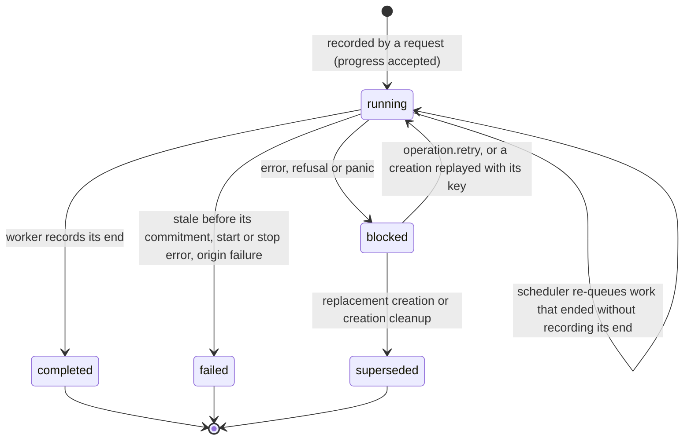
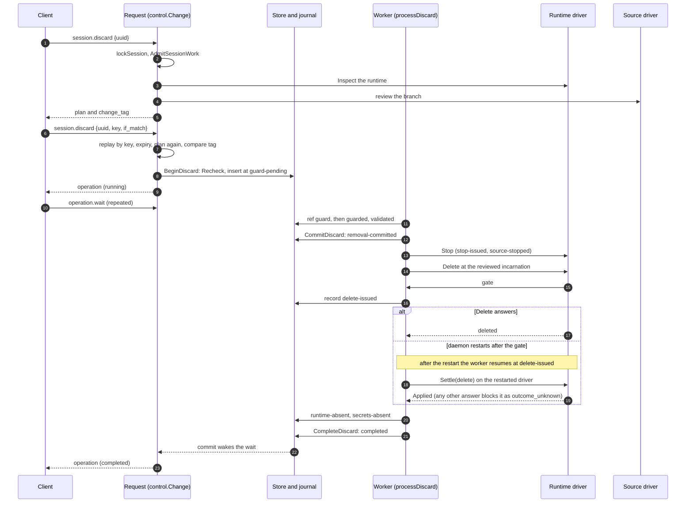

# Control plane: the daemon core and its state

The control plane is the part of [P core](../../GLOSSARY.md#p-core) that runs in the `p daemon`
process: it owns one SQLite database per [P instance](../../GLOSSARY.md#p-instance), decides
whether a change may start, records every change as a journaled operation before its first
effect, runs that operation's work in a worker that resumes after a restart, and reaches Git and
Incus only through the two drivers. This document explains how the daemon is composed and
started, what the store holds and who writes it, how the operation journal, admission, the
[risky change](../../GLOSSARY.md#risky-change) engine and the workers fit together, and what a
restart keeps and loses. It is part of the [P architecture overview](README.md), whose
[cross-cutting guarantees](README.md#cross-cutting-guarantees) it realizes, and it describes the
code at 471a3eb.

## What callers must know

The control plane has three kinds of caller: clients on the control socket
([Control protocol and clients](control-protocol-and-clients.md)), sessions on their own sockets
([Plugins and events](plugins-and-events.md) and
[Source driver and P's Git endpoint](source-driver-and-git-endpoint.md)), and the daemon's own
workers. What they can rely on:

- **Every change is an operation.** A request that changes anything (creating a project or a
  [session](../../GLOSSARY.md#session), starting or stopping it, renaming, removing, changing an
  [origin](../../GLOSSARY.md#origin) or publishing) is answered with an *operation*: one row of
  the `operations` table, the *journal*. The row is written before the change's first effect, so
  a client that loses its reply, or a daemon that restarts, finds the operation and its progress.
  Three changes record nothing: session service actions (`session.service.action`), an origin
  refresh (`origin.refresh`), which stores a fresh observation, and the background release of
  unused commit images, which keeps its intent in the image index row instead.
- **Operation status.** An operation is `running`, `blocked`, `failed`, `superseded` or
  `completed` (the `CHECK` on `operations.status` in
  [`internal/control/schema.sql`](../../internal/control/schema.sql)). It also carries a *phase*
  (how far its work got), `committed` (whether it passed its irreversible point), evidence (the
  facts it acts on) and, when it stopped, a reason code and a bounded diagnostic. A blocked
  operation waits for `operation.retry`; failed, superseded and completed are final.
- **Keys.** Keyed changes (`project.create`, `session.create`, `session.rename`,
  `project.retained.rename`, `origin.change`, and the run of every risky change) carry an
  *idempotency key*. The same key with the same request returns the recorded operation instead
  of making a second one; the same key with another request, or one retired with a deleted
  project, answers `invalid` with reason `key_reused`. Keys share one namespace across kinds.
- **Risky changes are two calls.** A [dry run](../../GLOSSARY.md#dry-run) returns a
  [plan](../../GLOSSARY.md#plan) and, when it is allowed, a
  [change tag](../../GLOSSARY.md#change-tag); the run repeats the parameters with a key and that
  tag and is accepted only if planning again gives the same tag. The daemon stores nothing
  between the two calls. See [Risky changes](#risky-changes-dry-run-run-and-change-tags).
- **Start and stop converge.** `session.start` and `session.stop` take no key. A session already
  as asked records nothing and returns its view; a start or stop already unfinished is returned
  as it is ([`internal/daemon/lifecycle.go`](../../internal/daemon/lifecycle.go)
  `changeSession`).
- **Admission.** At most one unfinished (running or blocked) operation holds a session. Competing
  work is refused: `retry`/`session_held` naming the running holder, or `conflict`/
  `operation_blocked` naming a blocked one. The one exception is an assembled creation cleanup,
  which shares its session with the blocked creation it cleans up.
- **Waiting.** `operation.wait {id, timeout}` (timeout 1 to 25 seconds) returns as soon as the
  operation is not running, or at the timeout with it still running. The journal's commits wake
  the waiters; nothing polls ([`internal/daemon/lifecycle.go`](../../internal/daemon/lifecycle.go)
  `WaitOperation`, `wake`).
- **Requests do not carry the work.** A request's 30-second deadline ends the request, not the
  operation: workers run on the daemon's context. A request answered `retry`/`deadline` may
  still have recorded its operation; replaying its key finds it.

## How it works

### Packages and their split

| Part | Responsibility |
|---|---|
| [`cmd/p`](../../cmd/p/main.go) `daemon` | `p daemon HOST_JSON` loads trusted host configuration, opens the store, and runs `daemon.Serve` until SIGINT or SIGTERM. |
| [`internal/control`](../../internal/control) | The SQLite store and schema, the journal's write path, admission, the generic risky-change engine (`Change`), per-kind store transactions (`*_store.go`), Git authority, host configuration, the control RPC server, the session RPC, and the origin-change and publication workers. |
| [`internal/daemon`](../../internal/daemon) | Composition (`Serve`), the `lifecycle` (worker queue, holds, waits, retry, recovery), the registry of operation kinds, every other worker, planning of the risky changes, driver wiring, effect settlement, attachments, endpoints, commit images and event delivery. |
| [`internal/strictjson`](../../internal/strictjson/strictjson.go) | Strict decoding of untrusted JSON: duplicate keys, inexact field case, unknown fields and trailing values are refused. |

Only `cmd/p` imports `internal/daemon`. `internal/control` imports the driver interface packages
(`internal/runtimedriver`, `internal/sourcedriver`) but no driver implementation; the boundary
tests listed under [Permitted dependencies](README.md#permitted-dependencies) keep Incus, Git
and the driver storage out of it.

### Composition and startup

`daemon.Serve` ([`internal/daemon/daemon.go`](../../internal/daemon/daemon.go)) builds the
daemon in a fixed order. The store has already been opened by `cmd/p`.

1. Read the instance UUID; lease the managed plugin packages host configuration selects
   (`leaseConfiguredPackages`).
2. Start event delivery, which starts the selected [event handler](../../GLOSSARY.md#event-handler)
   if any (`newEventDelivery`; see [Plugins and events](plugins-and-events.md)).
3. Without a `git` block: serve the control socket with the system methods only, and stop here.
4. Start the [source driver](../../GLOSSARY.md#source-driver) (`newSourceDriver`), then the Git
   capability (`newGitCapability`): pin the driver's backend, load the pinned SSH server key and
   the client key, listen on the loopback `git.listen` address, and prepare the SSH server.
5. With a `runtime` block: `newLifecycle` reads the selected agent adapter, starts the
   [runtime driver](../../GLOSSARY.md#runtime-driver) and runs its `Check`, opens the endpoint
   manager, captures each active project's policy, and sets itself as the journal's observer.
   Then `Recover` runs (see [Recovery after a restart](#recovery-after-a-restart)).
   Without a `runtime` block, `newGitLifecycle` runs only the operation kinds marked
   `withoutRuntime` (origin change and publication) and resumes them.
6. Serve the SSH server and the control socket together (`runPair`); if either stops, the other
   is stopped too.

These give three daemon shapes from one `Serve`: no Git (system methods only), Git without a
runtime (projects, branches, origins and their operations), and Git with a runtime (everything).
Event delivery and package leases start in all three.

**What refuses a start.** Every step above fails the start rather than running degraded:

- host configuration that is not a private, singly linked file owned by the daemon user, is
  larger than 64 KiB, has duplicate or unknown keys, or names another schema
  ([`internal/control/config.go`](../../internal/control/config.go) `LoadHostConfig`);
- a state directory with an untrusted ancestor, a `daemon.lock` another daemon holds, a database
  of another schema version or one failing `PRAGMA quick_check`
  ([`internal/control/store.go`](../../internal/control/store.go) `openStore`);
- an event handler, source driver or runtime driver whose launch checks, digest, hello or (for
  the drivers) `Check` fails ([Driver model](driver-model.md));
- a source driver describing another backend while any project exists, or a changed SSH server
  key (`PinSourceBackend`, `loadPinnedServerKey` in
  [`internal/daemon/git.go`](../../internal/daemon/git.go));
- an agent adapter package whose digest does not match, or an endpoint prefix that is not private
  and owned by the daemon.

**Shutdown.** `Serve` returns when its context ends. The deferred steps cancel the workers'
context first, then close the endpoints and stop the runtime driver, then stop the SSH listener
and the source driver, then stop event delivery and release the package leases. Workers that see
their context end record nothing, so their operations stay `running` and resume at the next start.

### The store

[`internal/control/store.go`](../../internal/control/store.go) `openStore` opens
`<state_dir>/control.sqlite` behind an exclusive `flock` on `<state_dir>/daemon.lock`, so one
daemon owns a state directory. It sets `SetMaxOpenConns(1)`: every transaction of the daemon runs
on one connection, one at a time. It requires WAL mode, foreign keys, and a 5-second busy timeout.

The schema is fresh-only. `schema.sql` is applied once to an empty database together with a new
instance UUID and `user_version` 30 (`schemaVersion`); a database of any other version is refused
with a message to start from a new state directory. There is no migration code.

Much of the control plane's correctness lives in the schema itself. About thirty triggers and
several partial unique indexes enforce invariants across rows, for example:

- `active_session_operation` admits one running or blocked operation per session, except that an
  assembled creation cleanup may share its session with the blocked creation it cleans up
  (`active_assembled_cleanup` admits one of those);
- `one_project_delete` admits one unfinished project deletion per project;
- the `deleting_project_*` triggers refuse every write to a deleting project's rows (its
  sessions, operations, principals, guards, origin and images) other than the deletion's own;
- `immutable_session_policy` and `immutable_operation_request` make a session's identity and
  policy, and an operation's request, key, kind and change hash, immutable;
- `discard_requires_established` and its siblings refuse a removal or rename of a session that
  is not established; `operations_retired_key` refuses a key retired with a deleted project.

`classifyWrite` maps the text of a failed constraint or trigger to the refusal it stands for
(`constraintAnswers`: `key_reused`, `project_deleting`, `branch_reserved`, `branch_assigned`,
`project_exists`, `cleanup_active`, `session_not_established`, `session_held`,
`public_addresses`). A constraint that is not listed answers `internal`, because the daemon is
expected to have checked it first.

### The journal

The journal is the `operations` table and the one write path that changes it,
[`internal/control/operation_journal.go`](../../internal/control/operation_journal.go):

- `journalTx.insert` is the only `INSERT INTO operations`; every operation starts `running`.
- `journalTx.update` runs every `UPDATE operations` and records the status change it makes.
- `journalTx.commit` calls the observer's `Ending(id)` for each operation leaving `running`
  *before* the commit, then commits, then calls `Changed(op, from)` for every status change in
  commit order (`journalMu`).

The daemon's `lifecycle` is the observer. `Ending` releases the in-memory session holds of the
operation's worker, so that once the end is recorded nothing of the operation holds the session.
`Changed` emits the `operation.progress` event (`accepted` for a new operation, then `running`,
`blocked`, `completed`, `failed`, or `cancelled` for `superseded`) and wakes the
`operation.wait` calls for that operation
([`internal/daemon/lifecycle.go`](../../internal/daemon/lifecycle.go) `Ending`, `Changed`,
`progressPhase`).

`TestJournalWritesGoThroughOneFunction`
([`internal/control/journal_writes_test.go`](../../internal/control/journal_writes_test.go))
fails on any string literal in `internal/control` that inserts into or updates `operations`
outside those two functions. It does not cover deletes, and two deletes bypass the journal:
recording a start or stop deletes the session's finished start and stop rows
([`internal/control/session_start_stop.go`](../../internal/control/session_start_stop.go)
`BeginSessionChange`), and completing a project deletion deletes the project's other operation
rows ([`internal/control/project_delete_store.go`](../../internal/control/project_delete_store.go)).
Both delete only finished rows, so no hold or waiter is affected. No other operation is ever
pruned ([Q6](README.md#open-questions)).

`Store.AdvanceOperation` ([`internal/control/store.go`](../../internal/control/store.go)) is the
general transition: it refuses any change to a completed or superseded operation, refuses to
clear `committed`, bounds evidence (16 KiB, more for project deletion), checks creation and
cleanup evidence only grows, and refuses to end a creation while its session is still
`creating`. Many per-kind transitions are separate store methods (`CommitDiscard`,
`FailStaleDiscard`, `TransitionRetainedRename` and others) that read, verify and update in
steps; only the process-wide Git authority lock keeps some of them safe
([L4](README.md#known-limits)).

The diagram answers which status transitions an operation can make; its scope is one row of the
journal.

A blocked operation keeps its phase, evidence and guards; it changes only when someone acts on
it. Only lifecycle workers block: start and stop, origin changes and publications end `failed`
instead, apart from a panic, which blocks any kind. `operation.retry` re-records a blocked
operation as running and queues it; a superseded one answers `conflict`/`operation_superseded`.
A creation also resumes when its `session.create` is sent again with the same key: the request
queues it, and its worker continues from the recorded phase. This is the
[exact retry](../../GLOSSARY.md#exact-retry).

### Admission and the two kinds of hold

Two mechanisms keep competing work apart, and they are easy to confuse.

- **The durable hold is the operation row.** `sessionHolderTx`
  ([`internal/control/session_change.go`](../../internal/control/session_change.go)) refuses
  work on a session while another running or blocked operation names it, inside the transaction
  that would record the new operation; the `active_session_operation` index enforces the same
  rule in SQLite. This hold survives a restart.
- **The in-memory hold is a one-slot channel per session**
  ([`internal/daemon/lifecycle.go`](../../internal/daemon/lifecycle.go) `sessionLockSlot`).
  Requests take it with `lockSession`, which refuses at once with `retry`/`session_held` when it
  is taken: session start and stop, attach, rename, service actions, and the `Hold` of every
  risky change on a session. Workers take it with `holdSession`, which waits: creation, creation
  cleanup, replacement cleanup, and start and stop hold their session for their whole run. The
  discard, delete, rename, retained-branch and project-deletion workers do not take it and rely
  on the durable row. Reads (`readSession`) run beside each other and are refused only while a
  change holds the slot; a change waits for reads in flight.

The in-memory hold is lost on a restart, which is safe because the durable row stays and the
journal's `Ending` releases a worker's holds before its end is committed.

### Risky changes: dry run, run and change tags

`control.Change[D]` ([`internal/control/change.go`](../../internal/control/change.go)) answers
both calls of every risky change. Each kind supplies its action and target, a `Hold`, a `Plan`
function, optional `Shown` facts, a `Replay` lookup and a `Begin` that records the operation. The
daemon builds six of them (`removal.go`, `project_delete.go`, `retained_delete.go`,
`create_replace.go`, `create_cleanup.go` in `internal/daemon`); publication's is in
`internal/control/publication_api.go`.

- **Dry run** (no key and no tag): under `Hold`, plan the change. A `conflict` from planning
  becomes a [refusal](../../GLOSSARY.md#refusal) in the plan rather than an error; the plan is
  allowed exactly when it has none. An allowed plan gets a tag. A plan whose encoding would not
  fit a control frame answers `conflict`/`bound_exceeded`.
- **Change hash.** The [change hash](../../GLOSSARY.md#change-hash) is the SHA-256 of the JSON of
  `{format "p.plan/v1", instance, action, target, inputs, plan}`, after `Shown` removes the facts
  the plan shows for information only (for a removal, whether the container was running and the
  driver's name for it). It is stored in `operations.change_hash` and never returned.
- **Change tag.** `<expiry as 20060102T150405Z>-<SHA-256 of expiry + "-" + hash>`, expiring two
  minutes after the dry run (`ChangeTTL`). The tag uses no secret; it binds the expiry to the
  hash because the daemon never discloses the hash. It binds a run to a plan; it does not
  authenticate a caller.
- **Run** (`Change.run`), in this order: parse the tag; replay first, so the same key returns
  the recorded operation even after the tag expired or the daemon restarted; refuse an expired
  tag (`precondition_failed`/`expired`); take `Hold`; replay again; plan again and compare the
  tag (`precondition_failed`/`changed` when it differs); check the expiry again; call `Begin`.
- **Begin** records the operation. For a session removal (`beginRemoval` in
  [`internal/control/discard_store.go`](../../internal/control/discard_store.go)) it takes the
  Git authority write lock, replays by key, runs `Recheck` (a third plan, which must give the
  same hash), then in one journal transaction re-reads the session, checks the expiry again, runs
  `sessionHolderTx` and inserts the operation with its change hash.

The rationale for this protocol is recorded in the archived
[change-tag design](../archive/rework/state-hash-confirmation.md).

### Workers, the queue and the scheduler

[`internal/daemon/operation_kinds.go`](../../internal/daemon/operation_kinds.go) registers each
kind's worker (`process`), an optional `refuseRetry` (refuses an explicit retry the kind cannot
resume), an optional `admit` (refuses to schedule work that must not run now), the session
condition it shows while removing, and `withoutRuntime`.

`lifecycle.queue` deduplicates by operation ID (`working`), applies `admit`, and starts at most
eight workers (`queueSlots`); the rest wait in a FIFO. A worker reads its operation, runs the
kind's phase machine, and records each phase with `AdvanceOperation` before or right after the
effect it guards. When a worker returns, any hold it still has is released, and a panic is
recovered and recorded as `blocked` with reason `internal`, keeping its phase and guards
(`recoverOperation`, `Store.BlockAfterPanic`).

A scheduler goroutine runs every second (`schedule`, `resumeRunning`) and queues every `running`
operation in acceptance order. It re-runs a worker that ended without recording its end, for
example after a store error or an `admit` refusal; it never touches blocked operations.

The table summarizes each kind. "Gated" effects record their intent in the driver's gate and are
settled after a lost call; "re-sent" effects converge and are sent again
([Driver model](driver-model.md) explains gates and `Settle`).

| Kind | Call | Phases (in order) | Commitment | Driver effects |
|---|---|---|---|---|
| `project.create` | keyed | `repo-pending`, then for a blank project or an empty origin the bootstrap session's `branch-assigned` … `workspace-ready`, ending `established` | `branch-assigned` (the [bootstrap session](../../GLOSSARY.md#bootstrap-session) row is recorded) | source `CreateRepository`, origin observe and fetch (re-sent); runtime as for `session.create`, except that the init gate records no attempt ([Q17](README.md#open-questions)) |
| `session.create` | keyed | `source-ready`, `branch-assigned`, `image-ready` (image building only), `principals-ready`, `runtime-created`, `assembly-ready`, `workspace-ready`, ending `established` | `branch-assigned` | source `CreateBranch` (gated); runtime `BuildImage` and `Create` (gated), `Start` (re-sent) |
| `session.start`, `session.stop` | no key | `starting` or `stopping`, ending `ready` or `stopped` | none | runtime `Start`, `Stop` (re-sent) |
| `session.discard`, `session.delete` | risky | `guard-pending`, `guarded`, `validated`, `removal-committed`, `stop-issued`, `source-stopped`, `delete-issued`, `runtime-absent`, `secrets-absent`; delete adds `branch-delete-issued`, `branch-absent` | `removal-committed` | runtime `Stop` (re-sent), `Delete` (gated); source `DeleteBranch` for delete (gated) |
| `session.rename` | keyed | `reserved`, `guarded`, `prepare-issued`, `workspace-prepared`, `new-ref-create-issued`, `new-ref-created`, `workspace-rename-issued`, `workspace-renamed`, `assignment-updated`, `old-ref-delete-issued`, `old-ref-deleted`, `backup-absent` | `new-ref-created` | runtime `WriteWorkspace`, `RemoveWorkspace` (gated); source `CreateBranch`, `DeleteBranch` (gated) |
| `project.retained.rename` | keyed | `reserved`, `new-ref-create-issued`, `new-ref-created`, `old-ref-delete-issued`, `old-ref-deleted` | `new-ref-create-issued` | source `CreateBranch`, `DeleteBranch` (gated) |
| `project.retained.delete` | risky | `guarded`, `ref-delete-issued` | `ref-delete-issued` | source `DeleteBranch` (gated) |
| `project.delete` | risky | `ensure-absent`, `finalizing` | at acceptance: the project is closed, its sessions marked removing and their Git principals disabled | per resource: runtime `Stop` (re-sent), `Delete` (gated), `DeleteImage` (gated, re-sent); source `DeleteRepository` (gated, pinned to the reviewed repository) |
| `session.create.cleanup` | risky | local (the creation failed before its runtime was initialized): `local-cleanup`, `local-complete`; assembled (its stopped container exists and is deleted): `validated`, `delete-issued`, `runtime-absent`, `local-complete` | local: at acceptance; assembled: `delete-issued` | assembled: runtime `Delete` (gated) |
| `session.create.replace` | risky (not a kind of its own) | records a new `session.create` at `source-ready` (or `replacement-cleanup` first) | — | as `session.create` |
| `origin.change` | keyed | `accepted` | none | source `ObserveOrigin` |
| `origin.publish` | risky | `accepted`, `push-issued` | a push whose answer is lost in the call sets `committed`; a worker resumed at `push-issued` fails without it | source `Publish` (gated, never settled or re-sent) |

Every completed operation ends with status `completed`; the last phase shown is the one its
completion records. Workers that fail a removal or rename before its commitment record `failed`
with phase `stale` and release their guard; after the commitment they only block. The scheduling
hooks are: `session.create` waits (`refuseRetry` and `admit`) while an assembled cleanup holds its
session (`creationAwaitsCleanup`), and a creation cleanup that found its review stale is not
retried (`cleanupFoundStale`). A replacement or cleanup marks the blocked creation it handles
`superseded` in the transaction that records it (for an assembled cleanup, in the transaction
that commits its delete).

The origin-change and publication workers are the only workers in `internal/control`
(`OriginAPI.RunOriginChange`, `RunPublication`); `internal/daemon/origin.go` delegates to them
([L8](README.md#known-limits)). Publication is described in
[Source driver and P's Git endpoint](source-driver-and-git-endpoint.md).

### Recovery after a restart

`lifecycle.Recover` runs before the SSH and control servers accept connections:

1. For every session: reopen its endpoints if it is established, or if it is being created and
   its creation has committed and reached `principals-ready` or later
   ([`internal/daemon/endpoint_recovery.go`](../../internal/daemon/endpoint_recovery.go));
   seed the observed facts that event diffing compares against; and emit
   `session.policy_changed` for a project whose trusted policy changed.
2. Queue every `running` operation in acceptance order, and start the scheduler
   (`recoverJournal`).
3. Start image release for every project, so images left unused while the daemon was down go.

Each worker re-enters at its recorded phase. A phase named `*-issued` means an effect may have
happened, and the kind fixes what the worker does about it. For an effect that does not converge
it asks the restarted driver to `Settle` it and, with few exceptions, continues only on `Applied`
(for example `settleRuntimeDelete` in
[`internal/daemon/runtime_removal.go`](../../internal/daemon/runtime_removal.go) and `settleHead`
in [`internal/daemon/git.go`](../../internal/daemon/git.go)), blocking the operation with reason
`outcome_unknown` on any other answer. An effect that converges (`stop-issued`, a project
deletion's image and repository deletes) is sent again, and a publication at `push-issued` fails
with `outcome_unknown` without asking the driver. Before its commitment a worker revalidates its facts and
fails as stale if they changed; after it, it repeats its proofs of absence before the next
irreversible step. Which effects are settled and which are re-sent is listed in the table above
and discussed as [Q2](README.md#open-questions).

What a restart keeps and what it loses:

| Survives | Lost |
|---|---|
| Every operation row with its status, phase, `committed`, evidence and change hash | The worker queue and in-flight driver calls (their effects are settled or re-sent) |
| Ref guards, Git principals, unborn grants (the durable side of every hold) | In-memory session holds, origin locks and the Git authority lock |
| Sessions, projects, origins, commit-image index, public-address slots, the latest unattended status | Attachments and their tokens and leases; `attached_count` returns to 0 |
| Retired keys of deleted projects | Queued events and the facts event diffing compared against (re-seeded, not re-emitted) |
| Session keys and endpoint directories on disk | `operation.wait` calls, rate windows, connection slots |

### State

The daemon process is the only writer of the database, through `*control.Store`. The
[overview's state table](README.md#state-ownership) places this state beside the drivers'.

| State | Where | Written by |
|---|---|---|
| Instance UUID, source backend pin, SSH server key fingerprint | `metadata` | store creation; `PinSourceBackend`; `loadPinnedServerKey` |
| [Projects](../../GLOSSARY.md#project) and sessions (registry state, immutable policy snapshot) | `projects`, `sessions` | lifecycle store transactions only |
| Operations | `operations` | `journalTx` (plus the two deletes above) |
| Git authority: principals, ref guards, unborn grants | `git_principals`, `git_ref_guards`, `git_unborn_grants` | lifecycle store transactions under the Git authority write lock; read by the SSH server under its read lock |
| Latest unattended status per session | `session_unattended`, `status_sequence` | the status reducer ([Plugins and events](plugins-and-events.md)) |
| Origin URL and last observation | `project_origins` | origin change and refresh |
| [Commit image](../../GLOSSARY.md#commit-image) index | `commit_images` | image build and release; the runtime keeps the same facts as image labels |
| Public IPv4 slots (four) | `session_public_addresses` | reserved with the session row |
| Receipts of a deleted project's keys | `retired_lifecycle_requests` | project deletion's completion; never updated or deleted |
| Instance lock, control socket | `<state_dir>/daemon.lock`, `control.sock` | the daemon |
| SSH server and client keys, per-session keys | `<state_dir>/git_server_key`, `git_client_key`, `session_keys/<uuid>` | the Git capability; creation and removal workers |
| Image build staging | `<state_dir>/image-builds/` | commit-image builds |
| Session endpoints | `<endpoint_prefix>/<uuid>/git.sock` and `session.sock` | the endpoint manager |
| Worker queue, session holds, waiters, attachments, observed facts | `lifecycle` (memory) | the daemon |
| Git authority lock, origin locks and slots, attachment counts, rate windows | `Store` (memory) | the daemon |

The source driver's repositories live in the same state directory, because its storage is the
state directory ([Q4](README.md#open-questions)); only the driver touches them.

**Session endpoints.** For each session the endpoint manager
([`internal/daemon/endpoints.go`](../../internal/daemon/endpoints.go)) serves two sockets in a
daemon-owned directory under `endpoint_prefix`, which the runtime driver mounts into the session.
`git.sock` is a byte proxy to the loopback SSH server (at most 8 connections per session and 64
in all); `session.sock` serves the session RPC (at most 4 connections per session and 16 in all).
Which socket a client used binds the session; no request names it. The per-session SSH key in
`session_keys/` is the key whose Git principal the SSH server checks.

## Representative flows

### Discarding a session, from dry run to completion

The diagram answers how one risky change passes admission, the journal, a worker and the
drivers, and where a restart in the middle lands. Its scope is one `session.discard`; a delete
differs only by deleting the branch at the end.

The run never acts on a plan other than the one its tag names, and once `delete-issued` is
recorded, the daemon settles the delete instead of sending it again. In more detail:

1. **Dry run.** `lifecycle.removal` builds the `control.Change`
   ([`internal/daemon/removal.go`](../../internal/daemon/removal.go)). Its `Hold` takes the
   session's in-memory slot. `planRemoval` refuses when an attachment is open, another operation
   holds the session, the session is not established, or the runtime is neither running nor
   stopped; it asks the runtime driver to `Inspect` (or, for an absent runtime, to prove its
   absence through the inventory) and the source driver for the branch review. The plan lists the
   container and everything in it as a [loss item](../../GLOSSARY.md#loss-item); P does not look
   inside a container.
2. **Run.** `Change.run` replays, checks expiry, plans again and compares tags; `Begin` builds the
   evidence (incarnation, assigned tip, image fingerprint, instance UUID) and calls
   `Store.BeginDiscard`, which records the operation at `guard-pending`. The journal's commit
   emits `operation.progress` `accepted`, and the request queues the worker.
3. **Before the commitment.** The worker sets a ref guard, which refuses pushes to the branch;
   revalidates the tip and the runtime's incarnation; and records the digest of P's refs. If
   anything changed, `FailStaleDiscard` records `failed`/`stale`, releases the guard and leaves
   the session as it was.
4. **Commitment.** `CommitDiscard`, under the Git authority write lock, re-verifies the refs,
   marks the session `removing`, disables its Git principal and sets `committed`.
5. **Effects.** The worker records `stop-issued` and stops the runtime (a stop is re-sent after a
   restart, since it converges), then deletes it through the driver's gate, which records
   `delete-issued`, then proves the runtime absent through `Inspect` and a complete inventory
   ([`internal/daemon/runtime_proofs.go`](../../internal/daemon/runtime_proofs.go)), then removes
   the session's endpoints and key (`secrets-absent`).
6. **Completion.** `CompleteDiscard` checks that the guarded branch still has the reviewed tip,
   deletes the session row, its unborn grant, its inactive principal and the guard, and records
   `completed`. The branch stays as a [retained branch](../../GLOSSARY.md#retained-branch).

Any other error after step 2 blocks the operation with the error's reason; `operation.retry` re-enters
at the recorded phase. The client's side of this flow, with its prompts, exit statuses and
handling of a stale tag, is in [Control protocol and clients](control-protocol-and-clients.md).

### Starting and stopping a session

`session.start` takes the session's in-memory slot, returns the unfinished start if there is one,
returns the session's view without recording anything if it is already ready, and otherwise
records a `session.start` operation at phase `starting` (`BeginSessionChange`). Recording it
deletes the session's finished start and stop rows, so a session keeps only its newest one. Its
key column holds its own operation ID. The worker holds the session for the whole driver call and
records `completed` (phase `ready`) once the runtime driver's `Start` returns with a ready
[persistent interactive host](../../GLOSSARY.md#persistent-interactive-host), or `failed` with the
host's diagnostic. While a start or stop is unfinished, the session's
[session condition](../../GLOSSARY.md#session-condition) reads `starting` or `stopping`, whatever
the runtime shows. The archived [waiting design](../archive/rework/waiting.md) records why start
and stop became operations.

## Where changes belong

- **A new risky change.** A `Kind*` constant in `operation_journal.go`; a store file with its
  Begin, commit, fail-stale and complete transactions through `journalTx`; schema triggers or
  indexes for its invariants, with `schemaVersion` raised; a `control.Change` in
  `internal/daemon` (planning, `Shown` facts, replay, `Begin`); a worker registered in
  `operationKinds` with its phases recorded around each gated effect; an interface in
  `rpc_lifecycle.go` with its compile-time assertion in `lifecycle.go`; the method and its plan
  details in `internal/api` ([Control protocol and clients](control-protocol-and-clients.md)).
  Tests: a store test for each transaction, `change_test.go`-style tag tests, a worker test that
  restarts the in-memory drivers mid-phase, and a VM scenario.
- **A new keyed change.** The same without `control.Change`: a request handler that replays by
  key and inserts through `insertForProject` or its own journal transaction.
- **A schema change.** Edit `schema.sql` directly and raise `schemaVersion`; there is no
  migration, and a changed constraint text may need a `constraintAnswers` entry.
- **A new state fact that must survive a restart.** A table or column, written in the same
  transaction as the operation phase that depends on it; in-memory state is lost on restart.

## What surprises newcomers

- **The journal's single write path covers inserts and updates only.** Two deletes bypass it, and
  status changes are still written per site in many store files
  ([L8](README.md#known-limits)).
- **Workers depend on the concrete `*control.Store`**, and five workers are long; no worker runs
  against a stand-in store ([L8](README.md#known-limits)).
- **The control RPC server and host configuration live in the store package**
  ([L9](README.md#known-limits)), so `internal/control` is both persistence and protocol.
- **The Git authority lock is a process-wide `sync.RWMutex` taken by polling** `TryLock` and
  `TryRLock` every 10 ms. Every Git service holds a read lock for its whole life, so a removal's
  commitment waits for pushes and fetches in flight, and a publication holds the write lock
  across its origin calls ([Q5](README.md#open-questions)).
- **Host configuration is not decoded with `strictjson`.** `LoadHostConfig` refuses duplicate and
  unknown keys but accepts keys in another letter case ([Q13](README.md#open-questions)).
- **Session condition is computed on every read**, from the registry state, any unfinished start
  or stop, and the runtime driver's `Inspect`; it is not stored. Condition events are emitted
  only when something reads a session ([Q12](README.md#open-questions)).
- **Finished operations stay.** Apart from start and stop, a project's operations remain until
  the project is deleted; their keys then become receipts that answer `key_reused` forever
  ([Q6](README.md#open-questions)).

## Implementation and test entry points

Start reading, in order:

1. [`cmd/p/main.go`](../../cmd/p/main.go) (the `daemon` command) and
   [`internal/daemon/daemon.go`](../../internal/daemon/daemon.go) `Serve`;
2. [`internal/control/schema.sql`](../../internal/control/schema.sql) and
   [`internal/control/store.go`](../../internal/control/store.go) (`openStore`, `classifyWrite`,
   `AdvanceOperation`);
3. [`internal/control/operation_journal.go`](../../internal/control/operation_journal.go) and
   [`internal/control/change.go`](../../internal/control/change.go);
4. [`internal/daemon/lifecycle.go`](../../internal/daemon/lifecycle.go) (`Recover`, `queue`,
   `lockSession`, `holdSession`, `WaitOperation`, `Retry`) and
   [`internal/daemon/operation_kinds.go`](../../internal/daemon/operation_kinds.go);
5. one risky change end to end: [`internal/daemon/removal.go`](../../internal/daemon/removal.go),
   [`internal/daemon/discard_process.go`](../../internal/daemon/discard_process.go),
   [`internal/control/discard_store.go`](../../internal/control/discard_store.go).

Unit tests:

- journal and waiting: [`internal/control/operation_journal_test.go`](../../internal/control/operation_journal_test.go),
  [`internal/control/journal_writes_test.go`](../../internal/control/journal_writes_test.go),
  [`internal/daemon/journal_test.go`](../../internal/daemon/journal_test.go) (holds released
  before the end, progress events, resumed work);
- recovery order and retry: [`internal/daemon/operation_dispatch_test.go`](../../internal/daemon/operation_dispatch_test.go);
  panics: [`internal/daemon/operation_panic_test.go`](../../internal/daemon/operation_panic_test.go);
- change tags: [`internal/control/change_test.go`](../../internal/control/change_test.go),
  [`internal/daemon/plan_test.go`](../../internal/daemon/plan_test.go);
- store reopen and per-kind transactions: [`internal/control/store_test.go`](../../internal/control/store_test.go)
  and the `*_store_test.go` files; restarts mid-removal and settled deletes:
  [`internal/daemon/discard_test.go`](../../internal/daemon/discard_test.go),
  [`internal/daemon/runtime_removal_test.go`](../../internal/daemon/runtime_removal_test.go);
- the method table: [`internal/control/rpc_surface_test.go`](../../internal/control/rpc_surface_test.go).

The daemon tests run the workers against the in-memory drivers
([`internal/runtimedriver/memory`](../../internal/runtimedriver/memory),
[`internal/sourcedriver/memory`](../../internal/sourcedriver/memory)), whose world survives a
simulated driver restart. No Go test calls `daemon.Serve`; the whole composition runs only in the
VM scenarios under [`tests/integration/steps`](../../tests/integration/steps): SIGKILL restarts
of the daemon in `02-control-plane.sh`, `07-daemon-git.sh`, `10-daemon-lifecycle.sh` and
`11-session-status.sh`; driver restarts under a live daemon in `59-runtime-driver-restart.sh`
and `60-source-driver-restart.sh`; the risky changes in `30` to `53`; the NixOS service restart
in `55-nixos-service.sh`.
