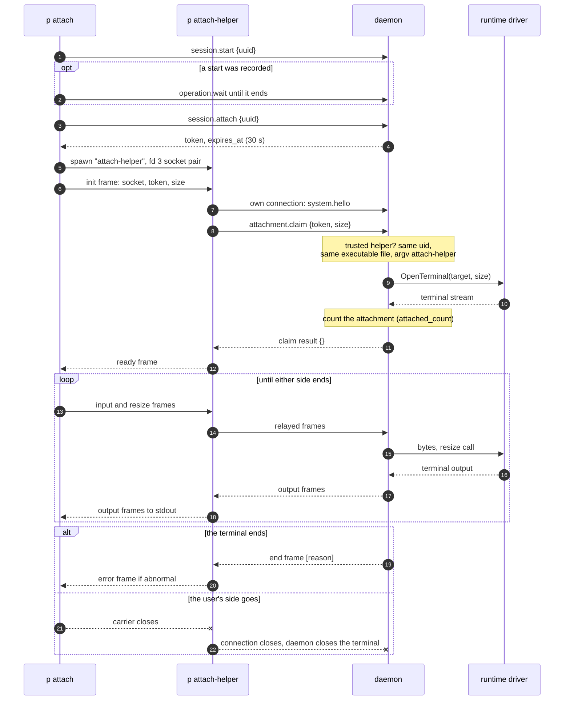

# Control protocol and clients

A person or a script reaches a running P daemon through the control protocol, `p.control/v2`: newline-delimited JSON-RPC 2.0 on the instance's private Unix socket. This document explains that protocol as callers meet it and the clients built on it: the `p` command line, its task commands and raw `p api` calls, the terminal browser (`p tui`), and `p attach`, which carries a session's terminal through a helper process and the daemon's relay. It covers what the wire guarantees, how the CLI and TUI handle lost replies, risky changes and waiting, and where a new command, method or page belongs. The daemon's side of each change (admission, the journal, workers) is in [Control plane: the daemon core and its state](control-plane.md). This document is part of the [P architecture overview](README.md) and describes the code at 471a3eb.

## What callers must know

### One typed contract, one executable

[`internal/api`](../../internal/api/method.go) is the whole wire contract: each method is an `api.Method[Req, Res]` value that binds its name to one request type and one result type. The daemon registers handlers with `control.Register` and clients call with `api.Do` on the same value, so both sides compile against one definition. Request types carry `Validate`, which bounds every field; `api.Do` runs it before anything is sent, and the daemon runs it again after decoding. Clients decide nothing about lifecycle or authority: every decision is the daemon's.

There is one `p` executable. [`cmd/p`](../../cmd/p/main.go) dispatches task commands (`p NOUN VERB`), `p version`, `p tui`, `p attach`, `p api`, the hidden `p attach-helper`, the host commands `p daemon` and `p plugins`. Because it imports `internal/daemon` and `internal/control` for those host commands, the daemon binary is also every client binary. The attachment trust check depends on that (see [Attaching to a session](#attaching-to-a-session)).

### The control socket

- **Location.** `<state_dir>/control.sock`. A client picks the socket from `--socket PATH` (or a positional `SOCKET` where a usage line shows one), then a non-empty `P_SOCKET`, then `/var/lib/p/control.sock` ([`api.ClientSocket`](../../internal/api/client.go)). A relative path is refused rather than resolved to another instance. The NixOS module exports `P_SOCKET` system-wide ([Deployment on NixOS](nixos-deployment.md)).
- **Access.** The daemon creates the socket under a temporary name, sets mode 0600, then renames it into place (`ServeWithHandler` in [`internal/control/rpc.go`](../../internal/control/rpc.go)). The file mode is the only access control for ordinary requests: any process of the daemon's account may call any method. `attachment.claim` is the one method that also checks the peer process.
- **Limits.** 64 connections (further ones are closed), 16 requests in flight per connection (more answer `retry`/`too_many_requests`), 30 s per request, a 2-minute idle read deadline, and a 5 s write deadline per reply.

### Framing, hello and capabilities

- **Frames.** One JSON-RPC 2.0 object per newline-terminated line of at most 64 KiB (`api.MaxFrameBytes`, `api.ReadFrame`). The daemon parses the envelope strictly: only `jsonrpc`, `id`, `method` and `params`, no duplicate keys, an id that is a string of at most 128 bytes or an integer.
- **Strict decoding both ways.** The daemon decodes params with [`strictjson.Decode`](../../internal/strictjson/strictjson.go), which refuses unknown fields, duplicate keys, field names that differ in case, and trailing values, and answers `invalid` naming the field. The client decodes every result the same way (`Conn.Call` in [`internal/api/client.go`](../../internal/api/client.go)), so a result with a field the client does not know fails as `invalid <method> result`.
- **Hello first.** The first request on a connection must be `system.hello {"protocol":"p.control/v2"}`. The daemon answers it before reading the next line, so a client may pipeline its first request after it. Any other request before a successful hello answers `invalid_request`/`hello_required`; a foreign protocol answers `unsupported_version`/`protocol` with the supported list. A repeated hello is accepted. `api.Dial` connects, sends the hello and closes the connection if the daemon agrees another protocol.
- **Capabilities.** The hello result carries `protocol`, `build_version`, `instance_id` and the configured `capabilities`: `git`, `runtime` and `services`. A daemon has three shapes (no Git; Git without a runtime; both), and every method of a capability it lacks answers `not_configured` with the capability as reason. Clients use `HelloResult.Has` to decide what to load. `build_version` is reported (by `p status`) but never compared: the protocol string is the only version check (**Known gap**, [Q14](README.md#open-questions)).
- **Cancellation.** `rpc.cancel {id}` cancels an in-flight request on the same connection. No client in the repository sends it, because `api.Conn` makes one call at a time; closing the connection is how clients give up.

### Methods

`api.Methods()` lists every method with its capability; the server registers exactly that table. Each method falls into one of a few call classes, and the class decides how a client may repeat it.

| Capability | Reads | Changes |
|---|---|---|
| none | `system.hello`, `system.health`, `system.inspect` | `rpc.cancel` |
| `git` | `project.list`, `project.branches`, `project.retained_branches`, `origin.inspect`, `origin.sources`, `operation.inspect`, `operation.list`, `operation.wait` | keyed: `origin.change`; risky: `origin.publish`; unkeyed: `operation.retry`; `origin.refresh` contacts the origin and records its observation without an operation |
| `runtime` | `session.inspect`, `session.list` | keyed: `project.create`, `session.create`, `session.rename`, `project.retained.rename`; risky: `session.discard`, `session.delete`, `project.delete`, `project.retained.delete`, `session.create.replace`, `session.create.cleanup`; converging: `session.start`, `session.stop`; attachment: `session.attach`, `attachment.claim` |
| `services` | `session.services`, `session.service.logs` | unkeyed: `session.service.action` |

- **Keyed changes** take an idempotency key (`key`, 1 to 128 bytes) and return `OperationResult` with the recorded [operation](README.md#operations-and-the-journal). The same key with the same request returns the recorded operation; the same key with a different request answers `invalid`/`key_reused`.
- **Risky changes** are the seven [risky changes](../../GLOSSARY.md#risky-change), each one method called twice. A call with neither `key` nor `if_match` is the [dry run](../../GLOSSARY.md#dry-run) and returns `ChangeResult{plan, change_tag}`; the [change tag](../../GLOSSARY.md#change-tag) is present only when the [plan](../../GLOSSARY.md#plan) is allowed. The run repeats the request with `key` and `if_match` set to the tag and returns `ChangeResult{operation}`. A run with a key and no tag answers `precondition_required`/`if_match_missing`. A tag has the form `YYYYMMDDTHHMMSSZ-<64 hex>` and expires two minutes after its dry run. The daemon stores nothing between the two calls ([`internal/api/plans.go`](../../internal/api/plans.go); the server side is in [Risky changes and change tags](README.md#risky-changes-and-change-tags)).
- **Converging changes.** `session.start` and `session.stop` take no key. They return `SessionChangeResult{changed, operation | session}`: the unfinished start or stop if one exists, a new operation, or the session's view when it is already ready or stopped. Repeating them is safe.
- **Unkeyed changes.** `session.service.action` queues a systemd job in the session and records nothing; `operation.retry` re-runs a blocked operation. Neither can be told apart from its repeat, so clients never resend them after a lost reply or a deadline.
- **Waiting.** `operation.wait {id, timeout}` returns as soon as the operation is not `running`, or after `timeout` seconds (1 to 25) with it still running ([Waiting for an operation](README.md#waiting-for-an-operation)).
- **The private session RPC** (`session.identity`, `session.capabilities`, `status.report`) is defined in `internal/api` too but is served only on each session's own socket and called from inside the session; it is described in [Plugins and events](plugins-and-events.md).

### Errors and exit statuses

An error is `{"code", "message": "<kind>", "data": {"reason", "target", "field", "supported"}}` ([`internal/api/errors.go`](../../internal/api/errors.go)). It carries no text from the daemon's cause: the message is the kind's identifier, the reason is a stable code from about 80 `Reason*` constants that plan [refusals](../../GLOSSARY.md#refusal) share, the target names what the error is about (`session/<uuid>`, `operation/<id>`, `project/<path>`, `project/<path>:branch/<name>`, `project/<path>:origin-branch/<name>`), and the field names the request field at fault. There are 15 kinds, from `parse_error` to `failed`.

Clients hold the only sentences they print: [`internal/errtext`](../../internal/errtext/errtext.go) maps each kind and reason, refusal, [loss item](../../GLOSSARY.md#loss-item), operation outcome and target to one sentence. The task commands turn errors into exit statuses ([`cmd/p/command.go`](../../cmd/p/command.go) `exitStatus`):

| Status | Meaning |
|---|---|
| 0 | Done. |
| 1 | The daemon could not be reached, answered a failure, or the operation failed; also a lost reply. |
| 2 | Invalid arguments or flags; the daemon's `invalid`. |
| 3 | Nothing changed because the state does not allow it: `conflict`, `capacity`, `precondition_failed`, `precondition_required`, a plan that is not allowed, a refused question, or an interruption before a change was sent. |
| 4 | The operation is blocked, or runs on after the CLI stopped waiting. |

`p tui` and `p api` do not follow this table: `p api` exits 1 for any error reply, and `p tui` returns plain errors.

## How it works

### Calls, budgets and automatic repeats

The CLI opens one connection per call (`once` in [`cmd/p/call.go`](../../cmd/p/call.go)): dial, hello, one request, close. Each call has a budget: 35 s, so the daemon's own 30 s `retry`/`deadline` answer arrives first, or 25 s for an `operation.wait` that asks for 20 s.

`repeat` handles a `retry` answer, which means the daemon refused before doing anything:

- a refusal whose target names `operation/<id>` waits for that operation to leave `running` and repeats, up to 10 times;
- `retry`/`deadline` repeats at most twice, and only through `call` (reads, keyed changes, start and stop), never through `callOnce` (service actions and `operation.retry`), because a repeat after a deadline could act twice;
- any other `retry` reason repeats every 500 ms for up to 10 s.

### Keyed changes and lost replies

A keyed command generates a key `cli-<32 hex>` unless `--key` gives one (`keyedChange`). When the connection fails after the request may have been sent, the CLI exits 1 and prints the exact command to repeat with `--key KEY` (`lostChange`, `repeatCommand`). The repeat first looks the key up client side by paging `operation.list` (`recordedChange`, `lookupKey`): a recorded operation of the same kind and intent is followed without sending anything, and one of another kind or intent is a usage error. Only when the key is unknown does the CLI resolve its arguments again and send the change, and the daemon's key replay still makes it at most once. A key whose operation the journal no longer keeps reads as unknown (see [Q6](README.md#open-questions) on retention).

Start and stop say that repeating is safe; a lost service action says the action "may have been queued" and points at `p service list`; a lost `operation.retry` gets the generic lost-reply text.

### Risky changes from the client side

`askChange` in [`cmd/p/ask.go`](../../cmd/p/ask.go) runs every risky task command (`session discard|delete|cleanup`, `session create --replace`, `project delete`, `branch delete`, `origin publish`):

1. With `--key`, look the key up as above and follow a recorded run.
2. Resolve names from live state (`PROJECT:BRANCH` through `session.list`, [`cmd/p/names.go`](../../cmd/p/names.go)) and send the dry run.
3. Print the plan on standard error: the heading, the refusals when not allowed, what is already gone, and a loss block (bold red on a terminal) when the plan loses work. A plan that is not allowed exits 3. `--dry-run` prints the tag on standard output and exits 0.
4. Authorize: `--force` runs at once, or after a 10-second countdown when the plan loses work; otherwise the person answers `[y/N]`, which needs both standard input and standard error to be terminals, or nothing runs (exit 3).
5. Run with the key and the tag, then follow the operation.
6. On `precondition_failed` (`changed` or `expired`), make a new dry run and show it. Ask again, unless `--force` or `--key` was given: then stop with exit 3, so a forced run never acts on a plan nobody saw and one key never carries two tags.

`--if-match TAG` skips the dry run and runs the plan that tag names. `--dry-run`, `--force` and `--if-match` exclude one another, and `--dry-run` takes neither `--key` nor `--no-wait`. The control plane's [discard flow](control-plane.md) shows what the daemon does with the run.

### Following an operation

`follow` calls `operation.wait` with a 20 s timeout until the operation leaves `running`, printing each new phase. `ended` then reports: `completed` exits 0; `blocked` exits 4 and prints `p operation retry ID`; `failed` or `superseded` exits 1 with the `errtext.Operation` sentence and the diagnostic, which names `outcome_unknown` when a driver effect's outcome is unknown. Ctrl-C, SIGTERM or SIGHUP while waiting exits 4 with the `p operation wait ID` command; before a change is sent it exits 3, saying nothing changed. `--no-wait` prints the operation id and returns.

### `p api`

`p api [CONTROL_SOCKET] METHOD [JSON_PARAMS]` sends one untyped request through `api.CallRaw` and prints the raw response envelope ([`cmd/p/client_args.go`](../../cmd/p/client_args.go)). It is the only caller of `CallRaw`, a test enforces that, and it is how most VM scenarios drive the daemon, with hand-written JSON that no compiler checks. Its deadline is 10 s, or the wait's timeout plus 5 s for `operation.wait`, shorter than the daemon's 30 s request deadline.

### The TUI

[`internal/tui`](../../internal/tui/model.go) is a Bubble Tea browser over the same methods ([`internal/tui/client.go`](../../internal/tui/client.go) `SocketClient`). It opens one connection and hello per call, and refreshes its inventory every 3 seconds: the projects with the `git` capability, the sessions and the operations with the `runtime` capability, at most 4096 records. It reuses the CLI's semantics: keys `tui-<hex>`, a risky change's run prepared with its key and tag before the person confirms (so a second `y` after a lost reply sends the same key), a re-read of the plan on `precondition_failed`, and waits that are re-sent on the next tick after a lost reply. Its risky changes are session discard and delete, reviewed on a page before `y` sends the run. It calls neither project or retained-branch deletion, retained-branch rename, origin change or publish, nor creation replace or cleanup: the CLI is the superset (**Known limit**, [L16](README.md#known-limits)). A TUI change follows the [TUI change and validation workflow](../tui-validation-workflow.md).

To enter a session, the TUI runs `p attach SOCKET UUID` as a child under `tea.ExecProcess` and recovers the last `p: …` line of its standard error as the notice to show ([`internal/tui/attachment_screen.go`](../../internal/tui/attachment_screen.go) `pTail`).

### Attach: three processes and a relay

An [attachment](../../GLOSSARY.md#attachment) involves three processes besides the runtime driver:

- **`p attach`** ([`internal/attachment/client.go`](../../internal/attachment/client.go) `Client`) owns the user's terminal: raw mode, keystrokes, `SIGWINCH`. It holds no authority and only carries bytes.
- **`p attach-helper`** ([`internal/attachment/helper.go`](../../internal/attachment/helper.go)) is the same executable started in a fixed mode, in its own session (`setsid`), with a private socket pair on descriptor 3. It receives the token in its first frame, never in its arguments, opens its own control connection and is the only process the daemon lets redeem a token. It has 40 s to reach the daemon and claim, and it buffers at most 16 of the client's frames while the claim opens the terminal; overflow ends the attachment.
- **The daemon** owns the token, the attachment lease, the presence count (`attached_count`) and the relay ([`internal/daemon/attachment.go`](../../internal/daemon/attachment.go), [`internal/control/relay.go`](../../internal/control/relay.go)). The [runtime driver](../../GLOSSARY.md#runtime-driver) opens the terminal to the session's [persistent interactive host](../../GLOSSARY.md#persistent-interactive-host) ([Runtime driver and the session guest](runtime-driver-and-session-guest.md)).

**Token rules.** `session.attach` admits only a ready session with no unfinished operation, returns a 64-hex token that expires after 30 s, and keeps at most 8 pending or open attachments per session and 128 in all. A token is redeemed once; an expired, used or unknown token answers `precondition_failed`/`expired`. Tokens live only in the daemon's memory, so a daemon restart ends every attachment.

**The helper trust check** (`Connection.trustedHelper` in [`internal/control/attachment.go`](../../internal/control/attachment.go)) accepts a claim only when the peer's `SO_PEERCRED` uid equals the daemon's effective uid, `/proc/<pid>/exe` is the same file as the daemon's `/proc/self/exe` (`os.SameFile`), and the peer's command line is exactly `[argv0, "attach-helper"]`. A claim is answered only while no other request is in flight on its connection; once it opens a terminal, the connection stops carrying requests and carries terminal frames: a kind byte, a big-endian 32-bit length and at most 32 KiB of data (kinds 1 init, 2 input, 3 output, 4 resize, 5 ready, 6 error, 7 end; [`internal/api/terminal.go`](../../internal/api/terminal.go)).

## Representative flows

### Attaching to a session

The diagram answers how `p attach SESSION` gets from a command to a live terminal, and which process holds which authority. Its scope is one attachment from the CLI; the TUI runs the same command as a child.

The takeaway: the client receives the token but cannot redeem it, and the helper redeems it but never opens a terminal itself. Authority sits with the daemon, which checks the helper's identity, opens the terminal through the runtime driver, counts presence and relays bytes.

Failures along the way, from [`internal/daemon/attachment.go`](../../internal/daemon/attachment.go) `ClaimAttachment`:

- A session that is not ready answers `conflict` (`session_not_running` or `runtime_missing`), or `failed`/`runtime` when its runtime is unreachable. `p attach` avoids most of these by starting the session first.
- A claim from any other process answers `invalid_request`/`connection`.
- A terminal the driver could not open answers `failed`/`runtime`, and the token is released.
- An open whose outcome is unknown keeps the lease without counting presence: the daemon settles the named terminal through the driver, or, when no terminal is named (the driver's connection was lost), keeps the lease until the session stops. The driver-side rules are in [Driver model: launch, protocol and settlement](driver-model.md).
- Ctrl-C, SIGTERM or SIGHUP (a closed terminal) returns `p attach`, which closes the carrier; the helper sees end of file and closes its connection, and the daemon closes the terminal. Detaching never stops the session host.

### Deleting a session from the CLI

`p session delete team/app:work` resolves the branch to a session UUID with `session.list`, sends `session.delete {uuid}` as a dry run, shows the plan with its loss block, asks, sends `session.delete {uuid, key, if_match}`, and follows the operation until it leaves `running`. A stale tag leads to a fresh dry run and a second question; a lost reply prints the command to repeat with `--key`. [Control plane: the daemon core and its state](control-plane.md) follows the same change through admission, the journal, the worker and the drivers.

## State

Clients keep nothing durable. The CLI's key lives only in its process, and is printed when a reply is lost; the user or script holds it from then on. The TUI keeps an in-memory inventory snapshot, the pending confirmation with its key and tag, the creation draft and per-session interaction times ([`internal/tui/model.go`](../../internal/tui/model.go) `Model`). `p attach` owns the terminal's raw mode and restores it on exit. The daemon owns attachment tokens and leases in memory and the presence count in the store's in-memory status. No client changes daemon state except through methods.

## Where changes belong

- **A new task command.** Add an entry to `commands` in [`cmd/p/commands.go`](../../cmd/p/commands.go) with its noun, verb, arguments and flags (`keyFlags`, `askFlags`, `noWaitFlag`); help, usage lines and flag parsing come from the table. Write `run` with `call` or `list` for reads, `keyedChange` for a keyed change, `askChange` with a `riskyChange` for a risky one, and `callOnce` for a change without a key. Test it against `fakeDaemon` ([`cmd/p/fake_daemon_test.go`](../../cmd/p/fake_daemon_test.go)), which serves the real `control.ServeConn` and can drop replies.
- **A new method.** Request and result types with `Validate` in [`internal/api/requests.go`](../../internal/api/requests.go) and `types.go`; a `Method` value and a row with its capability in `Methods()` ([`internal/api/method.go`](../../internal/api/method.go)); regenerate the golden file with `go test ./internal/api -run Golden -update`; add reason constants with their `errtext` sentences and list them in the control API reference that `TestEveryKindAndReasonIsDocumented` reads; register the handler in `internal/control` ([Control plane](control-plane.md)); add the method to tui-mock if the TUI calls it. A field added to an existing result breaks every client built before it ([Q14](README.md#open-questions)).
- **A new TUI page.** A page name in `Model.page` set through `navigate`, key handling in `Model.key`, rendering in `View`'s page switch ([`internal/tui/view.go`](../../internal/tui/view.go)), daemon calls through `callOf` and `begin`, and replies handled by method name in `accept` ([`internal/tui/workflows.go`](../../internal/tui/workflows.go)). Follow the [TUI change and validation workflow](../tui-validation-workflow.md) and explore with `just tui-mock`.

These tests pin the contract and fail when a change misses a place:

- `TestMethodShapesMatchGolden` compares every method's JSON fields with [`internal/api/testdata/methods.golden`](../../internal/api/testdata/methods.golden); `TestMethodTypesAreClosedStructs` refuses maps and interfaces in request and result types; `TestMethodNamesAreUnique` ([`internal/api/methods_test.go`](../../internal/api/methods_test.go)).
- `TestNoLooseShapesOnTheWire` ([`internal/api/shapes_test.go`](../../internal/api/shapes_test.go)) walks control, daemon, tui, attachment, cmd/p and tui-mock and refuses `map[string]any` on any call or handler and `CallRaw` outside cmd/p.
- `TestEveryRequestTypeIsBounded` requires every request type to refuse its zero value.
- `TestEveryKindAndReasonIsDocumented` ([`internal/api/errors_test.go`](../../internal/api/errors_test.go)) and `TestEveryKindAndReasonHasASentence` ([`internal/errtext/errtext_test.go`](../../internal/errtext/errtext_test.go)).
- `TestTheTableRegistersExactlyTheProtocol`, `TestEveryProtocolMethodIsServedOrNotConfigured` and `TestAttachmentHelperMethodsNeedTheirConnection` ([`internal/control/rpc_surface_test.go`](../../internal/control/rpc_surface_test.go)).

## What surprises newcomers

- **`p attach` needs the very same executable file as the running daemon.** The trust check compares files, so after `p` is reinstalled while the old daemon runs, or with a development build, every claim answers `invalid_request`/`connection` (**Known gap**, [Q14](README.md#open-questions)). tui-mock registers its claim with `control.RegisterClaim` and no trust check, so `just tui-tests` cannot catch this; only the VM scenarios that attach for real do (12, 13 and 56 to 59).
- **Strict result decoding.** Adding a field to any result breaks older clients that speak the same protocol string ([Q14](README.md#open-questions)).
- **One connection per call.** Both the CLI and the TUI dial and say hello for every call; the TUI's refresh opens a connection for each page of each list, and its first call sends two hellos. The archived [wire types record](../archive/rework/wire-types.md) accepts it for the TUI on the grounds that on a local socket the hello costs one more line; no measurement is recorded.
- **`--key` replay is a client-side scan** of `operation.list`, 20 operations per page, up to 4096 pages ([`cmd/p/call.go`](../../cmd/p/call.go) `lookupKey`).
- **The TUI scrapes `p attach`'s standard error** for its last `p: ` line, which couples it to `main`'s error format.
- **The TUI loads operations only when the daemon has the `runtime` capability**, although the operation methods belong to `git`, so a Git-only daemon shows no operations in the TUI ([L16](README.md#known-limits)).
- **The wire package depends on driver and plugin packages.** `internal/api` imports `internal/plugin` (for `plugin.GitRef`, the item of `project.branches`), `internal/runtimedriver` (`MaxServiceName`) and `internal/sourcedriver/gitnames`, which the CLI uses to pre-parse branch names and commit IDs by the bundled driver's rules. No import-boundary test covers any client package (**Known limit**, [L10](README.md#known-limits)).
- **`ProjectCreateRequest.Validate` checks only that the key is non-empty**, where every other keyed request bounds it to 1–128 bytes; the store refuses a longer key when it records the creation ([`internal/control/lifecycle_store.go`](../../internal/control/lifecycle_store.go)).
- **"Capability" has several meanings:** hello capabilities (`git`, `runtime`, `services`), plugin capability classes, the glossary's [host-side capability](../../GLOSSARY.md#host-side-capability), and the session RPC's `session.capabilities`.
- **The error-kind documentation test reads a document.** `TestEveryKindAndReasonIsDocumented` reads the control API reference, which the archive keeps as [control-api.md](../archive/control-api.md); a new kind or reason must still be listed there for the test to pass ([L18](README.md#known-limits)).

## Implementation and test entry points

Start reading at [`internal/api/method.go`](../../internal/api/method.go) (the whole protocol on one page), then [`internal/api/client.go`](../../internal/api/client.go), [`internal/api/plans.go`](../../internal/api/plans.go), [`cmd/p/command.go`](../../cmd/p/command.go), [`cmd/p/call.go`](../../cmd/p/call.go) and [`cmd/p/ask.go`](../../cmd/p/ask.go). For the TUI, [`internal/tui/model.go`](../../internal/tui/model.go) `update` and `key`, then [`internal/tui/workflows.go`](../../internal/tui/workflows.go) `accept`. For attach, [`internal/attachment/client.go`](../../internal/attachment/client.go) and [`helper.go`](../../internal/attachment/helper.go), then [`internal/control/attachment.go`](../../internal/control/attachment.go), [`internal/control/rpc.go`](../../internal/control/rpc.go) `ServeConn` and [`internal/daemon/attachment.go`](../../internal/daemon/attachment.go). The server's dispatch and error mapping are `Register` in `rpc.go` and `answerError` in [`internal/control/errors.go`](../../internal/control/errors.go).

Tests:

- **Unit:** `cmd/p/*_test.go` cover asking, replay, repeats, waits, start and stop, and exit statuses against `fakeDaemon`; `internal/tui/*_test.go` use a fake client; `internal/api` and `internal/errtext` hold the contract tests listed above.
- **Terminal:** `just tui-tests` runs three Python PTY suites against [tui-mock](../../tests/integration/cmd/tui-mock/main.go), a stateful fake daemon that serves the TUI's methods through the real `control.ServeConn`, `Register` and `Change`, with tmux terminals.
- **VM scenarios** ([`tests/integration/steps/`](../../tests/integration/steps)): 12 drives the real CLI, helper, daemon relay and Incus terminal through `attachment-fixture`; 56 and 58 drive the live TUI; 57 runs the task commands end to end; most other scenarios call the daemon through `p api`.

The archived [control API reference](../archive/control-api.md) and [CLI record](../archive/rework/cli.md) hold the history and rationale of these rules.
