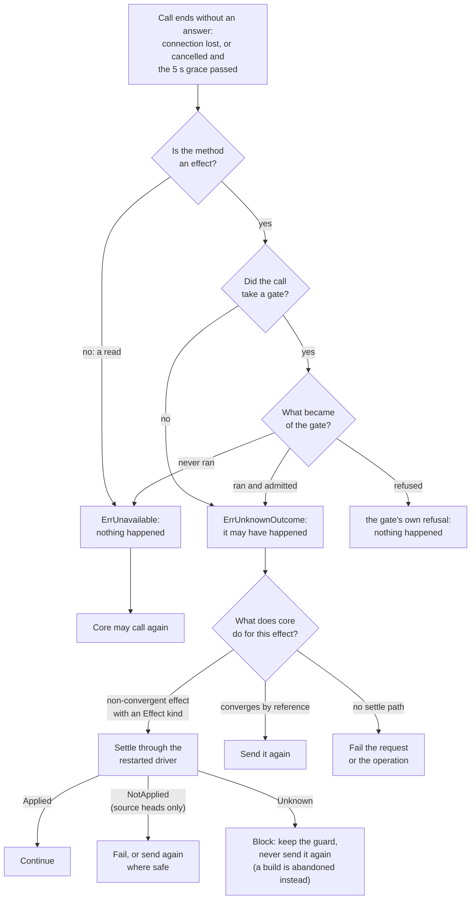

# Driver model: launch, protocol and settlement

P core never touches Incus or Git itself. It reaches them through two
trusted executables it starts and supervises, the
[runtime driver](../../GLOSSARY.md#runtime-driver) (`p-runtime-incus`) and the
[source driver](../../GLOSSARY.md#source-driver) (`p-source-git`), and it
reaches the selected [event handler](../../GLOSSARY.md#event-handler) (the
bundled `p-event-file` or another package) the same way. This document
explains, once, what the three share: how the daemon checks and starts them,
how it talks to them, what a call lost with a dead driver means, how core
settles an effect whose outcome it does not know, and how the supervisor
restarts a driver. The [runtime driver](runtime-driver-and-session-guest.md),
[source driver](source-driver-and-git-endpoint.md) and
[plugins](plugins-and-events.md) documents link here instead of repeating it.
It is part of the [P architecture overview](README.md), whose
[unknown-outcomes](README.md#unknown-outcomes-gates-and-settle) and
[launch-checks](README.md#launch-checks-and-supervision) sections summarize
it, and it describes the code at 471a3eb.

## What callers must know

**One model, three executables.** Each is pinned in trusted host
configuration, started by the daemon as a child process, and reached over a
private connection. Core holds only an interface: `runtimedriver.Driver`,
`sourcedriver.Driver`, or the handler's `Supervisor`. The supervisor
implements that interface and forwards every call to whichever driver process
is running.

| | Runtime driver | Source driver | Event handler |
|---|---|---|---|
| Host configuration | `runtime.driver {path, sha256, config}` | `git.driver {path, sha256, config}` | `events {path, sha256, config}` |
| What the digest covers | the executable file | the executable file | the whole package directory (`p.plugin/v2`) |
| Protocol version | `p.runtime-driver/v1` | `p.source-driver/v1` | `p.event-handler/v1` |
| The hello's answer | `Capabilities` (image builder, builder policy, networks, egress addresses, services) | `Description` (backend, version, SSH commands) | identity `{id, version}`, which must equal the package manifest |
| Environment | empty | the daemon's `HOME` and `SSH_AUTH_SOCK` only | empty |
| Checked before it serves | first start only: the daemon calls `Check` | every start: the supervisor calls `Check` (at most a minute) | launch checks of the package only |
| After a restart fails its launch checks | retried with backoff | retried with backoff | stays stopped until the daemon restarts |
| Supervisor | [`internal/runtimedriver/supervise`](../../internal/runtimedriver/supervise/supervise.go) | [`internal/sourcedriver/supervise`](../../internal/sourcedriver/supervise/supervise.go) | [`internal/eventhandler/supervise`](../../internal/eventhandler/supervise/supervise.go) |

The guarantees a caller in core relies on:

- **The bytes checked are the bytes run.** The daemon hashes the open file
  and starts that file, so a file swapped at the path after the check never
  runs.
- **A failed first start stops the daemon.** A launch check, the digest, the
  exec, the hello, the description check or the source driver's `Check`
  failing at the first start makes `p daemon` refuse to start.
- **A call never returns while its gate or a callback runs.** When core's
  gate records durable intent, that record is committed before the call
  returns, however the call ends.
- **A lost call says whether anything may have happened.** A read or an
  effect whose gate never ran answers *unavailable* (nothing happened); an
  effect that may have happened answers *unknown outcome*. The exact rules
  and the diagram are under [Lost and cancelled calls](#lost-and-cancelled-calls).
- **Errors keep their kinds across the connection.** The driver's error
  carries `data.kinds` (for the runtime driver `unknown_outcome`, `mismatch`,
  `unavailable`, `unsupported`, `no_service`, `not_ready`, `canceled`,
  `deadline_exceeded`, `host`, `unended_terminal`), so `errors.Is` works in
  core as it did in the driver.
- **While a driver is down, every call answers unavailable at once.** Core
  does not queue calls for the next driver.
- **A restarted driver must describe itself as the first one did.** A driver
  that answers the hello with other capabilities or another description is
  killed and the restart is tried again.

## How it works

### Launch checks and start

[`internal/driverwire/launch`](../../internal/driverwire/launch/launch.go)
starts all three executables. Before every start, the first one and every
restart, it applies the launch checks
([`check.go`](../../internal/driverwire/launch/check.go)):

1. The path is absolute and clean, and the pinned SHA-256 is 64 lowercase hex
   digits.
2. The executable's directory and every ancestor up to `/` is a real
   directory (no symbolic link), owned by root or by P's own account, and
   writable by neither group nor others, unless root owns it and it is
   sticky. The directory is opened first and confirmed to be the one
   checked.
3. The executable is opened from that directory without following a link,
   and the open file must be a regular file owned by root or P's account,
   writable by neither group nor others, executable by its owner, and singly
   linked unless root owns it and no one may write it. The last exception
   admits Nix store files, which the store may hard-link.
4. The open file is hashed and compared with the pin.

For the event handler, `launch.Config.Open` replaces steps 3 and 4 with
`plugin.OpenExecutable`
([`internal/plugin/launch.go`](../../internal/plugin/launch.go)): every file
of the package directory passes the file check, the entry passes the
executable check, and the package digest over all files must equal the pin.

`startChecked` then starts the checked file by its descriptor: the child
execs `/proc/self/fd/4`. It gets the connection, one end of a fresh Unix
socket pair, on descriptor 3; its own executable on descriptor 4;
`/dev/null` as input; the daemon's standard error as its output; only the
environment the table above gives; `/` as its working directory; a process
group of its own; and `Pdeathsig: SIGKILL`, so a daemon that dies takes its
drivers with it. The child calls `Inherited` first, which marks descriptor 4
close-on-exec and takes over descriptor 3, so nothing the driver starts
inherits either
([`inherit.go`](../../internal/driverwire/inherit.go)).

### Hello and version agreement

The first frame on the connection is core's `hello`: the protocol version,
the driver's own `config` from host configuration (which only the driver
reads), and a `core` object with the settings core owns that the driver
needs. For the runtime driver that is the instance ID, the endpoint prefix,
the disk-source ceilings, the builder storage pool and the public-egress
substrate; for the source driver its storage directory and its own
executable path; for the event handler the capability name. The driver
answers with the version it agreed and its description, or refuses a
version it does not speak. Nothing else may be sent before the hello, and
the start fails if the answer takes more than 30 seconds
([`driverwire.Connect`](../../internal/driverwire/client.go)).

### Calls, gates and callbacks

[`internal/driverwire`](../../internal/driverwire/driverwire.go) carries
JSON-RPC 2.0 on the connection, one newline-terminated frame per message, at
most 16 MiB a frame (a session's assets, up to 1 MiB each, travel in runtime
requests), decoded strictly. Each protocol built on it names its version, its
**effects** (the methods that change state), the methods that pass
descriptors with the request (`SCM_RIGHTS`; a terminal's own socket pair, or
the Git service's streams) and its callbacks. The driver serves each call in a
goroutine of its own, so the driver itself orders nothing; core's session
locks and the driver's re-observations between effects keep calls on one
object apart.

Requests go both ways. Core calls the driver's operations, and the driver
calls back what a call in flight lent it:

- A **gate** is a core function the driver calls at most once, after its last
  check and right before its first effect. Core records its durable intent
  there, for example an operation's `delete-issued` phase. If the gate
  refuses, nothing happened, whatever the driver answers. If the call fails
  after the gate passed, the outcome is unknown.
- Other **callbacks** are authorizations with parameters and a result, such
  as the source driver's `open`, `approve` and `input` while it serves Git.
  `open` counts as that call's gate.

A gate or callback that runs when the call ends is waited for; one the driver
calls after the call ended is refused (`endLent`). A frame write that the
peer does not read for 30 seconds ends the connection.

### Lost and cancelled calls

A call can end without an answer in two ways: the connection is lost (the
driver died, or core closed it), or the caller's context ended. In the
second case core sends a `cancel` notification and, for an effect, waits a
further 5 seconds for the driver's answer, which would say what happened
(`cancelGrace`). If no answer comes, the call ends by these rules
(`Client.stopWaiting`). This view answers what a lost call means, and what
core does next; it covers all three executables.

The takeaway: a lost call is never treated as success, and an effect that
may have happened is never repeated unless repeating it converges on the same
state. The [table below](#what-core-does-after-a-lost-effect) says which
branch each effect takes. Two edge cases follow the same rules: an effect
whose answer is malformed counts as an unknown outcome, and the event
handler's protocol declares no effects, so a lost `event.handle` is only
unavailable and the event is dropped.

### Settle

`Settle(Effect)` asks the restarted driver what became of an effect whose
call returned an unknown outcome. The driver answers from native state only,
so the answer holds across restarts, with one of three settlements:

- **Applied**: the intended outcome is present exactly and nothing the
  backend admitted on the target is still running.
- **NotApplied**: the backend proves the effect can never be admitted later.
- **Unknown**: the driver cannot tell yet. Core keeps its guard. An
  operation blocks with `outcome_unknown`, and `operation.retry` resumes it at
  its phase, where the worker observes or settles again; the SSH server's Git lease and an attachment's
  terminal lease are polled until `Settle` answers Applied.

The Incus driver never answers NotApplied, since Incus may still admit a
queued request ([Settle on Incus](runtime-driver-and-session-guest.md#settle-on-incus)). The
bundled source driver answers NotApplied for a head effect whose prior state
still holds and that nothing can still change, and never for a Git service
([`internal/sourcedriver/driver.go`](../../internal/sourcedriver/driver.go)).
A `Settle` call is itself a read: lost, it answers unavailable.

### What core does after a lost effect

Verified against every `Settle` call in internal/daemon, internal/control
and internal/sshserver. "Converges" means a repeat of the call leaves the
same state, so core sends it again instead of settling.

| Driver | Effect | Gate | What core does after an unknown outcome |
|---|---|---|---|
| Runtime | `Create` with no incarnation | yes: a session creation records its init attempt; a project creation's bootstrap session records none | Settles `EffectCreate`. Applied: `Create` at the observed incarnation completes the runtime. Anything else blocks the creation, and for a session creation the recorded attempt refuses a second init, which can leave it blocked for good ([Q19](README.md#open-questions)); a bootstrap session's retry with the runtime absent sends init again ([Q17](README.md#open-questions); [`lifecycle.go`](../../internal/daemon/lifecycle.go) `initRuntime`, `creationInitGate`). |
| Runtime | `Create` at an incarnation | no | Converges: sent again on resume; it keeps identical guest files and refuses different ones. |
| Runtime | `Start`, `Stop` | no | Converge. A creation or removal worker sends them again on resume; a `session.start` or `session.stop` operation fails, and the next start or stop converges. Core never settles them, though the Incus driver supports it. |
| Runtime | `Delete` | yes: removal records `delete-issued` | Settles `EffectDelete`. Only Applied lets the removal go on to prove absence; anything else blocks it with `outcome_unknown` ([`runtime_removal.go`](../../internal/daemon/runtime_removal.go)). |
| Runtime | `WriteWorkspace`, `RemoveWorkspace` | yes: the rename records the edit | Settles `EffectWrite` or `EffectRemove` against what the file must now be. Only Applied lets the rename go on ([`rename.go`](../../internal/daemon/rename.go)). |
| Runtime | `BuildImage` | yes: the creation records the build attempted | Settles `EffectBuild` until the driver answers (a `Settle` that fails leaves the build to settle on the next attempt). Applied: the image is accepted after the builder's leftovers are deleted. Any other answer abandons the build, deletes its leftovers and starts a build with a new reference ([`image.go`](../../internal/daemon/image.go) `settleBuild`). |
| Runtime | `DeleteImage` | yes: project deletion records `DeleteIssued`; image release marks a ready index row `releasing`; an unindexed image takes none | Converges: deleting an absent image succeeds, so it is sent again ([`image_release.go`](../../internal/daemon/image_release.go)). |
| Runtime | `OpenTerminal` | no | An `UnendedTerminal` error names the terminal: core keeps the attachment's lease, without presence, and polls `Settle(EffectTerminal)` until Applied. Without a name the lease stays until the session stops ([`attachment.go`](../../internal/daemon/attachment.go)). |
| Runtime | `ServiceAction` | no | No settle path: the request fails as a runtime failure, and nothing is journaled ([`services.go`](../../internal/daemon/services.go)). |
| Source | `CreateBranch`, `DeleteBranch` | yes: phases such as `BranchCreateIssued` | Settles the head effect. Applied: continue. NotApplied: fails with reason `git`, or, for a session creation's new branch, sends it again. Unknown: `outcome_unknown`, guard kept ([`git.go`](../../internal/daemon/git.go) `settleHead`, [`branch_assignment.go`](../../internal/daemon/branch_assignment.go)). |
| Source | `CreateRepository`, `FetchOrigin` | no | Converge: sent again on retry. |
| Source | `DeleteRepository` | yes: project deletion records `DeleteIssued` | Sent again at the reviewed incarnation on retry; a repository present again after its confirmed absence is never deleted ([`project_delete_process.go`](../../internal/daemon/project_delete_process.go)). |
| Source | `Publish` | yes: the publication records `push-issued` | Never settled and never sent again: the publication fails with `outcome_unknown`. A push whose answer is lost in the call also sets `committed`; a worker that a restart finds at `push-issued` fails it without setting `committed` ([`publication_api.go`](../../internal/control/publication_api.go)). |
| Source | `ServeGit` | `open` counts as the gate | The SSH server polls `Settle(EffectService)`, 100 ms doubling to 5 s, and releases the Git lease only on Applied ([`sshserver/git.go`](../../internal/sshserver/git.go)). |

The glossary states the rule more widely than this table: it says an effect
whose call was lost is settled, never sent again. The code repeats effects
that converge and has no settle path for `ServiceAction` or a publication's
push. Which reading is the contract is open question [Q2](README.md#open-questions) in the
[overview](README.md#open-questions).

### Supervision and restart

`launch.Supervisor.supervise` watches the running driver. When its
connection is lost or its process exits, the supervisor:

1. marks the driver down, so every call answers unavailable at once;
2. waits for the exit without reaping the process (`waitid` with `WNOWAIT`),
   so its process ID, which names its group, stays reserved;
3. kills the whole process group, so anything the driver started that did
   not leave the group ends before a new driver serves;
4. reaps the driver;
5. waits a backoff, 100 ms doubling to 30 s and back to 100 ms after a driver
   that ran for a minute, and starts it again with the full launch checks,
   hello and description check.

A restart that fails is tried again after the next backoff, without end, for
both drivers. The event handler is the exception: a restart that fails its
launch checks leaves it stopped until the daemon restarts
(`StopAfterFailedCheck`), while other failures are retried. Calls in flight
when a driver dies end by the lost-call rules above; the effects among them
are settled through the restarted driver, as the table says.

The two drivers differ in what a restart proves:

- The **runtime driver** is not asked to `Check` itself at a restart. The
  daemon calls `Check` after the first start, and again before it decides a
  session's [policy condition](../../GLOSSARY.md#policy-condition), before
  each capacity observation and in each proof of absence;
  every Incus mutation but opening a terminal checks the Incus
  project's confinement itself.
- The **source driver**'s supervisor calls `Check` before every started
  driver serves. The bundled driver's `Check` ends the Git services and
  origin commands a dead predecessor left running in their own process
  groups, which the group kill did not reach. Details are in the
  [source driver document](source-driver-and-git-endpoint.md).

At daemon shutdown, `Serve` cancels the workers' context before it closes the
drivers, so a call cut short leaves its operation running and the next start
resumes it ([`daemon.go`](../../internal/daemon/daemon.go)). Closing a
driver closes its connection, which tells it to exit, and kills it after 5
seconds.

### What is not detected

- **A hung driver.** The supervisor restarts a driver only when its process
  exits or its connection is lost. A driver that keeps its connection open
  and stops answering stalls every call to it until the call's context ends;
  workers' calls run on the daemon's context. Known limit [L1](README.md#known-limits)
  ([A hung driver is never restarted](../debts/state-safety.md#a-hung-driver-is-never-restarted)).
  The event handler escapes this only through its per-event deadline.
- **Unbounded output.** Each child writes to the daemon's standard error with
  no bound. Known limit [L3](README.md#known-limits)
  ([A driver's or plugin's output is not bounded](../debts/state-safety.md#a-drivers-or-plugins-output-is-not-bounded)).

## Representative flows

**The runtime driver dies during a removal's delete.** A discard's worker
calls `Delete(ref, incarnation, gate)`. The Incus driver re-checks the
incarnation, the runtime's state, the project's confinement and that no Incus
operation runs on the instance, then calls the gate; core records the
operation's `delete-issued` phase, and the driver sends `incus delete`. The
driver is killed now. The client returns `ErrUnknownOutcome`, because the gate
ran. The worker calls `Settle(EffectDelete)` at once
([`runtime_removal.go`](../../internal/daemon/runtime_removal.go)
`deleteRuntime`); while the supervisor reaps the driver, kills its group and
waits its backoff, that call answers unavailable, so the operation blocks with
`outcome_unknown`. `operation.retry` resumes it at `delete-issued` and settles
through the new driver, which observes the instance twice: absent both times
with no Incus operation running answers Applied, and the removal goes on to
prove the runtime absent through `Inspect` and the inventory. Any other answer
blocks it again; the delete is never sent again. If the daemon died instead, `Pdeathsig` killed the driver too;
at the next start the worker resumes at `delete-issued` and settles the same
way. VM scenario 59 kills the runtime driver during a creation and during an
attachment.

**The source driver dies while an agent pushes.** The Git service the dead
driver started runs in its own process group, so the group kill does not end
it, and the SSH server holds that service's Git lease. The supervisor starts
a new driver, whose `Check` ends every service its records name that is not
its own and removes the records. The SSH server's `Settle(EffectService)`
then answers Applied, and the lease is released. VM scenario 60 kills the
source driver after an approved push and after a branch creation.

## Where changes belong

- **A new driver operation** changes the contract in
  [`internal/runtimedriver/driver.go`](../../internal/runtimedriver/driver.go)
  or [`internal/sourcedriver/driver.go`](../../internal/sourcedriver/driver.go),
  then the protocol (method name, the `effects` map, wire types, client and
  server), the supervisor's forwarder, the in-memory driver, the conformance
  suite and the real driver. Decide first whether it is an effect, whether it
  takes a gate, and how a lost call is resolved: an `Effect` kind with a
  `Settle` rule, or convergence by reference. Add the row to the table above.
- **A replacement backend** is an executable that serves
  `protocol.Serve` with its own `Driver`, passes the conformance groups it
  claims through a `Fixture`, and is pinned in host configuration. Core needs
  no rebuild, though it still refuses image references that are not 64-hex
  fingerprints ([Q1](README.md#open-questions)); what core still assumes about Incus and Git is in the
  [runtime](runtime-driver-and-session-guest.md#what-replacing-incus-would-take)
  and [source](source-driver-and-git-endpoint.md) documents (known limit
  [L17](README.md#known-limits)).
- **A change to launch, restart or the lost-call rules** lands in
  internal/driverwire and affects all three executables at once. Its unit
  tests are in `launch` and `driverwire`, and each supervisor has its own
  restart tests; VM scenarios 59, 60 and 13 exercise real restarts.

## What surprises newcomers

- **The owner check trusts P's own account.** A driver file owned by the
  daemon's account passes the launch checks; the digest pin, checked on every
  start, is what stops that account from swapping the driver.
- **The source driver's Git hook runs the driver by path**, not the checked
  descriptor: the hook script execs `Core.Executable`, the configured path,
  on every push. Open question [Q3](README.md#open-questions).
- **`Pdeathsig` covers the driver, not its children's own groups.** Git
  services and origin commands survive a daemon crash until the next source
  driver's `Check` ends them.
- **A broken runtime or source driver file is retried forever.** After the
  first start, a driver whose file no longer matches its pin fails every
  restart, and every call answers unavailable until an operator fixes the
  file or the configuration. Only the event handler stops trying.
- **Effects without a gate are unknown when lost, even if nothing ran.**
  `Start`, `Stop`, `OpenTerminal` and `ServiceAction` take no gate, so the
  client cannot tell a call that never reached Incus from one that did.

## Implementation and test entry points

Start reading:

1. [`internal/driverwire/driverwire.go`](../../internal/driverwire/driverwire.go)
   (package comment: the whole model) and
   [`client.go`](../../internal/driverwire/client.go) (`stopWaiting`,
   `waitCancelled`, `endLent`).
2. [`internal/driverwire/launch/launch.go`](../../internal/driverwire/launch/launch.go)
   (`startChecked`, `supervise`, `restart`) and
   [`check.go`](../../internal/driverwire/launch/check.go).
3. The three supervisors linked in the first table, and their protocols:
   [`internal/runtimedriver/protocol`](../../internal/runtimedriver/protocol/protocol.go),
   [`internal/sourcedriver/protocol`](../../internal/sourcedriver/protocol/protocol.go),
   [`internal/eventhandler/protocol.go`](../../internal/eventhandler/protocol.go).
4. Core's settle sites: [`runtime_removal.go`](../../internal/daemon/runtime_removal.go),
   [`git.go`](../../internal/daemon/git.go), `initRuntime` in
   [`lifecycle.go`](../../internal/daemon/lifecycle.go).

Tests:

- `internal/driverwire/launch` `check_test.go` and `launch_test.go`: launch
  checks, start by descriptor, environment, group kill, backoff.
- `internal/driverwire` internal tests, and the protocol tests of each
  driver (`internal/runtimedriver/protocol/protocol_test.go`,
  `internal/sourcedriver/protocol/protocol_test.go` and `servegit_test.go`):
  hello, framing, lost calls, gates and callbacks.
- Supervisor tests (`supervise_test.go` in each supervise package): restart,
  settle after a kill, launch checks at restart, the source driver's
  environment.
- **Conformance suites prove a driver against the contract.**
  [`internal/runtimedriver/conformance`](../../internal/runtimedriver/conformance/conformance.go)
  (groups sessions, recovery, deletion, inventory, workspace, terminals,
  services, images),
  [`internal/sourcedriver/conformance`](../../internal/sourcedriver/conformance/conformance.go)
  (names, repositories, heads, commits, settling, workspace, service, origin)
  and [`internal/eventhandler/conformance`](../../internal/eventhandler/conformance/conformance.go)
  (hello and its refusals, launch checks, ordering, a missed deadline, a
  crash). They run against the in-memory drivers
  ([`internal/runtimedriver/memory`](../../internal/runtimedriver/memory/driver.go),
  [`internal/sourcedriver/memory`](../../internal/sourcedriver/memory/driver.go)),
  whose restartable `World` lets a test kill a driver and settle through the
  next one, against both over the real protocol, and against the real
  drivers. The Incus driver runs against a stubbed Incus and skips the images
  group; nothing runs the suite against real Incus (known limit [L7](README.md#known-limits)).
- VM scenarios: `59-runtime-driver-restart.sh`, `60-source-driver-restart.sh`,
  `13-daemon-events.sh` (handler restart, a changed package staying stopped),
  `01-plugins.sh` and `03-plugins.sh` (launch-check refusals).

The archived [runtime driver design](../archive/rework/runtime-driver.md#how-a-driver-is-replaced)
records why a driver is a separate executable (replacing it needs no rebuild
of P), and its [settling section](../archive/rework/runtime-driver.md#settling-uncertain-effects)
the reasoning behind Settle; the archived
[source driver design](../archive/rework/source-driver.md#trust-and-launch)
records the trust and launch rationale shared by both drivers.
