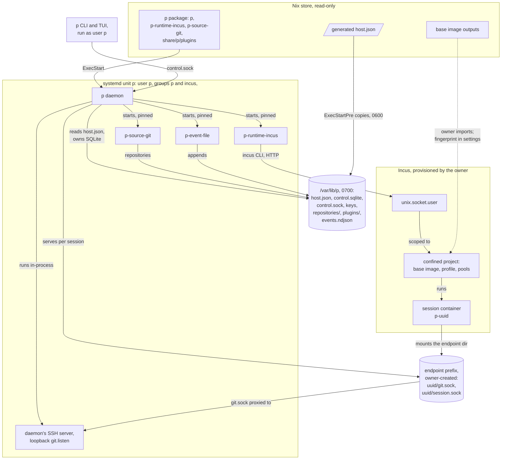

# Deployment on NixOS

P is installed on a NixOS host from one Nix flake: it builds the `p` package with both
drivers and the bundled plugins, the session base image, and a NixOS module that
generates P's trusted host configuration and runs `p daemon` as a hardened systemd
service. This document explains what each artifact is, how the module turns the
owner's settings into the host configuration the daemon accepts, what the machine
owner must provision by hand, which executables and settings are pinned by digest, and
what a service restart keeps. It is part of the [P architecture overview](README.md)
and describes the code at 471a3eb.

## What callers must know

### What the flake builds

[`flake.nix`](../../flake.nix) has these outputs for `x86_64-linux`:

| Output | What it is |
|---|---|
| `packages.default` ([`dev/package.nix`](../../dev/package.nix)) | The `p` package: `bin/p` (the CLI and the daemon in one executable), `bin/p-runtime-incus` and `bin/p-source-git` (the two drivers the daemon starts), and the bundled plugin catalog `share/p/plugins/` with `file-log/` (whose entry `p-event-file` is built here and moved out of `bin/`) and `codex-adapter/`. Static Go executables (`CGO_ENABLED=0`) plus licence notices. |
| `runtime-image`, `runtime-metadata`, `runtime-fingerprint` | The session base image ([`runtime/image.nix`](../../runtime/image.nix)): a NixOS Incus container image as a squashfs and a metadata tarball, and its fingerprint, the SHA-256 of the metadata tarball followed by the squashfs, which is Incus's identity for a split image. The image carries the runtime kit ([`runtime/package.nix`](../../runtime/package.nix)) at `/usr/libexec/p/runtime-kit`, the session user `p` (uid 1000), tmux, Git, OpenSSH, Python and Codex, which it asserts is version 0.151.0. |
| `nixosModules.default` | [`nix/module.nix`](../../nix/module.nix), with `services.p.package` defaulting to `packages.default`. |
| `apps.default` | Runs `bin/p`. |
| `devShells` | The development shell. |

The flake has no `checks` output, so `nix flake check` only evaluates it. Building
`packages.default` does more: its build runs `go-licenses` with an allow-list
(Apache-2.0, MIT, BSD-2-Clause, BSD-3-Clause, ISC) over the four executables, and its
`checkPhase` runs the whole Go test suite (`go test ./...`) under `proot` in a private
filesystem view, then the Python unit tests. The runtime kit's package builds with
`doCheck = false`; its tests run in the main package's suite.

### The trusted host configuration

The daemon runs as `p daemon HOST_JSON`, and the file is P's only trusted
configuration ([`internal/control/config.go`](../../internal/control/config.go)
`HostConfig`, schema `p.host/v1`):

| Block | Content |
|---|---|
| `schema`, `state_dir` | `p.host/v1`, and P's state directory. |
| `git` | `listen`, a numeric loopback TCP address for P's SSH server; `driver: {path, sha256, config}`, the [source driver](../../GLOSSARY.md#source-driver). |
| `runtime` | `driver: {path, sha256, config}`, the [runtime driver](../../GLOSSARY.md#runtime-driver); `endpoint_prefix`; `disk_source_ceilings` (1 to 8 directories); `base_image_fingerprint`; exactly one of `project_policy` or `project_policies` (`network`, `filesystem_mounts`, `command`); optional `environment` (`system`, `builder_storage_pool`) to build [commit images](../../GLOSSARY.md#commit-image); optional `public_egress`; optional `agent_adapter`. |
| `events` | `{path, sha256, config}`, the [event handler](../../GLOSSARY.md#event-handler) package. |

`LoadHostConfig` refuses the file unless:

- its path's ancestors are directories owned by root or the daemon's account and not
  writable by others (a root-owned sticky directory excepted), and it is opened
  without following a symbolic link;
- it is a regular file owned by the daemon's account, private (no group or other
  permission bits), singly linked and at most 64 KiB;
- it holds one JSON object with no duplicate key and no unknown field, schema
  `p.host/v1`;
- `git.listen` is a numeric loopback address; each pinned path is absolute and clean
  with a 64-hex SHA-256; each driver's and the handler's `config` is a JSON object,
  which only that driver or handler reads;
- `runtime` comes with `git`, a 64-hex base image fingerprint and trusted paths, and
  its policies and grants pass validation.

Field names are matched without regard to letter case, unlike the daemon's other
strict decoding. **Known gap** [Q13](README.md#open-questions).

### The NixOS module

`services.p` ([`nix/module.nix`](../../nix/module.nix)) has these options:

| Option | Default | Meaning |
|---|---|---|
| `enable` | false | Run the service. |
| `package` | `packages.default` (through the flake module) | The `p` package. |
| `user`, `group` | `p`, `p` | The service account. |
| `createUser` | true | Create a system account whose home is the state directory; false to use an existing confined account. |
| `stateDirectory` | `p` | The state directory's name under `/var/lib`. |
| `settings` | `{}` | The `p.host/v1` fields, untyped, without `schema` and `state_dir`. |
| `bundledActivation` | false | Select the package's bundled file-log and Codex adapter in the generated configuration. |

At build time the module turns `settings` into `host.json`:

1. It forces `schema = "p.host/v1"` and `state_dir = /var/lib/<stateDirectory>`.
2. A `runtime.driver` or `git.driver` without `path` gets the package's own
   `bin/p-runtime-incus` or `bin/p-source-git`, pinned by the SHA-256 computed while
   the file is built. `path` and `sha256` must come together. A `git.driver` without
   `path` also gets `config.git` and `config.ssh` set to the system's Git and OpenSSH,
   unless its `config` names them, because `p-source-git` inherits no `PATH`.
3. With `bundledActivation = true`, it runs `p plugins defaults
   /var/lib/<stateDirectory>/events.ndjson <package>/share/p/plugins` in the build and
   adds the resulting `events` and `runtime.agent_adapter` blocks, unless `settings`
   already has them. With the default, false, the generated configuration selects no
   event handler and no agent adapter, so the daemon produces no events and sessions
   get no adapter. **Known gap** [Q8](README.md#open-questions).

The result is a file in the Nix store, which is world-readable and owned by root, so
the daemon would refuse it. The unit's `ExecStartPre` therefore copies it, as the
service account, to `/var/lib/<stateDirectory>/host.json` with mode 0600 through a
temporary file and `mv -T`, at every start. `ExecStart` is
`<package>/bin/p daemon /var/lib/<stateDirectory>/host.json`.

The service unit `p`:

- runs as `user`/`group`; the module adds the account to the `incus` group, which
  gives it Incus's user socket;
- requires `incus-user.socket`, starts after `incus.service`, and is wanted by
  `multi-user.target`;
- has a 0700 state directory, `UMask=0077`, `NoNewPrivileges`, `ProtectSystem=strict`,
  `ProtectHome`, `PrivateTmp`, `PrivateDevices`, `RestrictSUIDSGID`, an empty
  capability bounding set, and write access only to the state directory and
  `runtime.endpoint_prefix`;
- restarts on failure after 2 seconds and has 30 seconds to stop.

The module also installs `p` system-wide and exports `P_SOCKET` as
`/var/lib/<stateDirectory>/control.sock`. The control socket is 0600 and owned by the
service account, so CLI and TUI calls run as that account (for example `sudo
--preserve-env=P_SOCKET -u p p status`).

Its assertions refuse a host that is not `x86_64-linux`, Incus not enabled, a root
account or one in `incus-admin`, an unsafe `stateDirectory`, settings without both
`git` and `runtime`, a driver with only one of `path` and `sha256`, and any public
egress: a `runtime.public_egress` block or a policy whose network is not `none`.
Public egress runs only with a daemon the owner starts outside the module.

### What the machine owner provisions

The module provisions neither Incus nor anything inside it. The owner provides:

- **Incus**, enabled with `virtualisation.incus.enable`, with its user socket.
- **A confined Incus project** for the service account, which the Incus driver
  requires: not `default`, reached through a socket named `unix.socket.user` owned by
  root, with the administrative `unix.socket` not writable by the account. Its
  restrictions, profile, storage pools and the disk paths it allows for endpoint and
  grant directories are the owner's.
- **The session base image**, built with `nix build .#runtime-image`,
  `.#runtime-metadata` and `.#runtime-fingerprint`, imported through the account's
  user socket into that project, with the fingerprint written to
  `runtime.base_image_fingerprint`. Nothing in P imports it. **Known gap**
  [Q15](README.md#open-questions).
- **The endpoint prefix and grant directories.** The endpoint prefix must exist before
  the unit starts, because the unit lists it among its writable paths; the daemon
  requires it private and owned by the service account. Grant sources must lie under
  `disk_source_ceilings`, and the Incus project must allow disk devices from those
  directories.
- **Origin access**, if projects use an [origin](../../GLOSSARY.md#origin): the source
  driver runs `ssh` with the account's home (with `createUser`, the state directory)
  for its OpenSSH configuration and known hosts, and with any `SSH_AUTH_SOCK` the
  service has.

The test VM's machine configuration, [`dev/vm/machine.nix`](../../dev/vm/machine.nix),
is the one worked example of all of this: an Incus preseed with a restricted
`user-1000` project (isolated containers, no nesting, disk devices only under the
endpoint and grant directories, at most four containers), its profile and pools, and a
service that imports the base image before P starts.

## How it works

### The deployed host

The diagram answers which processes, files and services make up a running
installation and who provides each; its scope is one NixOS host with one session.

Everything inside the unit is P: the daemon, with its SSH server in the same process,
and the three children it starts share the unit's account and sandbox. Session
containers are not: Incus runs them in the owner's confined project, and they reach P
only through the sockets in the endpoint directory, which Incus mounts into each one.

### Where each executable and setting comes from

| Item | Where it comes from | Pinned by digest? |
|---|---|---|
| `p` (daemon and CLI) | The unit's `ExecStart` store path | No; the store path only |
| `p-runtime-incus` | The package's `bin/`, or `settings.runtime.driver.path` | Yes, `runtime.driver.sha256`; launch checks at every start ([driver model](driver-model.md)) |
| `p-source-git` | The package's `bin/`, or `settings.git.driver.path` | Yes, `git.driver.sha256`; launch checks at every start |
| `p-event-file` | `share/p/plugins/file-log/`, with `bundledActivation` or an own `events` block | Yes, the package digest in `events.sha256`; launch checks at every start ([plugins and events](plugins-and-events.md)) |
| `p-codex-adapter` | `share/p/plugins/codex-adapter/`, with `bundledActivation` or an own `runtime.agent_adapter` | Yes, `runtime.agent_adapter.sha256` at daemon start; the file's digest again inside each session |
| `p-runtime-kit` | Built into the session base image | Not on its own; the image is pinned as a whole by `runtime.base_image_fingerprint` |
| Session base image | Built by the owner and imported by hand | Its fingerprint, in settings |
| `incus`, `journalctl` | Paths in `runtime.driver.config` | No; the Incus driver checks the `incus` binary's owner, mode and Nix-store target |
| `git`, `ssh` | Paths in `git.driver.config`, the system's by default | No |
| Incus project, profile, pools, endpoint and grant directories | The owner | Not configuration P generates |

### Starting and restarting the service

At each start, `ExecStartPre` writes the private `host.json`, and `p daemon` loads it,
opens the control store and composes the daemon. Opening the store takes an exclusive
`flock` on `daemon.lock`, so one daemon owns a state directory. It also refuses a
database built by another schema version: P does not migrate state, so a build with
another schema needs a fresh state directory. The [control plane](control-plane.md) describes
the composition order and what a restart keeps.

For deployment, a restart of the unit:

- keeps everything on disk: SQLite, repositories, keys, the managed registry and the
  event log;
- keeps session containers running, because Incus owns them;
- ends open attachments, drops queued events, and lets running operations resume at
  their recorded phase;
- regenerates `host.json` from the current Nix store file, so a changed setting or
  package takes effect at the next start.

The unit's processes share its control group, so stopping the unit also ends Git
services that `p-source-git` runs in their own process groups. The module sets no
`KillMode`, so systemd's default applies.

## Representative flows

### Installing P on a NixOS host

1. The owner enables Incus and provisions the confined project, its profile and pools,
   and the endpoint and grant directories for the service account.
2. The owner builds the base image outputs, imports the image through the account's
   user socket, and records the fingerprint.
3. The owner imports `nixosModules.default` and writes `services.p.settings` with
   `git.listen`, `runtime.driver.config` (the Incus `binary`, `user_socket`, `project`
   and optional `journalctl`), `endpoint_prefix`, `disk_source_ceilings`,
   `base_image_fingerprint` and a project policy, and sets `bundledActivation = true`
   to get events and the Codex adapter.
4. `nixos-rebuild` builds the package, pins both drivers and the bundled packages into
   the generated `host.json`, and starts the unit.
5. The daemon starts both drivers and the handler after their launch checks. Any
   refusal (a wrong digest, a loosened mode, a failed driver check) makes the daemon
   exit with an error, and systemd starts the unit again under `Restart=on-failure`.

### Changing the package

A rebuild with another `p` package changes the store paths and digests in the
generated `host.json` and the unit's `ExecStart`. At the next start the daemon starts
the new drivers under the new pins. The source driver's backend name is pinned at the
first start and must stay the same while any project exists; a driver build with a new
digest but the same backend is accepted. A build whose state schema differs refuses the
existing state directory. Until the unit restarts, `p attach` from the new package
fails its trust check against the old daemon's executable. **Known gap**
[Q14](README.md#open-questions).

## Where changes belong

- **A new host setting.** `control.HostConfig` and `loadHostConfig` in
  [`internal/control/config.go`](../../internal/control/config.go); if the module must
  generate or default it, [`nix/module.nix`](../../nix/module.nix); and an assertion if
  the hardened service cannot support it.
- **A new executable in the package.** `subPackages` and the licence check in
  [`dev/package.nix`](../../dev/package.nix), and a pin in the module if the daemon
  starts it.
- **A change in the session guest.** The image ([`runtime/image.nix`](../../runtime/image.nix))
  and the runtime kit change together with the runtime driver; shipping it means
  rebuilding and re-importing the base image and changing
  `runtime.base_image_fingerprint`. See the
  [runtime driver and session guest](runtime-driver-and-session-guest.md).

## What surprises newcomers

- **The module selects no plugins by default.** `bundledActivation` defaults to false.
  **Known gap** [Q8](README.md#open-questions).
- **The base image is outside the module.** Nothing checks the image's runtime kit
  against the driver's guest schemas, and the owner imports the image by hand.
  **Known gap** [Q15](README.md#open-questions).
- **The module's own driver pinning is untested.** The test VM pins both drivers in its
  settings, so the module's default-pinning branch never runs in a test, and
  [`tests/nix/service-module.nix`](../../tests/nix/service-module.nix), which checks the
  module's assertions, is not run by any recipe or check. There is no CI.
  **Known limit** [L14](README.md#known-limits).
- **One executable is the daemon and every client.** `bin/p` is both, and `p attach`
  works only with the same file the daemon runs.

## Implementation and test entry points

Start reading at [`flake.nix`](../../flake.nix), [`nix/module.nix`](../../nix/module.nix),
[`dev/package.nix`](../../dev/package.nix) and `LoadHostConfig` in
[`internal/control/config.go`](../../internal/control/config.go).

Checks:

- `just build` (`nix build .#default`): the Go and Python unit suites and the licence
  allow-list.
- `just check` (`nix flake check --no-build`): evaluation only.
- VM scenario 55 ([`tests/integration/steps/55-nixos-service.sh`](../../tests/integration/steps/55-nixos-service.sh))
  runs the module-generated service with real sessions; scenarios 56 to 58 reuse it;
  48 checks the installed catalog and executables. The VM itself
  ([`dev/vm/machine.nix`](../../dev/vm/machine.nix)) imports the module with
  `bundledActivation = true` and explicitly pinned drivers.
