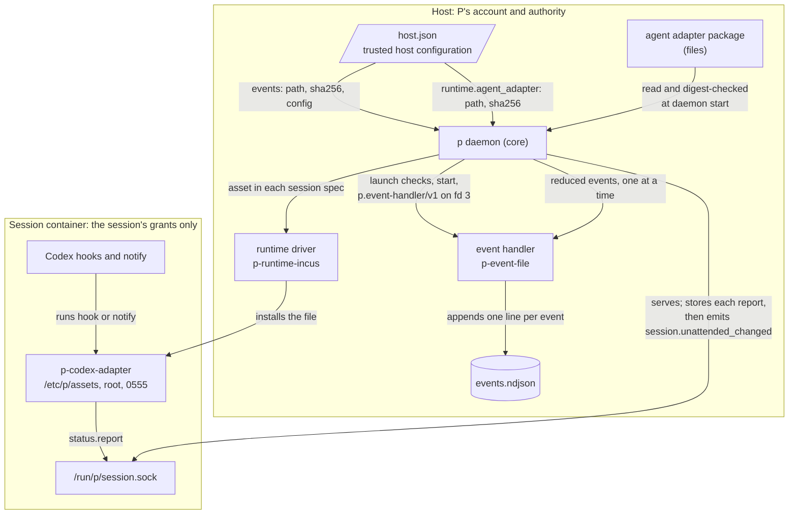

# Plugins and events

A [plugin](../../GLOSSARY.md#plugin) is a package that trusted host configuration
selects for one of two capabilities: an [event handler](../../GLOSSARY.md#event-handler),
which the daemon starts on the host and sends reduced events to, or an agent adapter,
a package of files the [runtime driver](../../GLOSSARY.md#runtime-driver) installs in
each [session](../../GLOSSARY.md#session) and P never starts. This document explains
the package format and how a package is selected, staged and removed; the event-handler
protocol; how the daemon produces and delivers `p.event/v1` events; the bundled
file-log handler; the Codex agent adapter; and the per-session socket an adapter
reports to. It is part of the [P architecture overview](README.md) and describes the
code at 471a3eb. The launch checks, the hello and supervision that the event handler
shares with both drivers are described once in the
[driver model](driver-model.md); this document states only what differs for the
handler.

## What callers must know

### Packages and selection

A package is a flat directory of regular files with a manifest, `plugin.json`, of
schema `p.plugin/v2` ([`internal/plugin/types.go`](../../internal/plugin/types.go)
`Manifest`). The manifest names an `id` (a reverse-domain name such as
`org.p.filelog`), a `major.minor.patch` `version`, a description of 1–512 characters,
and exactly one capability:

| Capability | Manifest field | What P does with it |
|---|---|---|
| `event-handler` | `entry`: the executable file | The daemon starts the entry as one long-lived child process and sends it events. |
| `agent-adapter` | `assets`: exactly `["p-codex-adapter"]` | The daemon reads the files once at start and hands their bytes to the runtime driver for each session it creates. P never executes them. |

[`internal/plugin/package.go`](../../internal/plugin/package.go) `snapshotOpen` and
`validateManifest` refuse a symbolic link, a non-regular file, a file the manifest does
not declare, more than 128 files, a file over 32 MiB, a package over 64 MiB and a
manifest over 64 KiB. The **package digest** is a SHA-256 over every file in name
order: its name, a NUL byte, its size as 8 big-endian bytes, then its bytes. Host
configuration pins a package by that digest, and every read of a package recomputes
it.

Only the trusted host configuration selects a package, by its absolute directory and
digest ([`internal/control/config.go`](../../internal/control/config.go)):

- `events: {path, sha256, config}` selects the event handler. `config` must be a JSON
  object; core never reads it and passes it to the handler in the hello.
- `runtime.agent_adapter: {path, sha256}` selects the agent adapter.

Nothing else selects a package. Discovering a catalog (`p plugins list`), validating
one (`p plugins conformance`) or staging one in the managed registry
(`p plugins install`) activates nothing: staging answers with
`explicit_trusted_selection_required: true` and the selection to copy into host
configuration. Repositories, requests, sessions and agents have no way to name a
package.

The daemon reads both selections when it starts. A first start of the handler that
fails its launch checks, digest, hello or identity, or an adapter package that fails
its digest or bounds, refuses the daemon's start
([`internal/daemon/daemon.go`](../../internal/daemon/daemon.go) `Serve`,
[`internal/daemon/lifecycle.go`](../../internal/daemon/lifecycle.go) `newLifecycle`).
With no `events` block, the daemon produces no events at all.

### The event-handler protocol

The daemon and the handler speak `p.event-handler/v1`
([`internal/eventhandler/protocol.go`](../../internal/eventhandler/protocol.go)), built
on the shared driver wire: JSON-RPC 2.0, one newline-terminated frame per message
(at most 16 MiB), over a socket pair the handler inherits on descriptor 3. The daemon
sends a hello, then one event at a time, in order:

```
→ {"jsonrpc":"2.0","id":1,"method":"hello","params":{"protocol":"p.event-handler/v1","config":{"path":"/var/lib/p/events.ndjson","max_bytes":4194304},"core":{"capability":"event-handler"}}}
← {"jsonrpc":"2.0","id":1,"result":{"protocol":"p.event-handler/v1","capabilities":{"id":"org.p.filelog","version":"0.2.0"}}}
→ {"jsonrpc":"2.0","id":2,"method":"event.handle","params":{"schema":"p.event/v1","id":"e-3f9c…-7","kind":"session.condition_changed","occurred_at":"2026-11-04T10:00:00.123Z","instance":"<instance uuid>","project":"team/app","session":"<session uuid>","branch":"work","fields":{"condition":"ready"}}}
← {"jsonrpc":"2.0","id":2,"result":{"status":"handled"}}
```

The handler answers `handled` (it acted on the event) or `skipped` (it chose to do
nothing). It calls nothing back: the protocol defines no method of P's, and no handler
answer changes P's state or decides anything.

An out-of-tree handler must also honour these wire facts, which the code enforces and
no live document states (**Known gap**, [Q7](README.md#open-questions)):

- P decodes every answer strictly: an unknown field, a duplicate key or a field name in
  another letter case fails the call, and so does any result besides
  `{"status":"handled"}` or `{"status":"skipped"}`.
- An error's `data.kinds` may name only `unavailable`, `canceled` or
  `deadline_exceeded`; an unknown kind fails the call.
- P may send a `cancel` notification, `{"id":N}`, for a call it stopped waiting for.
- The handler also inherits descriptor 4, its own executable, which it may close.
- The handler library (`eventhandler.Serve`, `Inherited`) and the conformance suite
  live under `internal/`, so code outside this Go module cannot import them.

### The event model

An event is a reduced record of something core has already committed
([`internal/eventhandler/event.go`](../../internal/eventhandler/event.go)). It is a
notification, not a source of truth: a handler that misses one cannot ask for it again.

| Field | Content |
|---|---|
| `schema` | `p.event/v1` |
| `id` | `e-<32 hex, random per daemon start>-<sequence>`, or `e-<instance>-status-<receive sequence>` for an unattended-status event |
| `kind` | One of the five kinds below |
| `occurred_at` | RFC 3339 time the daemon emitted it (for a status event, when the report was received) |
| `instance` | The [P instance](../../GLOSSARY.md#p-instance) UUID |
| `project`, `session`, `branch` | Context, each optional, at most 256 bytes, no line breaks |
| `fields` | Exactly one field, named by the kind |

| Kind | Field | Values |
|---|---|---|
| `session.condition_changed` | `condition` | `creating`, `starting`, `ready`, `stopping`, `stopped`, `missing`, `unreachable`, `discarding`, `deleting` |
| `session.attachment_changed` | `count` | 0 to 1000000 |
| `session.unattended_changed` | `unattended_condition` | `none`, `running`, `attention`, `idle`, `failed`, `unknown` |
| `session.policy_changed` | `policy_condition` | `current`, `outdated`, `invalid` |
| `operation.progress` | `phase` | `accepted`, `running`, `blocked`, `completed`, `failed`, `cancelled` |

An encoded event is at most 4 KiB. The daemon validates every event before it queues
it and before it sends it, and `eventhandler.Serve` validates it again on the
handler's side.

### The session RPC

Each session has a private socket, `session.sock`, that core's endpoint manager serves
in the session's endpoint directory and the guest sees at `/run/p/session.sock`
([`internal/daemon/endpoints.go`](../../internal/daemon/endpoints.go) `serveSession`,
[`internal/control/session_rpc.go`](../../internal/control/session_rpc.go)). It is the
only way an agent adapter, or anything else in the session, tells P something.

- **The socket binds the session.** Core serves one socket per session UUID and never
  reads a session from the request.
- **No hello.** Each request carries `"v":1` instead
  ([`internal/api/method.go`](../../internal/api/method.go) `SessionMethods`).
- **Methods.** `session.identity` answers the session's UUID and branch;
  `session.capabilities` adds its policy digest, network mode, filesystem grants under
  `/mnt/p/<name>` and `source_git`/`status_report`. `status.report` is a notification,
  never answered:
  `{"jsonrpc":"2.0","method":"status.report","params":{"v":1,"source":"codex/thread/<uuid>","condition":"idle","reason":"turn complete","adapter":"codex","adapter_version":"0.151.0"}}`
  ([`internal/api/status.go`](../../internal/api/status.go) `StatusReport`).
- **Limits.** At most 4 connections per session and 16 across all sessions; a frame of
  at most 64 KiB; a 2-minute idle deadline; 100 lines a second and 600 a minute per
  session before parsing; and 20 valid reports a second and 240 a minute.
- **Silent refusals.** A malformed, invalid or rate-limited report is dropped without
  an answer. A session that is not established answers `not_found` to a request and
  ignores a notification.

## How it works

### Where each plugin runs

The diagram answers where each plugin runs, who selects it and what it can reach; its
scope is one host with one session.



The two capabilities sit on opposite sides of the session boundary. The event handler
runs on the host as P's account, with P's authority; the adapter's files run inside the
session as whoever invokes them, and reach P only through the session's own socket.

### Producing events

Events come from four places in the daemon
([`internal/daemon/events.go`](../../internal/daemon/events.go)):

- **Observation.** `lifecycle.InspectSession` ends with `observeView`, which compares
  the [session condition](../../GLOSSARY.md#session-condition) and
  [policy condition](../../GLOSSARY.md#policy-condition) it just computed with the last
  ones seen for that session and emits `session.condition_changed` or
  `session.policy_changed` on a difference. `InspectSession` runs when a client calls
  `session.inspect` or `session.list` (once per listed session), when a creation
  completes, when a start or stop is recorded and when it ends, and when an attachment
  is opened. The first observation of a session the daemon has no facts for (one that
  appeared without a creation event) records its facts and emits nothing.
- **Creation.** Accepting a session creation, or committing a project creation's
  [bootstrap session](../../GLOSSARY.md#bootstrap-session), emits
  `session.condition_changed` with `creating`.
- **The journal.** The journal observer's `Changed` runs after the commit of each
  operation status change and emits `operation.progress`: `accepted` for a recorded
  operation, then `running`, `blocked`, `completed`, `failed`, or `cancelled` for a
  superseded one ([`internal/daemon/lifecycle.go`](../../internal/daemon/lifecycle.go)
  `progressPhase`).
- **Presence and status.** After the attachment reducer confirms or releases a
  terminal, `attachmentChanged` emits `session.attachment_changed` with the count, and
  `session.unattended_changed` with `none` when an attachment cleared the unattended
  status. Each accepted `status.report` emits `session.unattended_changed` (below).

At recovery the daemon seeds each session's observed facts without inspecting its
runtime: the condition its registry state gives (`creating`, the removal's condition, or
nothing for an established session) and its policy condition, which the daemon computes
with a runtime driver `Check`. It emits `session.policy_changed` for each session of a
project whose trusted policy changed while it was stopped. An established session's
first observation after a restart records its condition without emitting, so a change
while the daemon was down is never reported for it; a session that was being created or
removed, and any policy change, emits on its first observation.

### Delivering events

`eventDelivery` owns delivery and is deliberately not a journal
([`internal/daemon/events.go`](../../internal/daemon/events.go)):

1. `emit` builds the envelope; `enqueue` validates it and puts it on a queue of 64
   without blocking. An invalid event or a full queue counts a drop.
2. One goroutine sends the queued events in order, one at a time, each within a
   2-second deadline, through the handler's supervisor.
3. While the handler is down, the call fails at once as unavailable and the event is
   dropped. When the handler misses the deadline, the supervisor cuts its connection,
   which kills and restarts it, and delivery goes on with the next event. Any other
   failure, such as an error answer, is logged.
4. The daemon logs `event delivery dropped`, `event handler deadline exceeded;
   restarting it` and `event handler delivery failed` at most once a minute each, with
   no event detail and no count anyone can read.

No commit waits for a handler: events are queued only after the state they describe
is committed, and a handler's failure never rolls anything back. Stopping the daemon
waits at most 250 ms for the delivery goroutine, then stops the handler; queued events
are lost. **Known limit** [L15](README.md#known-limits).

### Starting and supervising the handler

`internal/eventhandler/supervise` starts the handler through the shared launcher
described in the [driver model](driver-model.md). What differs from a driver:

- **Package checks instead of one file.** `plugin.OpenExecutable`
  ([`internal/plugin/launch.go`](../../internal/plugin/launch.go)) applies the launch
  checks to the package directory and its ancestors and to every file in it, requires
  the owner's execute bit on the entry, then computes the package digest over the very
  files it checked and compares it with `events.sha256`. The package must provide
  `event-handler`. The entry it checked is the file the launcher executes.
- **Identity.** The hello's answer must name the manifest's `id` and `version`
  exactly (`Supervisor.Accept`).
- **Per-event deadline.** `Supervisor.Handle` closes the connection when an event's
  2-second deadline passes, so a hung or slow handler is killed and restarted. This is
  the handler's only liveness check: a handler that hangs between events is found only
  when the next event's deadline passes.
- **A changed package stays stopped.** With `StopAfterFailedCheck`, a restart whose
  launch checks fail, for example because the package's bytes or modes changed, leaves
  the handler stopped until the daemon restarts. A restart that fails its hello or
  identity is retried with the launcher's backoff.

The handler runs with an empty environment, in its own process group, as P's account,
inside the daemon's service sandbox, with the daemon's standard error as its output.
It has no confinement of its own. **Known limits** [L2](README.md#known-limits) and
[L3](README.md#known-limits).

### The bundled file-log and the example filter

`p-event-file` ([`cmd/p-event-file/main.go`](../../cmd/p-event-file/main.go)) is the
entry of the bundled `org.p.filelog` package. It takes `{path, max_bytes}` from the
hello's config (an absolute clean path and a rotation size from 1 KiB to 100 MiB),
answers as `org.p.filelog 0.2.0`, and appends each event as one JSON line through
`eventfile.Append` ([`internal/eventfile/eventfile.go`](../../internal/eventfile/eventfile.go)):

- it walks every ancestor of the file by directory descriptor, so a symbolic link
  cannot redirect the append, and refuses a writable ancestor other than a root-owned
  sticky one;
- the parent directory must be private and owned by the handler's account, and the file
  private, owned, regular and singly linked;
- a line that would take the file past `max_bytes` first renames it to one prior
  segment, `PATH.1`.

The bundled selection (`p plugins defaults`) writes `STATE/events.ndjson` with a 4 MiB
rotation; the daemon never reads the file. The example
[`plugins/examples/filter-log`](../../plugins/examples/filter-log/main.go) appends only
`session.condition_changed` events with `ready` and answers `skipped` to the rest. It
is built from this Go module, against the internal handler library.

### The agent adapter

The agent adapter is files only. At start the daemon reads the selected package within
2 seconds, checks its digest and capability, and keeps the bytes of its one asset,
`p-codex-adapter`, which must be 1 byte to 1 MiB
([`internal/plugin/adapter.go`](../../internal/plugin/adapter.go) `ReadAgentAdapter`).
From there:

1. **Pinned per creation.** Each creation records the adapter's ID and package digest,
   or that none was selected, in its evidence. If the daemon later runs with another
   selection, an unfinished creation blocks with reason `plugin`
   ([`internal/daemon/lifecycle.go`](../../internal/daemon/lifecycle.go) `selection`).
2. **Installed by the runtime driver.** Core passes each file as a `runtimedriver.Asset`
   (role, mode 0555, bytes and their SHA-256) in the session spec. The Incus driver
   checks the bytes against that digest and writes the file to
   `/etc/p/assets/p-codex-adapter`, owned by root, mode 0555
   ([`internal/runtimedriver/incus/assembly.go`](../../internal/runtimedriver/incus/assembly.go)
   `assetInstall`). The session's config, `p.runtime-session/v3` or later, carries the
   file's digest as `agent_sha256`.
3. **Re-verified in the guest.** Before the session host starts, the runtime kit checks
   that `/usr/libexec/p/codex-adapter` links to that file, that the file is root-owned,
   mode 0555 and at most 1 MiB, and that its SHA-256 equals `agent_sha256`
   ([`internal/runtimekit/host.go`](../../internal/runtimekit/host.go)
   `ValidateFixedAssets`). The [runtime driver and session guest](runtime-driver-and-session-guest.md)
   document covers the guest's layout.

The bundled adapter
([`plugins/bundled/codex-adapter/p-codex-adapter`](../../plugins/bundled/codex-adapter/p-codex-adapter))
is a Python script for Codex 0.151.0. It reports nothing unless `codex --version`
answers exactly that version. It maps:

| Codex input | Condition | Reason |
|---|---|---|
| hook `UserPromptSubmit` | `running` | prompt submitted |
| hook `PreToolUse` | `running` | tool starting |
| hook `PermissionRequest` | `attention` | permission requested |
| notify `agent-turn-complete` | `idle` | turn complete |

The source is `codex/thread/<agent id>`, or `codex/session/<session id>` for a hook
without an agent ID. Any error in `hook` or `notify` exits 0, so Codex's own decision
is never affected. P never runs `codex-adapter init`: the user runs it inside the
session to write `~/.codex/hooks.json` and `config.toml`, and it refuses to overwrite
existing user state.

### Unattended status

`status.report` reaches `Store.RecordStatusWithCommit`
([`internal/control/session_status.go`](../../internal/control/session_status.go)),
which, under the status reducer's lock:

1. refuses a session that is not established and applies the per-session rate limits;
2. ignores the report while any attachment is open: it is neither stored nor emitted;
3. otherwise takes the next `receive_sequence` and upserts the session's one
   `session_unattended` row in a SQLite transaction;
4. after the commit, calls back the endpoint manager, which builds
   `session.unattended_changed` and only enqueues it.

Every stored report emits an event, even when the condition did not change. The
event's project and branch are the ones the endpoint manager read when the connection
opened. An attachment's confirmation clears the stored status, and the session's view
shows the latest stored report as its latest unattended condition.

### Managed packages and `p plugins`

`p plugins` ([`cmd/p/plugin_management.go`](../../cmd/p/plugin_management.go),
[`internal/plugin/managed.go`](../../internal/plugin/managed.go)) works on the host
without the daemon:

| Command | What it does |
|---|---|
| `defaults EVENT_LOG [CATALOG]` | Validates the bundled catalog and prints the `events` and `runtime.agent_adapter` blocks that select it; writes nothing. |
| `conformance DIR` | Validates one package's data and prints its path, digest and manifest; starts nothing. It is not the behavioural conformance suite. |
| `list DIR` | Lists the conforming and rejected packages of a catalog. |
| `run-event HOST_JSON EVENT_JSON` | Starts the selected handler once, outside the daemon, sends one event with a 2-second deadline and prints its answer. |
| `install HOST_JSON PACKAGE APPROVED_SHA256`, `update HOST_JSON OLD_SHA256 PACKAGE APPROVED_SHA256` | Stages a copy of the package under `STATE/plugins/packages/<digest>/` (directory and entry 0500, other files 0400) after checking it hashes to the approved digest; an update needs another digest of the same package ID. Selects nothing. |
| `remove HOST_JSON SHA256` | Removes a staged package for good. |

The managing commands open the control store, which takes the instance's `daemon.lock`,
so they run only while the daemon is stopped. `.p-registry.json` binds the registry to
one instance and state directory. A running daemon and `run-event` hold a shared
`flock` lease on each managed package they use, so it cannot be removed under them.
Removal is refused while host configuration selects the digest, or while any session,
unfinished operation or stored policy mentions it
([`internal/control/plugin_management.go`](../../internal/control/plugin_management.go)
`CheckPluginRemovalDependencies`). Removal syncs a receipt, `.disabled-<digest>`,
before it unlinks anything, so an interrupted removal can be retried exactly and the
digest can never be staged or used again.

### Trust per capability

The two capabilities carry different authority, which follows from where they run
(PROJECT.md, [Bound delegated authority](../../PROJECT.md#bound-delegated-authority)):

- **The event handler is trusted code with P's authority.** Selection by exact digest
  and the launch checks are the only controls. Once started, it can read and write P's
  state directory, use the Incus user socket and the network, because it runs as P's
  account with no sandbox of its own. P sends it only reduced events.
  **Known limit** [L2](README.md#known-limits).
- **The agent adapter stays within the session's grants.** Its file is root-owned and
  read-only in the guest; it runs as the session user when Codex invokes it; and it
  reaches P only through `session.sock`, which can change nothing but that session's
  unattended status.

The archived [plugin rework design](../archive/rework/plugins.md#trust) records why
executable plugins replaced WASI modules and the confinement it deferred.

## Representative flows

### A session becomes ready, and the file-log records it

1. A creation's worker completes the creation and calls `InspectSession`; the runtime
   driver reports a running, ready host, so the view's condition is `ready`.
2. `observeView` finds the last observed condition was `creating` and emits
   `session.condition_changed` with `ready`. The journal's commit of the creation's
   `completed` status has already emitted `operation.progress` with `completed`.
3. The delivery goroutine sends each event to `p-event-file`, which appends a line to
   `events.ndjson` and answers `handled`.

If the handler is down, both events are dropped and logged once. If it misses the
2-second deadline, it is restarted and the next event goes to the restarted handler;
the late event's outcome is unknown, and P relies on no handler effect, so nothing
settles it.

### Codex asks for permission

1. Codex runs `/usr/libexec/p/codex-adapter hook` with a `PermissionRequest` payload on
   standard input. The adapter checks the Codex version, maps the payload to
   `attention` and writes one `status.report` line to `/run/p/session.sock`.
2. The endpoint manager admits the connection (4 per session, 16 in all) and
   `ServeSessionConn` budgets the line, decodes it strictly and validates it.
3. `RecordStatusWithCommit` stores it, unless someone is attached, and the callback
   enqueues `session.unattended_changed` with `attention`, ID
   `e-<instance>-status-<sequence>`.
4. `session.list` and `session.inspect` show the session's latest unattended condition
   as `attention`; the handler receives the event.

## State

| State | Owner | Who else changes it |
|---|---|---|
| Bundled catalog `share/p/plugins/{file-log,codex-adapter}` | The Nix package, read-only | Nobody |
| Managed registry `STATE/plugins/` (`.p-registry.json`, `.registry.lock`, `.lease-<digest>`, `.disabled-<digest>`, `packages/<digest>/`) | `internal/plugin`, through offline `p plugins` | The daemon and `run-event` hold shared leases |
| Event log, `events.ndjson` and `events.ndjson.1` | The file-log handler | Nobody; the daemon never reads it |
| `session_unattended` rows and `status_sequence` (SQLite) | The status reducer in `internal/control` | Attachment confirmation clears a session's row |
| Creation evidence pinning the adapter's ID and digest | The control store | Read by `CheckPluginRemovalDependencies` |
| Observed facts, event contexts, the queue of 64, the drop counter | `internal/daemon/events.go`, in memory | Lost on restart; observed facts are re-seeded from the registry |
| `/etc/p/assets/p-codex-adapter` in each session | The runtime driver | Nobody in the guest can write it |
| `~p/.codex/hooks.json`, `config.toml` | The session user, through `codex-adapter init` | The session user |

## Where changes belong

- **A new event handler.** A handler is a package, not a change to P: a directory with a
  `plugin.json` of capability `event-handler` whose `entry` speaks `p.event-handler/v1`
  on descriptor 3. Inside this Go module it can use `eventhandler.Inherited` and `Serve`,
  as `p-event-file` and the example filter do; outside it, it must implement the wire
  facts listed above ([Q7](README.md#open-questions)). It proves itself with the
  behavioural suite in `internal/eventhandler/conformance` (from a Go test, as
  [`cmd/p-event-file/main_test.go`](../../cmd/p-event-file/main_test.go) does) and with
  `p plugins conformance DIR`, may be staged with `p plugins install`, and runs only once
  host configuration selects it as `events {path, sha256, config}` and the daemon
  restarts. It runs as trusted code with P's authority ([L2](README.md#known-limits)),
  must answer each event within 2 seconds, and gets events best effort
  ([L15](README.md#known-limits)).
- **A new event kind.** Add its field and values to `eventField` and `allowedValues` in
  [`internal/eventhandler/event.go`](../../internal/eventhandler/event.go), an `emit`
  call where the daemon commits the fact, and cases in `TestEventReductionAndInvalidValues`
  ([`internal/daemon/events_test.go`](../../internal/daemon/events_test.go)) and in VM
  step 13's schema check. Handlers that decode strictly will refuse the kind until
  they learn it.
- **A new capability.** Add the constant and its manifest rules in
  [`internal/plugin/types.go`](../../internal/plugin/types.go) and `validateManifest`,
  a selection block in `control.HostConfig` with `SelectedPackages` and
  `SelectsPackage`, and the daemon code that reads or starts it.
- **Another agent adapter.** The asset role `p-codex-adapter` is fixed in
  `internal/plugin` (`agentAdapterAssets`, `assetModes`), in the Incus driver
  (`guestAssets`), in the runtime kit and in the base image's links; a second agent
  needs a change in each.
- **A new status condition.** `api.StatusReport.Validate`, the `session_unattended`
  CHECK in `schema.sql`, `allowedValues`, and the adapter's mapping.

## What surprises newcomers

- **Condition events depend on someone looking.** No periodic observer exists: a
  runtime that stops on its own produces no event until a client or worker inspects
  the session. With a TUI open, its 3-second refresh calls `session.list`, so changes
  appear within seconds; without one, they may never be reported. An established
  session's change across a daemon restart is never reported. **Known gap** [Q12](README.md#open-questions).
- **Two event-ID schemes.** Most events use `e-<random per start>-<n>`; unattended
  events use `e-<instance>-status-<receive sequence>`.
- **Status reports are not bound to the adapter.** Any process in the session can
  connect to `session.sock` and send `status.report` with any `adapter` name; the
  socket only binds the report to its session. **Known gap**
  [Q16](README.md#open-questions).
- **No handler unless configured.** The NixOS module adds the bundled file-log and
  adapter only with `bundledActivation = true`, which defaults to false. **Known gap**
  [Q8](README.md#open-questions); see [Deployment on NixOS](nixos-deployment.md).
- **`internal/api` imports `internal/plugin`** only for `plugin.GitRef`, the item type
  of `project.branches`. No import-boundary test covers plugins or events.
  **Known limit** [L10](README.md#known-limits).
- **Two strict-JSON readers.** Manifests and the registry file go through
  `internal/plugin`'s own decoder, which refuses unknown and duplicate keys but accepts
  a key in another letter case; `internal/strictjson` refuses that too. **Known gap**
  [Q13](README.md#open-questions).
- **`emit` falls back to the ID prefix `e-test`** when delivery was built without one,
  a seam only tests use. **Known limit** [L12](README.md#known-limits).

## Implementation and test entry points

Start reading at [`internal/plugin/types.go`](../../internal/plugin/types.go), the
package comment of [`internal/eventhandler/protocol.go`](../../internal/eventhandler/protocol.go),
[`internal/eventhandler/supervise/supervise.go`](../../internal/eventhandler/supervise/supervise.go),
[`internal/daemon/events.go`](../../internal/daemon/events.go), then
[`internal/control/session_status.go`](../../internal/control/session_status.go).

Tests:

- **Conformance.** [`internal/eventhandler/conformance`](../../internal/eventhandler/conformance/conformance.go)
  checks a handler started as the daemon starts it: hello and refusals, launch checks,
  order, a missed deadline and a crash. It runs against `p-event-file`
  ([`cmd/p-event-file/main_test.go`](../../cmd/p-event-file/main_test.go)) and the
  example filter.
- **Unit.** `internal/plugin` (package format, digest, launch checks, managed registry,
  adapter); `internal/eventhandler` (envelope and protocol) and its `supervise` tests;
  [`internal/daemon/events_test.go`](../../internal/daemon/events_test.go) (order,
  drops, deadline, reduction); `internal/control/session_status_test.go` and
  `tests/unit/codex_adapter_test.py`, each checking its own side of the
  `status.report` frame.
- **VM scenarios** ([`tests/integration/steps`](../../tests/integration/steps)):
  01 and 03 (CLI: conformance, `run-event`, launch-check refusals, the example filter,
  adapter package rules); 11 (the daemon's side of the session RPC); 13 (the daemon
  with the file-log: order, restart after a kill or a missed deadline, a changed
  package staying stopped, a bad digest or mode refusing the start); 27 (the real
  adapter in a real session); 48 (the installed catalog); 54 (managed staging and
  removal); 55 (the module-generated service). Only 27 and 48 check the adapter and the
  daemon against each other.
