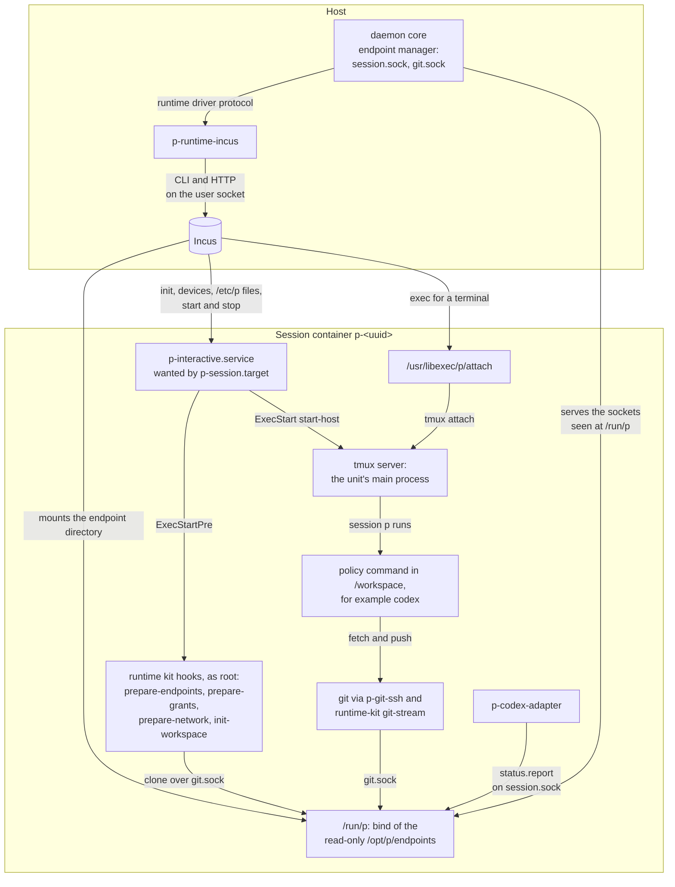

# Runtime driver and the session guest

The [runtime driver](../../GLOSSARY.md#runtime-driver) is the only code that
creates, changes, reads or deletes runtime machinery: a
[session](../../GLOSSARY.md#session)'s container and the files in it, the
[commit images](../../GLOSSARY.md#commit-image) sessions start from and the
builders that make them, terminals, project services, devices and the
network. P core names P's concepts; the driver decides how its backend
realizes them. This document explains the driver's contract, how the Incus
driver (`p-runtime-incus`) realizes it, and what runs inside a session's
container: the base image, the runtime kit and the
[persistent interactive host](../../GLOSSARY.md#persistent-interactive-host).
How the daemon launches, talks to and restarts the driver, and how it settles
a lost effect, is shared with the source driver and lives in the
[driver model](driver-model.md). It is part of the
[P architecture overview](README.md) and describes the code at 471a3eb.

## What callers must know

### The contract

[`runtimedriver.Driver`](../../internal/runtimedriver/driver.go) rests on
three ideas, stated in its package comment:

- **P's concepts, not the guest's layout.** Core names a session, its
  command, branch, Git key, endpoints, [grants](../../GLOSSARY.md#grant) and
  network; the driver decides where each goes. The one guest place core knows
  is the workspace, whose files core reads and writes only while the session
  is stopped.
- **Gates.** A mutation takes a gate that the driver calls once, after its
  last check and right before its first effect; core records its durable
  intent there.
- **Settle.** An unknown outcome is resolved by `Settle` or by operations
  that are idempotent by reference, never by sending a non-idempotent effect
  again.

The operations, by group:

| Group | Operations | Gate | What a caller relies on |
|---|---|---|---|
| Boundary | `Check`, `Inventory` | — | `Check` proves the driver's confinement and egress substrate from live state. `Inventory` lists every object in scope, P's or not, with labels as stored, or fails; never a partial list, and never more than `MaxObjects` (64). |
| Sessions | `Inspect`, `Create`, `Start`, `Stop`, `HostLog` | `Create` without an incarnation | `Inspect` reports absent only when nothing is at the session's address, and `ErrMismatch` for an object that carries the reference but differs. `Create` with no incarnation first searches the whole scope, so a renamed runtime blocks it; with an incarnation it only completes that stopped runtime. `Start` converges on a running runtime whose host is ready, or leaves it stopped and returns a `*HostError`. `Stop` converges on stopped. |
| Terminals | `OpenTerminal` | — | A PTY attached to the session host, with a completion witness armed before the attach; `*UnendedTerminal` when the attach began and its end is unproven. |
| Workspace | `ReadWorkspace`, `WriteWorkspace`, `RemoveWorkspace` | the writes | Only on a stopped runtime at an exact incarnation; never runs code the repository can change, never follows links. |
| Services | `Services`, `ServiceAction`, `ServiceLogs` | — | Project services of a running session whose host is ready; `ServiceAction` returns once the action is queued. |
| Images | `Describe`, `BuildImage`, `Images`, `InspectImage`, `DeleteImage`, `Settle`, `Delete` | `BuildImage`, `DeleteImage`, `Delete` | `BuildImage` leaves nothing behind except after an unknown outcome. `Delete` acts on a session's runtime only at the reviewed incarnation, or removes a build's leftovers. |

Identity crosses the contract in P's terms:

- A **reference** (`Ref`) is a session's UUID or the UUID core chose for one
  build attempt.
- **Labels** are P's identity facts (project, source commit, base image,
  system, builder version, build). The driver stores them with the object,
  immutably, adds its own P instance, and returns them verbatim.
- An **incarnation** is the driver's opaque identity for one runtime at a
  reference: the same across stop and start, new when the runtime is
  re-created or restored. Core identifies a runtime by it and shows the
  driver's own name for a runtime only for display.
- An **image reference** (`ImageRef`) is described as opaque to core. Core in
  fact admits only 64-hex Incus fingerprints, both for commit images and the
  configured base image: open question [Q1](README.md#open-questions).

A session's spec (`runtimedriver.Session`) carries the reference, labels,
image, command (from trusted project policy), workspace (repository, branch,
commit), the session's private Git key and the pinned host key of P's Git
endpoint, the host endpoint directory, grants, network and assets. The
driver's description (`Capabilities`) names its image builder and builder
policy, the networks it offers, how many public-egress addresses core may
reserve, and whether it offers services.

### How core reaches it

The daemon holds only the interface. `supervise.Start` in
[`internal/runtimedriver/supervise`](../../internal/runtimedriver/supervise/supervise.go)
starts `p-runtime-incus` from the pinned `runtime.driver {path, sha256,
config}` and forwards every call over the `p.runtime-driver/v1` protocol
([`internal/runtimedriver/protocol`](../../internal/runtimedriver/protocol/protocol.go));
launch checks, the hello, lost calls and restarts are described in the
[driver model](driver-model.md). The hello's `core` object carries the
instance ID, the endpoint prefix, the disk-source ceilings, the builder
storage pool (empty disables image builds) and the public-egress substrate.
The Incus driver's own `config` holds exactly `binary`, `user_socket`,
`project` and an optional `journalctl`
([`driver_config.go`](../../internal/runtimedriver/incus/driver_config.go));
core passes it through unread.

The daemon calls `Check` after the first start and fails to start if it
fails. Its callers are internal/daemon's lifecycle (creation, start and
stop, `InspectSession`), removal and its proofs, rename, project deletion,
assembled cleanup, images and image release, attachments, services and the
capacity observer.

## How the Incus driver works

[`internal/runtimedriver/incus`](../../internal/runtimedriver/incus/backend.go)
implements the contract on a local Incus. [`cmd/p-runtime-incus`](../../cmd/p-runtime-incus/main.go)
takes no arguments, runs with an empty environment, and serves the protocol
on descriptor 3. The driver persists nothing of its own: it reads native
state fresh on every call and claims nothing after an error. In memory it
holds only the protocol server's open terminals and a process-wide limit of
two concurrent Nix build stages.

### Reaching Incus

The driver reaches Incus in two ways, both through the confined user socket
`unix.socket.user` named in its config:

- **The `incus` CLI**, as `incus --force-local --project <project> …` with
  `INCUS_SOCKET` set to the user socket, a fresh temporary `INCUS_CONF` and
  `HOME`, and `PATH=/usr/bin:/bin`, in a killable process group with bounded
  output. A command gets 120 seconds, a builder command 5 minutes
  (`Backend.commandWith`).
- **Hand-built HTTP over the user socket** for what the CLI does not give
  exactly: the instance file API for guest files, exec with websockets for
  terminals, SFTP `lstat` for full modes, and a streamed upload of a build's
  source bundle. Known limit [L11](README.md#known-limits) records that these clients are written
  separately in many places.

Before every Incus command, `validateConfig` refuses to proceed when the
driver runs as root, the Incus binary is not an absolute path in trusted
directories (a link may lead only into `/nix/store`), the user socket is not
a root-owned socket named `unix.socket.user`, the account can write the
administrative `unix.socket` beside it, the project is empty or `default`,
or the disk ceilings or public-egress settings are invalid.
`CheckConfinement`, run before every mutation except opening a terminal, reads the Incus project and its default profile
and refuses unless the project is restricted (`restricted=true`, isolated
containers, nesting and low-level options blocked, GPUs blocked, NICs blocked
or managed when public egress is configured, disk paths exactly the trusted
ceilings, its own profiles and no networks of its own).

### Native objects and labels

The driver acts only in its configured Incus project and only on objects that
carry its P instance's labels:

| Object | Name | Labels and devices |
|---|---|---|
| Session runtime | `p-<session uuid>`, a container | `user.p.instance_uuid`, `session_uuid`, `project_path`, `contract_version`, `image_fingerprint`, set once by `incus init`. Devices `p-endpoint` (the endpoint directory, read-only at `/opt/p/endpoints`), `p-grant-<name>` (at `/mnt/p/<name>`) and `p-public` (the public-egress NIC). Its incarnation is Incus's `volatile.uuid` with `volatile.uuid.generation`. |
| Builder | `p-builder-<build uuid>`, a container | `user.p.instance` and `user.p.builder_*` identity keys. Every exit path deletes it, except an unknown outcome, which leaves it for `Delete`. |
| Commit image | an Incus image, by fingerprint | properties `p.instance`, `p.contract`, `p.compression`, `p.incus_project`, `p.selection`, the identity labels and, for a devShell, `p.material` and `p.capture_store_path`. An image with an unknown `p.` property is a mismatch. |
| Guest files | under `/etc/p` in the runtime's private root | see [Inside the session](#inside-the-session). |

The base image is not the driver's: the machine owner imports it into the
Incus project, and host configuration pins its fingerprint as
`runtime.base_image_fingerprint`. Anything an Incus administrator changes is
seen on the next read as a mismatch, a rename (the UUID label under another
name) or another incarnation, and is never adopted.

### Settle on Incus

`Settle` answers Applied only when two observations 250 ms apart are
identical, show the intended outcome, and show no Incus operation running on
the instance; otherwise Unknown. It never answers NotApplied, because Incus
may still admit a queued request. A build is Applied only for exactly one
image carrying the build's labels, no pending image publication and no
builder of the build left; a terminal is Applied once its exec operation has
finished or is gone. Which effects core actually settles is the
[driver model's table](driver-model.md#what-core-does-after-a-lost-effect).

### Commit images and builders

When host configuration enables image building (`runtime.environment` names
the system and the builder storage pool), a session creation starts its
session from a commit image of its source commit: the base image, that
commit's Nix development environment, and a clone of the commit in the
workspace. Core keeps the index; the driver builds and labels:

1. Core takes the commit's in-memory lock and looks in its `commit_images`
   index for an image of the same project, commit, base image, system and
   builder version.
2. If there is none, core asks the [source driver](source-driver-and-git-endpoint.md)
   to `Export` the commit as a Git bundle into a private directory under the
   state directory's `image-builds/`.
3. Core calls `BuildImage` with a new build reference, the labels and the
   bundle. The driver re-checks confinement and calls the gate, where the
   creation records the build as attempted, then creates
   `p-builder-<uuid>` from the base image. Without public egress the builder
   has no NIC and builds offline; with it, the builder gets a public address.
4. In the builder the driver streams the bundle in, clones it, resolves the
   commit's flake (`no-flake`, `no-default` or `devshell`) and, for a
   devShell, realizes and captures it. Each Nix stage takes one of two
   process-wide slots and ends after 7 minutes, its wait included. It then
   scrubs build scratch, collects garbage outside the captured closure,
   clones a fresh workspace, publishes the image with its labels and deletes
   the builder.
5. Core indexes the image. If another creation indexed one for the same
   commit first, this build's image is deleted. A build whose outcome was
   lost is settled until the driver answers: Applied is accepted after its leftovers go;
   anything else is abandoned and a new build starts with a new reference.
6. Image release, run in the background after an operation of the project
   leaves its worker, deletes images no session of their commit uses.

A failure before the image is published deletes the builder and is
definite. A failure during or after publication, or a builder that cannot be
removed, is an unknown outcome. A builder that Incus admits after its
creation's reply was lost is never collected: known limit [L6](README.md#known-limits)
([the debt entry](../debts/state-safety.md#a-builder-admitted-after-its-creations-reply-was-lost-is-never-collected)).
No committed VM check builds through a public-egress builder (known limit
[L7](README.md#known-limits)).

### Terminals

Core opens a terminal for an [attachment](../../GLOSSARY.md#attachment): it
creates a socket pair and passes the far end with `open_terminal`. The
driver checks that the runtime is the expected incarnation and its host is
running and ready, verifies the attach program's files, checks again, and
asks Incus to exec `/usr/libexec/p/attach` with a PTY of the requested size
and `TERM=xterm-256color`, connecting the exec's websockets and arming a witness of its
end; it must open within 15 seconds. Bytes flow on the socket pair; a resize
is a call on the main connection, and the terminal's end is the answer to a
long `wait_terminal` call. The attach program runs
`tmux attach-session -t =p` against the host's tmux socket.

If the attach began and could not be proven ended, the driver returns
`*UnendedTerminal` naming it, and core keeps the attachment's lease until
`Settle` of that terminal answers Applied. A dead driver's terminals end
unproven. The client side of attaching is in
[control protocol and clients](control-protocol-and-clients.md).

### Project services

A project service is a systemd user unit named `p-project-*.service` in the
session. Every services call runs a fixed `systemctl --user` or `journalctl`
command through `incus exec --user 1000 --group 1000`, with no more authority
than the session's own work ([`driver_services.go`](../../internal/runtimedriver/incus/driver_services.go)).
`ServiceAction` queues the action with `--no-block` and returns. Core has no
settle path for it: a lost call answers the request as a runtime failure and
nothing is journaled.

### Grants and network

Core captures each filesystem grant from trusted project policy, under the
configured disk-source ceilings, with the source's device, inode and owner.
The driver adds it as a disk device `p-grant-<name>` mounted at
`/mnt/p/<name>`, and before every create or start proves the host source is
still the captured path. A session's network is none, or public egress at an
address core reserved from four slots; for public egress, the driver proves
the host's nftables rule set and the Incus network and ACL match a closed
expectation, through a root `sudo` wrapper and pinned store executables,
before it attaches the `p-public` NIC. The driver validates that
configuration with `control.PublicEgressConfig`, which makes it import core's
store package: open question [Q10](README.md#open-questions).

## Inside the session

This view answers what runs in a session's container and how it reaches
core. Its scope is one running session: the host side shows only what the
guest talks to.

The takeaway: the guest reaches core only through two sockets in one
read-only directory, and the driver reaches the guest only through Incus.
Everything else in the container is the session's own.

**The base image** comes from [`runtime/image.nix`](../../runtime/image.nix):
NixOS with the Nix daemon, Git, OpenSSH, tmux, Codex 0.151.0 (asserted at
build time), Python and the runtime kit. It has the fixed user `p` (uid and
gid 1000, lingering, so its systemd user manager runs), and fixed links under
`/usr/libexec/p`: `runtime-kit`, `tmux`, `systemctl`, `journalctl`, and
`attach`, `git-ssh` and `codex-adapter`, which point at files under
`/etc/p/assets` that the driver installs. Its systemd unit links for
`p-session.target` and `p-interactive.service` also point into
`/etc/p/assets`, so the base image alone starts no host. The flake builds it
as `runtime-image`, `runtime-metadata` and `runtime-fingerprint`; the machine
owner imports it into Incus.

**The files the driver installs** before the first start, through the
instance file API, each checked against the stopped incarnation and kept if
identical, refused if different ([`assembly.go`](../../internal/runtimedriver/incus/assembly.go)):

- the session host, the driver's own and embedded from
  [`internal/runtimedriver/incus/host`](../../internal/runtimedriver/incus/host/p-interactive.service):
  `p-session.target`, `p-interactive.service` and `p-attach`;
- the agent adapter, the asset with role `p-codex-adapter`, checked against
  its digest and mode (at most 1 MiB);
- `/etc/p/session.json`, schema `p.runtime-session/v1` to `v5` chosen by
  activation, adapter, grants and network, holding the command, the
  activation material digest, the adapter digest, the grants and the public
  network;
- `/etc/p/workspace.json`, `p.workspace/v1` for a clone from P or `v2` for a
  commit image whose workspace is already cloned;
- `/etc/p/git/ssh_config`, `known_hosts` (the pinned host key of P's Git
  endpoint), `identity` (the session's private key, owned by `p`, mode 0400)
  and the `p-git-ssh` wrapper.

The kit's [`Config`](../../internal/runtimekit/config.go) and
`WorkspaceConfig` types are both the guest's parser and the schema the
driver writes.

**The persistent interactive host** is `p-interactive.service`, run as `p`
in `/workspace`. Its pre-start hooks run as root: `prepare-endpoints`
validates the read-only staging mount at `/opt/p/endpoints` and binds it at
`/run/p`; `prepare-grants` and `prepare-network` set up grants and the
public address; `init-workspace` clones the assigned branch from P over
`git.sock` into private scratch and publishes it at `/workspace`, or, for a
commit image, runs `adopt-workspace`, which checks the image's clone and
attaches it to the assigned branch. `validate` then runs as `p`.
`start-host` execs the tmux server in the foreground as the unit's main
process, sourcing the devShell's captured activation once first when there
is one; `prepare-host` creates tmux session `p`, which runs the policy
command through `run-command`. When that session ends, the tmux server
exits, and `ExecStopPost shutdown` powers the container off. Start succeeds
only when the unit is active and running with result success, within 100
seconds; otherwise the driver stops the runtime within 45 seconds and returns
the host's bounded diagnostic.

**Git from the guest** goes `git` → `GIT_SSH=/usr/libexec/p/git-ssh` →
`ssh -F /etc/p/git/ssh_config` → `ProxyCommand /usr/libexec/p/runtime-kit
git-stream`, which runs only as uid 1000 and connects to `/run/p/git.sock`.
On the host, the daemon's endpoint manager proxies that socket to P's SSH
server; the [source driver document](source-driver-and-git-endpoint.md)
follows the push from there.

**The agent adapter** reports to `/run/p/session.sock`; any process in the
session can reach that socket (open question [Q16](README.md#open-questions)). The
[plugins and events document](plugins-and-events.md) covers the session RPC.

Nothing checks that the image's runtime kit understands the schemas the
driver writes: the kit is pinned only as part of the base image's
fingerprint, and the NixOS module does not import the image. Open question
[Q15](README.md#open-questions).

## Representative flows

**Creating and starting a session's runtime.** The creation worker reaches
`principals-ready` (the overview's [creation flow](README.md#creating-a-session)
shows the steps before). Core builds the spec and calls `Inspect`:

1. Absent: core calls `Create(spec, "", gate)`. The driver runs its effect
   checks (endpoint directory, grant sources, confinement, public-address
   collision), checks the pinned image is in the project, and searches the
   whole project for the session's UUID. Then it calls the gate, where core
   records the init as attempted, and sends one `incus init`. It adds each
   device and re-observes after each, then installs the guest files, and
   returns a stopped, complete runtime with its incarnation.
2. Stopped with an incarnation (an interrupted create): `Create(spec,
   incarnation, nil)` adds what is missing and touches nothing else.
3. Running before core recorded `assembly-ready`: refused.

Core records `runtime-created` and `assembly-ready`, then calls `Start`,
which re-runs the effect checks, starts the container and waits for the host
to be ready. **If the driver dies after the init gate**, `Create` returns an
unknown outcome and core calls `Settle(EffectCreate)` at once. While the
supervisor restarts the driver that call answers unavailable, so the creation
blocks. On `operation.retry` the worker calls `Inspect` first: a runtime that
exists is completed at its incarnation with `Create(spec, incarnation, nil)`,
without `Settle`. An absent runtime is not initialized again for a session
creation, whose recorded attempt refuses the gate; `Settle` cannot answer
Applied for an absent instance, so the creation stays blocked
([Q19](README.md#open-questions)). A project creation's bootstrap session
records no attempt, so its retry sends init again when the runtime is absent
([Q17](README.md#open-questions)).

**Deleting a session's runtime.** A removal reviewed the runtime's
incarnation. The driver waits up to 15 seconds for Incus operations on the
instance to end, refuses another incarnation or a runtime neither running
nor stopped, checks confinement and idleness, and calls the gate, where core
records `delete-issued`. It force-stops a running runtime and sends one
`incus delete`. A failure after the gate is an unknown outcome that core
settles; only Applied lets the removal prove the runtime absent through
`Inspect` and a complete `Inventory`. The [control plane](control-plane.md)
document follows the removal around these calls.

## State

The driver owns its native objects in the configured Incus project: session
runtimes, builders, commit images, and the guest files it installs. It keeps
no durable state of its own. Core owns the endpoint directory and its
sockets, the source bundle a build reads, the commit-image index, and every
record of intent. Others who can change the driver's objects: core, only
through the driver; an Incus administrator directly, which the driver sees
as a mismatch or another incarnation; and the guest, inside its own private
root.

## What replacing Incus would take

A replacement is an executable that serves `protocol.Serve` with its own
`runtimedriver.Driver`, passes the conformance groups it claims through a
`Fixture`, and is pinned as `runtime.driver`; core needs no rebuild. It must
also supply its own session image and persistent host (the host is the
driver's, not a plugin's), deliver the endpoint directory and grants into the
guest, know the asset role `p-codex-adapter`, define a backend rule for
`Settle`, list its whole scope in at most 64 objects, and give runtimes a
stable incarnation. Core still holds Incus- and NixOS-shaped facts it would
meet (known limit [L17](README.md#known-limits)): the hello's `disk_source_ceilings`,
`builder_storage_pool` and `public_egress` fields, 64-hex image references
([Q1](README.md#open-questions)), the Nix devShell model in `Image.Shell` and `Selection`, core's
reservation of egress addresses, and the NixOS module's Incus assertions. The
archived [runtime driver design](../archive/rework/runtime-driver.md#kubernetes)
lists the limits a Kubernetes driver would meet.

## Where changes belong

- **A new guest file or setting**: `assembly.go` and `driver_guest.go`, a new
  `runtimekit.Config` schema version, and the kit's parser. Shipping it needs
  a rebuilt and re-imported base image and a changed
  `base_image_fingerprint`, since the kit lives in the image ([Q15](README.md#open-questions)).
- **Session host behavior**: `internal/runtimedriver/incus/host/` and
  [`internal/runtimekit/host.go`](../../internal/runtimekit/host.go).
- **A new driver operation**: the contract, protocol, supervisor, memory
  driver, conformance and Incus driver, in that order, deciding its gate and
  lost-call rule as the [driver model](driver-model.md#where-changes-belong)
  says.
- **A change to how P reaches Incus**: one of the hand-built clients
  ([L11](README.md#known-limits)); keep `validateConfig` and `CheckConfinement` before every
  mutation, and keep the boundary test passing (below).

## What surprises newcomers

- **Known gap: the attach exec names no user or working directory.** The
  Incus exec request carries only the command, the PTY size and `TERM`
  ([`driver_terminal.go`](../../internal/runtimedriver/incus/driver_terminal.go)
  `establish`), so Incus's defaults apply: the tmux client runs as root in
  the guest. The panes it shows belong to the tmux server, which runs as `p`.
  The contract's comment says the session user is attached; open question
  [Q9](README.md#open-questions).
- **Known gap: `Start` and `Stop` take no incarnation.** They take a
  `Session`, not a `Target`; a removal checks the stopped runtime's
  incarnation only after `Stop` returned ([Q18](README.md#open-questions)).
- **Known gap: opening a terminal skips `CheckConfinement`**, although the
  contract says the driver checks its boundary before every mutation. It still
  checks the instance's own identity and security settings
  ([Q18](README.md#open-questions)).
- **Known gap: the Git key travels beyond `Create`.** The contract says only
  `Create` installs the key and core leaves it out elsewhere; the creation
  worker sets it once and passes the same spec to `Inspect`, `Start` and
  `Settle`. Every spec, from any caller, also carries the selected assets (up
  to 1 MiB each) ([Q18](README.md#open-questions)).
- **The driver serializes nothing per session.** Each call runs in its own
  goroutine; ordering relies on core's session holds and the driver's
  re-observations between effects.
- **Known gap: the host parses guest-written journal files.** To show a
  stopped host's last words, the driver copies the guest's persistent journal
  files out through the file API (at most 16 MiB each) and runs the host's
  `journalctl` on them ([Q18](README.md#open-questions)).
- **The driver links core's store package**: open question [Q10](README.md#open-questions).
- **Builders are not sessions.** A builder never gets a session spec,
  endpoints or grants; its identity is fixed before any Incus mutation and
  not chosen by the source.

## Implementation and test entry points

Start reading:

1. [`internal/runtimedriver/driver.go`](../../internal/runtimedriver/driver.go):
   the contract.
2. [`internal/runtimedriver/protocol/protocol.go`](../../internal/runtimedriver/protocol/protocol.go)
   and the [driver model](driver-model.md).
3. [`internal/runtimedriver/incus/driver_session.go`](../../internal/runtimedriver/incus/driver_session.go),
   then [`backend.go`](../../internal/runtimedriver/incus/backend.go)
   (`validateConfig`, `CheckConfinement`, `inspect`, `initSession`,
   `checkedTransition`), [`driver_delete.go`](../../internal/runtimedriver/incus/driver_delete.go)
   and [`driver.go`](../../internal/runtimedriver/incus/driver.go) (builds and
   `Settle`).
4. [`assembly.go`](../../internal/runtimedriver/incus/assembly.go) with
   `host/`, then [`internal/runtimekit/host.go`](../../internal/runtimekit/host.go)
   and [`runtime/README.md`](../../runtime/README.md) for the guest.
5. Core's side: `createRuntime` and `initRuntime` in
   [`internal/daemon/lifecycle.go`](../../internal/daemon/lifecycle.go), and
   [`internal/daemon/image.go`](../../internal/daemon/image.go).

Tests:

- `conformance.Run` against the in-memory driver (every group), the memory
  driver over the protocol, and the Incus driver over a stubbed Incus (every
  group but images, `incus/conformance_test.go`); never against real Incus
  ([L7](README.md#known-limits), [the debt entry](../debts/checks.md#the-conformance-suite-never-runs-against-real-incus)).
- `TestOnlyTheIncusDriverReachesIncus`
  ([`incus/boundary_test.go`](../../internal/runtimedriver/incus/boundary_test.go)):
  only the Incus driver, `cmd/p-runtime-incus` and three VM fixtures may
  import the package, and no other file may name the Incus binary, its
  sockets or its environment.
- The Incus package's own tests (builders, terminals, workspace, egress,
  graceful stop, settle), `cmd/p-runtime-incus/main_test.go`, and the
  runtime kit's tests.
- VM scenarios in `tests/integration/steps/`: 05 (image and session host), 06
  (Incus driver through `runtime-fixture`), 09 and 09b (assembly, workspace
  retry), 11 (`session.sock`), 12 (attachment), 15 (Nix activation), 21, 22,
  24 to 26 and 53 (builders and commit images), 27 (Codex adapter), 36
  (grants), 37 (public egress), 51 (cleanup after an assembled creation failed), 59 (driver
  killed during a creation and during an attachment).

For rationale, the archived [runtime driver design](../archive/rework/runtime-driver.md)
and [runtime isolation](../archive/runtime-isolation.md) documents record
the decisions behind the contract, the fixed guest paths and the confinement
rules; the archived [commit images](../archive/rework/commit-images.md)
document records the image design.
