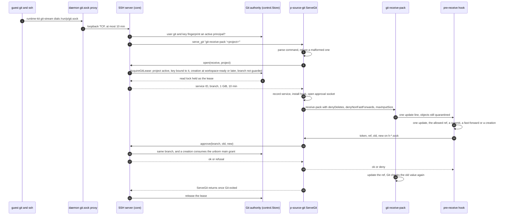
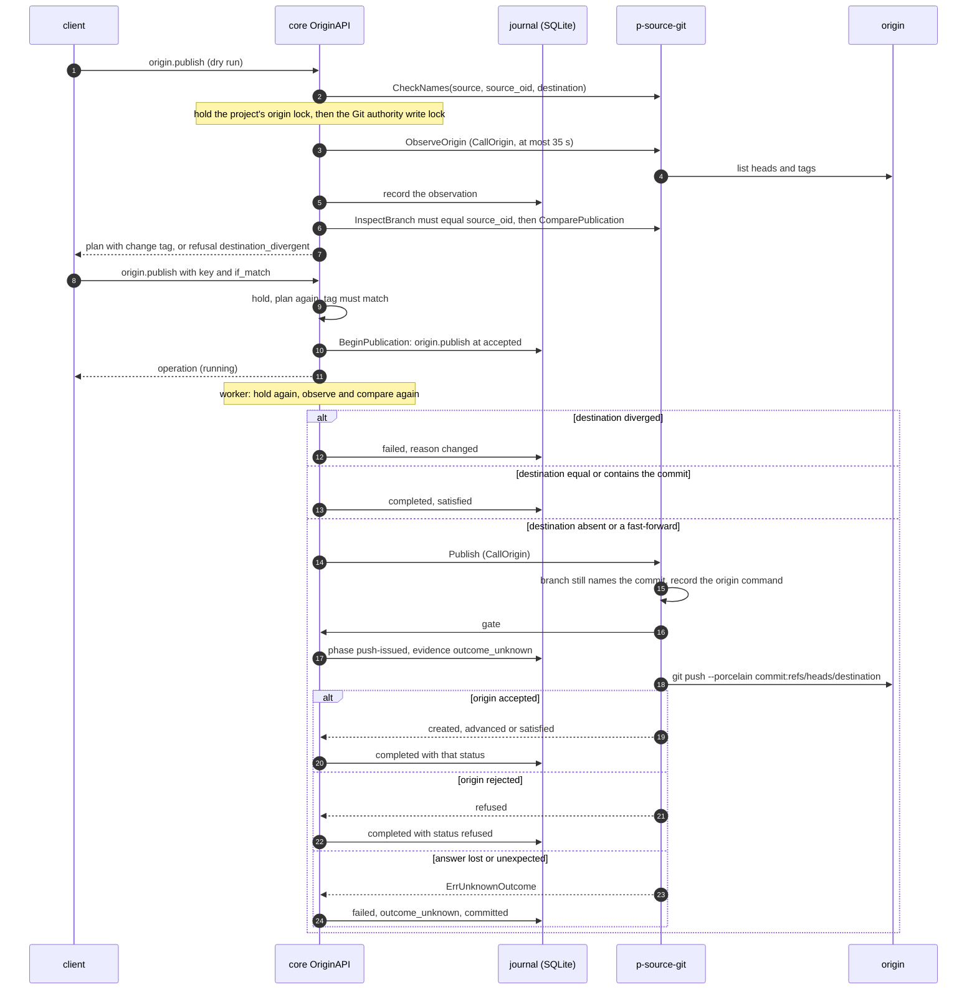

# Source driver and P's Git endpoint

The [source driver](../../GLOSSARY.md#source-driver) is the only code in P that creates, changes
or reads P's repositories, and the only code that runs Git against them or against an
[origin](../../GLOSSARY.md#origin). [P core](../../GLOSSARY.md#p-core) keeps the authority over
them: who may fetch or push, which head a [session](../../GLOSSARY.md#session) may move, and when
a lifecycle change may touch a branch. This document explains how that split works: the driver
contract, the bundled Git driver `p-source-git`, P's SSH server and the path an agent's
`git push` takes to it, the Git authority core enforces, and publication to an origin. It is part
of the [P architecture overview](README.md) and describes the code at 471a3eb. Launch checks, the
wire protocol, gates, lost calls, `Settle` and supervision are shared with the runtime driver and
explained once in [Driver model: launch, protocol and settlement](driver-model.md); this document
says only what is specific to the source driver.

## What callers must know

### Who owns what

The interface comment in [`internal/sourcedriver/driver.go`](../../internal/sourcedriver/driver.go)
draws the line, and the code holds to it:

| Core keeps | The source driver owns |
|---|---|
| Lifecycle state, the journal, policy, [change tags](../../GLOSSARY.md#change-tag) | P's bare repositories and everything in them |
| Git authority in SQLite: Git principals, ref guards, unborn grants; the in-memory leases | Every `git` and `ssh` process on the host |
| P's SSH server, its host key `git_server_key` and the host client key `git_client_key` | The Git service behind P's endpoint (`ServeGit`) and its pre-receive hook |
| The origin URL and its observations (`project_origins`), each project's origin lock | The origin transport: observe, fetch, compare, push |
| The backend pin (`metadata.source_backend`) | Git's syntax for the names P stores (`CheckNames`) |

The driver never opens P's SQLite database and never reaches a runtime: what it needs arrives as an
argument, a gate or a callback. Core addresses it in P's terms (a project, a branch, a commit, an
origin URL) and never sees a repository path. No other P code runs `git` or `ssh` on the host;
the boundary tests in [`internal/sourcedriver/git/boundary_test.go`](../../internal/sourcedriver/git/boundary_test.go)
enforce both rules (see [Permitted dependencies](README.md#permitted-dependencies)).

The daemon holds the driver only as a `sourcedriver.Driver`, concretely the supervisor in
[`internal/sourcedriver/supervise/supervise.go`](../../internal/sourcedriver/supervise/supervise.go).
Host configuration selects the executable as `git: {listen, driver: {path, sha256, config}}`; the
bundled driver's `config` is exactly `{git, ssh}`, two absolute paths, because it inherits no
`PATH` ([`internal/sourcedriver/git/driver.go`](../../internal/sourcedriver/git/driver.go) `New`).

### The driver contract

`sourcedriver.Driver` groups its methods by what they act on. Every method re-validates its values
and answers `ErrInvalid` for one `CheckNames` would refuse.

- **Description and health.** `Describe` returns the backend (`git`), the driver's version and the
  SSH command words `ServeGit` serves (`git-upload-pack`, `git-receive-pack`). `Check` proves the
  storage private to P's account, ends what an earlier driver left running, and proves `git` and
  `ssh` run.
- **Names.** `CheckNames` decides the syntax of branch names, rename targets, origin refs, commit
  IDs, publication destinations and origin URLs, offline and the same way every time.
  Core's request validators check only lengths; [`internal/control/names.go`](../../internal/control/names.go)
  `CheckNames` turns the driver's `*InvalidName` into `invalid` naming the request field, and runs
  after the key replay lookup and before anything is recorded. The bundled rules live in
  [`internal/sourcedriver/gitnames/gitnames.go`](../../internal/sourcedriver/gitnames/gitnames.go):
  P's narrow branch alphabet, at most 100 bytes and no leading `-` for a rename, nonzero lowercase
  SHA-1 or SHA-256 IDs, and SSH URL forms only.
- **Repositories.** `InspectRepository`, `CreateRepository` (converges; `main` is the default
  branch) and `DeleteRepository`, which deletes only the incarnation core reviewed. A
  repository's incarnation is an opaque token that changes whenever the repository is made again.
- **Heads.** `Branches`, `InspectBranch`, `CreateBranch` (only where nothing holds the name) and
  `DeleteBranch` (only at the expected tip). Heads change by compare-and-swap: the bundled driver
  runs `git update-ref --no-deref` with the expected old value.
- **Commits.** `InspectCommit`, `LosingCommits` (what removing heads would lose, for a
  [plan](../../GLOSSARY.md#plan)'s [loss items](../../GLOSSARY.md#loss-item)) and `Export`, which
  writes a Git bundle of one commit into a private directory core made under
  `<state_dir>/image-builds/`; the runtime driver's builder consumes it for a
  [commit image](../../GLOSSARY.md#commit-image).
- **Workspace rename.** `RenameWorkspace` has no effect: it computes the Git edits that rename a
  stopped session's clone from files core read through the runtime driver, using the pure code in
  [`internal/sourcedriver/gitclone/gitclone.go`](../../internal/sourcedriver/gitclone/gitclone.go);
  core writes the edits through the runtime driver.
- **Git service.** `ServeGit` serves one SSH exec command. It calls core's `open` once before any
  Git runs, calls `approve` for a push's one head update, and returns only when nothing it started
  can still change a head.
- **Origin.** `ObserveOrigin` (advertised heads and tags, nothing fetched), `FetchOrigin` (objects
  of one observed ref, no head created, safe to repeat), `ComparePublication` (how the origin
  head relates to a commit, fetching only the destination's objects) and `Publish` (create or
  fast-forward one origin head, no force, no tags).
- **Settlement.** `Settle` answers for head effects and Git services only.

The protocol `p.source-driver/v1`
([`internal/sourcedriver/protocol/protocol.go`](../../internal/sourcedriver/protocol/protocol.go))
marks seven methods as effects, whose lost call may have happened: repository creation and
deletion, branch creation and deletion, origin fetch, publication and the Git service. Core
settles the head effects and the Git service, sends repository creation and deletion and origin
fetches again because they converge, and never settles a publication's push; the
[driver model's table](driver-model.md#what-core-does-after-a-lost-effect) gives each method's
gate and rule. This is narrower than "every lost effect is settled", the reading the glossary
gives ([open question Q2](README.md#open-questions)).

For a head effect, the bundled driver's `Settle` reads the head
([`settle_heads.go`](../../internal/sourcedriver/git/settle_heads.go)): `Applied` when it holds the
intended value, `NotApplied` when it still holds the old one, `Unknown` otherwise. Core's
`headEffect` and `settleHead` in [`internal/daemon/git.go`](../../internal/daemon/git.go) go on
after `Applied`, fail the step with reason `git` after `NotApplied`, and otherwise block the
operation with `outcome_unknown`, keeping its guard. A session creation's branch assignment
([`branch_assignment.go`](../../internal/daemon/branch_assignment.go) `ensureBranchAssigned`)
settles a creation recorded as sent before anything else, and sends it again only after
`NotApplied`.

### P's Git endpoint

Inside a session, the agent's Git reaches P through a fixed chain. The runtime driver installs
`/etc/p/git/ssh_config` with `Host p`, user `git`, the session's key, P's pinned host key and
`ProxyCommand /usr/libexec/p/runtime-kit git-stream`
([`internal/runtimedriver/incus/assembly.go`](../../internal/runtimedriver/incus/assembly.go)); the
workspace's remote is `ssh://git@p/<project>` and the session environment sets
`GIT_SSH=/usr/libexec/p/git-ssh`. `git-stream`
([`internal/runtimekit/gitstream.go`](../../internal/runtimekit/gitstream.go)) runs only as uid
1000 and dials `/run/p/git.sock`, which is the host's per-session
`<endpoint_prefix>/<uuid>/git.sock`. The daemon's endpoint manager
([`internal/daemon/endpoints.go`](../../internal/daemon/endpoints.go) `serveGit`, `proxyGit`)
admits at most 8 connections per session and 64 in all, and copies bytes to the loopback TCP
address `git.listen` for at most 10 minutes.

P's SSH server ([`internal/sshserver/server.go`](../../internal/sshserver/server.go)) listens only on
loopback. It accepts user `git` with a public key whose fingerprint is an active Git principal;
ends a connection after 10 minutes, or after 2 minutes idle; serves at most 16 session channels
across the instance; refuses environment, PTY, subsystem and forwarding requests; and routes an
exec command by its first word to the service that declared it. The source driver's `Describe` is
the only declaration, so the server itself holds no Git command word. A command ends with exit
status 0 or 1.

Two kinds of Git principal exist. Each session has its own key (`session_keys/<uuid>`), bound to
its project, made active at the creation's `principals-ready` phase and made inactive when a
discard or delete commits. The host principal is `git_client_key`, which may only fetch, from any
active project; `system.inspect` reports it with the URL template `ssh://git@<endpoint>/{project}`.

### Git authority

Core's Git authority is three SQLite tables and one in-memory lock
([`internal/control/git_authority.go`](../../internal/control/git_authority.go)):

- **Git principals** (`git_principals`): key fingerprints with a role, a project and a session.
- **Ref guards** (`git_ref_guards`): a branch an operation is changing. A guarded branch refuses
  every push. Discard and delete set one through `SetGitRefGuard`; renames, retained-branch
  changes and creation cleanup write theirs inside their own store transactions.
- **Unborn grants** (`git_unborn_grants`): the one permission to create `main`, held by a
  [bootstrap session](../../GLOSSARY.md#bootstrap-session) until its first push consumes it.
- **The Git authority lock** (`Store.gitAuthority`, a `sync.RWMutex`): every Git service holds the
  read side, its **lease**, from `open` until the service is over; every lifecycle writer of
  principals, guards or grants takes the write side, so a guard is committed only once no push is
  in flight. Publication also takes the write side, for its whole dry run, run and worker. Both
  sides are taken by polling `TryLock` or `TryRLock` every 10 ms.

The lease is not durable: a restarted daemon holds none, and the next driver's `Check` has ended
every Git process the previous one left.

## How it works

### Storage under P's state directory

The daemon gives the driver P's state directory itself as its storage
([`internal/daemon/source_setup.go`](../../internal/daemon/source_setup.go) `sourceDriverLaunch`), so
the driver's files sit beside core's:

```
<state_dir>/                         the driver's storage; core's files live here too
  repositories/
    <sha256 of project>.git/         one bare repository per project, HEAD on main
      p-incarnation                  random token, written before the repository appears
    .p-lock                          flock serializing repository creation and deletion
    .p-git-init-*/                   a repository being made, renamed into place when complete
    .p-git-delete-*/repository       a repository moved away for deletion, then removed
  git-hooks/
    pre-receive                      #!/bin/sh: exec '<driver path>' git-hook
    h-<16 hex>.sock                  one approval socket per push
  git-services/
    <leader pid>.json                a running Git service: ID, owner, leader, boot ID, start time
    origin-<token>.json              a running Git command against an origin
  origin-fetch-*/, origin-push-*/    scratch bare repositories for origin commands
  control.sqlite, git_server_key, git_client_key, session_keys/, image-builds/, ...   core's
```

A project's repository is named by the SHA-256 of its path, so a project name containing `.git`
cannot land inside another repository. Deletion moves the repository into a `.p-git-delete-*`
directory under the lock, which empties its address at once, and removes it afterwards.

### The bundled driver's protections

The bundled driver ([`internal/sourcedriver/git/driver.go`](../../internal/sourcedriver/git/driver.go)
`gitEnv`) runs every Git command with no system or global configuration, no replace objects, no
optional locks and no lazy fetch, and overrides the repository's own configuration so that it runs
no hook, no fsmonitor and no automatic maintenance. P never collects garbage: a pending creation
from an origin relies on a fetched commit that no head holds yet, so objects fetched from origins
stay.

The Git service adds its own restrictions
([`service.go`](../../internal/sourcedriver/git/service.go) `transportGitConfigArgs`): only
`refs/heads/*` is advertised and a fetch may want only an advertised tip; a push runs P's hook
only, refuses deletions and non-fast-forwards, and is bounded by `receive.maxInputSize`. Core sets
each service's ceilings ([`internal/sshserver/git.go`](../../internal/sshserver/git.go)): 1 GiB of
client input and 10 minutes.

### Process groups and crash records

Each Git service and each Git command against an origin runs in a process group of its own, so the
driver can end one alone on its deadline. A driver killed outright does not take those groups with
it, so the driver records them in `git-services/`
([`records.go`](../../internal/sourcedriver/git/records.go)): a service before any client input
reaches it, with its Git's process ID, the boot ID and the process's start time; an origin command
before it starts, with a random token the command carries in its environment as
`P_SOURCE_ORIGIN`. A driver that cannot write the record starts nothing.

The supervisor has every started driver, the first and each restart, pass `Check` within a minute
before it serves ([`supervise.go`](../../internal/sourcedriver/supervise/supervise.go) `accept`).
`Check` kills the group of every service a record names while its Git is still the recorded
process, kills every process carrying a recorded origin token, fails if one survives 10 seconds,
and removes the records. `Settle` for a service answers `Unknown` while this driver runs it or a
record names a live Git, and `Applied` otherwise. A restarted driver that describes another
backend, version or command set is refused and retried.

### Origin transport

The driver reaches origins through the daemon account's OpenSSH: the supervisor gives it only the
daemon's `HOME` (for `~/.ssh` configuration and known hosts) and `SSH_AUTH_SOCK`, and Git runs
`ssh` with `BatchMode=yes`, no password prompts, no forwarding and no TTY
([`origin.go`](../../internal/sourcedriver/git/origin.go) `originEnv`). Each origin command runs
from a scratch bare repository with no configuration, hooks or refs of the project's, reaching
the project's objects only through `GIT_OBJECT_DIRECTORY`.

Core bounds every call that contacts an origin with `CallOrigin`
([`internal/control/origin_lock.go`](../../internal/control/origin_lock.go)): at most two run at
once across the instance, and each, its wait for a slot included, ends after 35 seconds. A call
cut off by that deadline answers that the origin did not answer, unless its effect may have
happened. Each project's origin lock (`LockOrigin`) serializes its origin work: observation,
creation from an origin ref, publication, creation of an origin project and the start of the
project's deletion.

## Representative flows

### An agent pushes its branch

This sequence answers which hop decides what when an agent runs `git push` in a session. Its
scope is one push of the session's [assigned branch](../../GLOSSARY.md#assigned-branch), from the
guest's Git to the updated head.



The push succeeds only if every hop agrees; each refuses for its own reason:

1. **SSH authentication.** A user other than `git`, or a key that is not an active Git principal,
   cannot connect. While a lifecycle writer or a publication holds the Git authority lock, the key
   check waits for it.
2. **Routing and parsing.** A request other than exec, or a command whose first word no service
   declared, is refused by the server. The driver refuses a command that is not
   `git-receive-pack '<project>'` or `git-upload-pack '<project>'` with a valid project before it
   calls `open`.
3. **`AcquireGitLease`.** The project must be active and the key an active principal bound to it.
   The host principal may only fetch. A session principal may fetch while its session is creating
   or established, but may push only once its creation reached `workspace-ready`, and never to a
   guarded branch. The service's branch is the session's own.
4. **The repository.** An absent repository answers `ErrNotFound`.
5. **The pre-receive hook** ([`hook.go`](../../internal/sourcedriver/git/hook.go)
   `RunPreReceiveHook`). It refuses more than one update, any ref but `refs/heads/<branch>`, a
   deletion, an object that is not a commit, and a non-fast-forward, reading the pushed objects
   where receive-pack keeps them apart. It then asks the driver over the push's own socket, which
   takes one connection with a 48-hex token and a 5-second deadline.
6. **`Approve`.** Core refuses another branch and an empty new value. A push that creates the
   branch is allowed only by consuming the session's pending unborn grant, which exists only for
   `main` of a bootstrap session and stays consumed even if the push then fails.
7. **Limits.** More than 1 GiB of client input, or a service past 10 minutes, kills Git's process
   group and answers `ErrLimit`.

A fetch takes the same path without the hook and the approval: upload-pack advertises every head
of the project, and a fetch may want only an advertised tip.

**When the service's call is lost.** Core releases the lease at once when `ServeGit` returns
without error or with a refusal of the driver's own (`ErrInvalid`, `ErrLimit`, `ErrConflict`,
`ErrNotFound`). Any other error may be a call lost with the driver, so core asks `Settle` for the
service, waiting 100 ms and doubling up to 5 seconds between calls, and releases the lease only on
`Applied` (`releaseWhenSettled`). If the daemon stops first, the lease stays held until it exits.
No push is replayed: the agent's Git sees a failed push. VM scenario 60 kills the driver after an
approved push and checks that the restarted driver's `Check` frees the lease.

### Publishing a branch to the origin

Publication is a [risky change](../../GLOSSARY.md#risky-change): a [dry run](../../GLOSSARY.md#dry-run)
returns a plan and a change tag, and a run carries out exactly that plan, as
[Risky changes and change tags](README.md#risky-changes-and-change-tags) explains. Its source is a
[retained branch](../../GLOSSARY.md#retained-branch) or a session's branch at an exact commit
(`source_oid`), and its destination an origin head. This sequence answers what happens from the
dry run to the push, including an outcome nobody can know; its scope is
[`internal/control/publication_api.go`](../../internal/control/publication_api.go) and the bundled
driver's [`origin_publication.go`](../../internal/sourcedriver/git/origin_publication.go).



The decision points, with what the code does:

- **Names first.** The driver checks the source branch (for a retained source), `source_oid` and
  the destination ref, and returns the origin branch's name. A key that already recorded this
  run is answered from SQLite before the names are checked.
- **The hold.** `holdPublication` takes the project's origin lock and then the instance-wide Git
  authority write lock, for the dry run, the run's admission and the worker. The dry run and the
  run each make two origin calls under it (observe and compare); the worker makes up to three
  (observe, compare and push).
- **The plan.** The origin URL must still be the one the client expected, the source branch must
  still name `source_oid` (otherwise `precondition_failed`, `changed`), and the comparison decides
  the relation. A divergent destination is a [refusal](../../GLOSSARY.md#refusal),
  `destination_divergent`. An origin that cannot be observed marks the last observation `unknown`
  and answers `failed`, reason `origin`.
- **The worker re-plans.** The destination may have moved since the run: a divergent one fails the
  operation with `changed`, and one that already has the commit completes it as `satisfied`
  without pushing.
- **The push.** The driver checks again that the P branch names the commit (otherwise
  `ErrConflict`, before the gate), writes the origin command's record (no record, no push), calls
  the gate, then runs one `git push --porcelain --no-verify --no-follow-tags` of the exact commit
  to `refs/heads/<destination>`. The porcelain answer gives `satisfied`, `created` or `advanced`
  when it matches the planned relation, and `refused` only for a definite `[rejected]` or
  `[remote rejected]`. Anything else, including lost contact or output that does not parse, is
  `ErrUnknownOutcome`. A push that could not start is a plain error: the operation fails with
  reason `origin`, since nothing reached the origin.
- **Unknown outcome.** A publication whose push answer is lost fails with `outcome_unknown` and
  `committed` set. A worker resumed after a restart that finds the operation at `push-issued`
  also fails it with `outcome_unknown`, but leaves `committed` unset, since `push-issued` is
  recorded uncommitted. P never settles a push and never sends it again; a later publication's
  comparison shows whether it landed (`equal` or `destination_contains` complete it as
  `satisfied`).

Publication failures end the operation `failed`, never `blocked`: `OriginAPI.fail` records every
error that way.

### Projects and sessions from an origin

`project.create` with an origin URL observes the origin under the project's origin lock, creates
the repository and records the project with that observation
([`internal/daemon/lifecycle.go`](../../internal/daemon/lifecycle.go) `createOriginProject`,
[`lifecycle_store.go`](../../internal/control/lifecycle_store.go) `CommitOriginProject`). An origin
that advertises no ref gets a bootstrap session on unborn `main` with a pending unborn grant;
otherwise the project completes with no session. A session created from an origin ref
(`createFromOrigin`) observes the origin afresh under the lock, records the observation, fetches
the ref's objects with `FetchOrigin`, and captures the commit as the source; the worker then
creates the new branch at it. `origin.change` is an operation whose worker observes a proposed URL
before recording it (`RunOriginChange`); `origin.refresh` observes and records the current origin
in the request itself (`Refresh`). Both run under the project's origin lock.

## Where changes belong

- **A new driver operation:** the method in `sourcedriver.Driver`
  ([`driver.go`](../../internal/sourcedriver/driver.go)), then the protocol (method name, wire
  types, the `effects` set if it changes state, client and server), the supervisor's forwarder,
  the in-memory driver ([`internal/sourcedriver/memory`](../../internal/sourcedriver/memory)), a
  conformance case ([`internal/sourcedriver/conformance`](../../internal/sourcedriver/conformance)),
  and the bundled driver. If it changes state, decide its gate and how core recovers a lost call
  (see the [driver model's table](driver-model.md#what-core-does-after-a-lost-effect)).
- **A Git name rule:** `gitnames`, which `CheckNames` and every operation use; the CLI pre-parses
  with the same rules (known limit [L10](README.md#known-limits)).
- **Who may fetch or push:** `AcquireGitLease` and `ConsumeGitUnbornGrant` in
  [`git_authority.go`](../../internal/control/git_authority.go), and `approve` in
  [`internal/sshserver/git.go`](../../internal/sshserver/git.go). Tests:
  `internal/control/git_authority_test.go`, `internal/sshserver/git_test.go`.
- **Transport restrictions on the Git service:** `transportGitConfigArgs` and the hook's checks in
  [`hook.go`](../../internal/sourcedriver/git/hook.go); tests in `protections_test.go`,
  `hook_test.go` and `service_test.go`.
- **Another SSH-served command:** a service that declares its command words, added as a `Route` in
  `sshserver.Prepare`.
- **A source backend other than Git:** a new executable serving `protocol.Serve` and passing the
  conformance suite, pinned as `git.driver`. Core refuses a different backend while any project
  exists, and still assumes Git in places (known limit [L17](README.md#known-limits)). The archived
  [replaceability test](../archive/rework/source-driver.md#the-replaceability-test-a-forge) lists
  the same assumptions.

## What surprises newcomers

- **Publication stalls all Git on the instance.** The Git authority write lock that publication
  holds across its origin calls is instance-wide, so every fetch, push and SSH key check on every
  project waits for it. Because both sides poll `TryLock` and `TryRLock`, and Go's `TryLock` does
  not register a waiting writer, overlapping Git services may keep a lifecycle writer out; this is
  inferred from the code, not observed. **Known gap:** [Q5](README.md#open-questions).
- **The hook runs the driver by path.** The daemon starts the driver from the file it checked, but
  the hello names the driver's path as `Core.Executable`, and the pre-receive script runs
  `exec '<path>' git-hook` on every push; only the start-time directory checks protect that path
  afterwards. **Known gap:** [Q3](README.md#open-questions).
- **The storage is P's state directory.** The driver's privacy proof covers the whole directory,
  and its scratch repositories sit beside `control.sqlite` and the keys; only the boundary test
  `TestOnlyTheBundledDriverOpensItsStorage` keeps other code out of the driver's names. **Known
  gap:** [Q4](README.md#open-questions).
- **Crash leftovers stay.** Nothing removes a `.p-git-delete-*` directory holding a whole
  set-aside repository, a `.p-git-init-*` directory, `origin-fetch-*` or `origin-push-*` scratch
  repositories, `h-*.sock` sockets or `.record-*` temporary files after a crash
  (`TestDeletionKilledAfterItsMoveLeavesTheAddressEmpty` asserts that the set-aside copy remains).
  **Known gap:** [L13](README.md#known-limits).
- **Read isolation is per project.** Upload advertises every head, so a session can fetch the
  other sessions' branches of its project; only writes are limited to its own branch.
- **`Check` ends every record that is not its own.** That is safe only because `daemon.lock`
  admits one daemon per state directory; two drivers over one storage share the repositories lock
  but would kill each other's services.
- **A per-mutation check is narrower than `Check`.** The interface says every mutation "makes the
  same check first"; the bundled driver's mutations re-prove only the storage's privacy
  (`prepareStorage`), not that `git` and `ssh` run or that earlier services ended.
- **Retained-branch rename is not atomic.** It is two recorded head effects through the driver:
  create the new name (`new-ref-create-issued`), then delete the old one
  (`old-ref-delete-issued`), each settled on its own
  ([`internal/daemon/retained_rename.go`](../../internal/daemon/retained_rename.go)).
- **A refused push to the origin completes the operation.** The operation's status is
  `completed` and its publication status `refused`; only a lost or unexpected answer is a failure.
- **Core still speaks Git in places.** It adds `refs/heads/` to branch names for display and in a
  publication's details, serves user `git` with the `ssh://git@…` URL template, and passes a Git
  bundle from `Export` to the runtime driver. **Known gap:** [L17](README.md#known-limits).
- **A hung driver is not detected**, so its Git services keep their leases and lifecycle writers
  wait ([L1](README.md#known-limits)); some store transitions rely on the Git authority lock to
  stay safe ([L4](README.md#known-limits)).
- **Admitted gaps in ending a dead driver's processes.** Between proving a recorded Git alive and
  the kill, its process ID can be reused; a process an origin command started that clears its
  environment and leaves the group escapes the kill (comments in
  [`records.go`](../../internal/sourcedriver/git/records.go)).

The archived [source driver design](../archive/rework/source-driver.md) records the rationale for
the split, for running Git services in their own process groups with durable records, and for
[trust and launch](../archive/rework/source-driver.md#trust-and-launch); where it disagrees with the
code, the code is described here.

## Implementation and test entry points

Start reading at:

1. [`internal/sourcedriver/driver.go`](../../internal/sourcedriver/driver.go), the contract.
2. [`internal/sshserver/git.go`](../../internal/sshserver/git.go) and
   [`internal/control/git_authority.go`](../../internal/control/git_authority.go), the authority.
3. [`internal/sourcedriver/git/service.go`](../../internal/sourcedriver/git/service.go),
   [`hook.go`](../../internal/sourcedriver/git/hook.go) and
   [`records.go`](../../internal/sourcedriver/git/records.go), the Git service and its crash
   records.
4. [`internal/control/publication_api.go`](../../internal/control/publication_api.go),
   [`origin_api.go`](../../internal/control/origin_api.go) and
   [`origin_lock.go`](../../internal/control/origin_lock.go), the origin.
5. [`internal/daemon/git.go`](../../internal/daemon/git.go) and
   [`source_setup.go`](../../internal/daemon/source_setup.go), the wiring and head settlement;
   [`cmd/p-source-git/main.go`](../../cmd/p-source-git/main.go), the executable and its
   `git-hook` mode.

Tests:

- **Conformance**, eight groups (names, repositories, heads, commits, settling, workspace,
  service, origin) in [`internal/sourcedriver/conformance`](../../internal/sourcedriver/conformance),
  run against the bundled driver with real Git (`git/fixture_test.go`), the in-memory driver, and
  both over the protocol (`git/protocol_test.go`, `memory/protocol_test.go`).
- **Boundaries:** `TestNoOtherCodeImportsTheBundledDriver`,
  `TestOnlyTheBundledDriverRunsGitOrSSHOnTheHost`, `TestOnlyTheBundledDriverOpensItsStorage` and
  `TestTheBundledDriverImportsNoSQLiteOrRuntimeDriverCode` in
  [`boundary_test.go`](../../internal/sourcedriver/git/boundary_test.go); the backend pin in
  `internal/daemon/git_test.go` `TestTheDaemonRefusesToStartWithAnotherBackendWhileAProjectExists`;
  the environment in `internal/sourcedriver/supervise/supervise_test.go`
  `TestTheDriverGetsOnlyItsCheckedPathAndTheDaemonsHomeAndSSHAgent`.
- **The bundled driver:** `records_test.go`, `origin_records_test.go`, `deletion_test.go`,
  `hook_test.go`, `service_test.go`, `protections_test.go`, `origin_publication_test.go`.
- **The protocol:** `protocol_test.go` and `servegit_test.go` (lost calls, `open` once, `approve`
  after return).
- **Core:** `internal/sshserver/server_test.go` and `git_test.go` (leases, settle then release,
  unborn grant), `internal/control/git_authority_test.go`, `internal/daemon/git_test.go`.
- **VM scenarios** in [`tests/integration/steps`](../../tests/integration/steps): 04-git,
  07-daemon-git, 08-git-source, 14-origin-substrate, 16-origin-lifecycle, 17-origin-creation,
  18-origin-publication, 19-commit-bundle, 20-public-publication, and 60-source-driver-restart
  (the driver killed after an approved push and after a branch creation).
